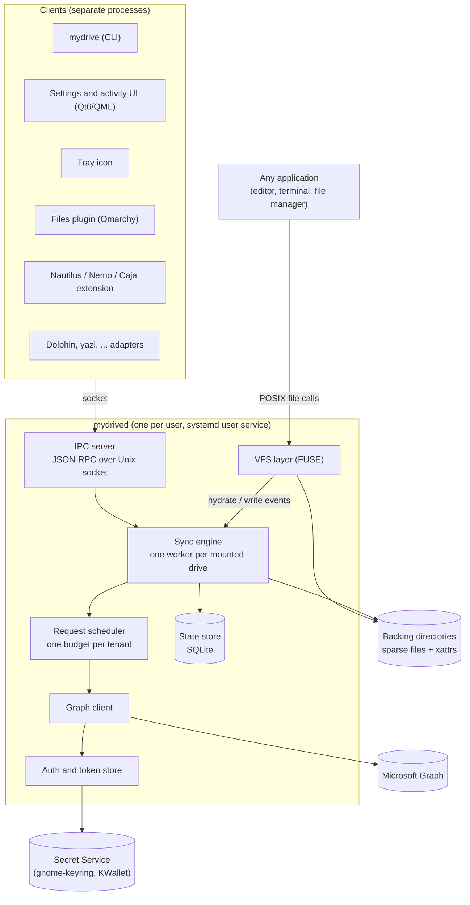
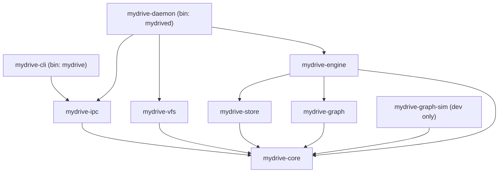

# Architecture overview

This is the keystone document. ADRs, flows, journeys and work packages must agree with the
vocabulary and structure here. If one of them has to disagree, change this file in the same
pull request and say why.

Working name: **my-drive** (binaries `mydrive`, `mydrived`). The product name is undecided;
renaming is a mechanical change and is tracked in ADR-0003.

## What we are building

A OneDrive client for Linux that behaves like the Windows client:

- Files and folders appear with real names, sizes and dates before any content is local.
- Content downloads on first access (**hydration**).
- "Always keep on this device" (**pin**) and "Free up space" (**dehydrate**) per item.
- Status visible in the file manager where the file manager allows it.
- One sign-in covers the user's OneDrive and a user-selected set of SharePoint libraries.

First target is Omarchy (Arch, Hyprland, the Files file manager). Other distros follow.

## Principles

Ordered. When two conflict, the earlier one wins.

1. **Never lose or corrupt user data.** A slower or less complete client is acceptable; one
   that deletes or damages a file is not.
2. **Fail loudly, never silently.** An unavailable file returns an error. It never reads as
   zeros or an empty file.
3. **The daemon owns all state.** Everything else (CLI, UI, file-manager adapters) is a
   client of the daemon's socket.
4. **Hydration lives below the file manager.** On-demand files work from a terminal, an
   editor and any file manager with no adapter installed.
5. **The drive is the unit of sync, not the account.**
6. **Runs unprivileged.** No root, no setuid helpers of our own, no kernel modules.
7. **Documented Microsoft Graph endpoints only.**

## Components

### Processes

| Process | Binary | Role |
|---|---|---|
| Daemon | `mydrived` | Sync engine, FUSE mounts, state store, IPC server. One per user. |
| CLI | `mydrive` | Full control surface. Everything the UI can do, the CLI can do. |
| UI | `mydrive-ui` (later) | Onboarding, settings, activity. Qt6/QML. |
| Adapters | per host | Draw status and menu entries; send commands. No state, no sync logic. |

### Crates

One Cargo workspace. Dependencies point downwards only.

| Crate | Owns | Must not |
|---|---|---|
| `mydrive-core` | Domain types, state model, name validation, traits (`Hydrator`, `Clock`), errors | Do I/O |
| `mydrive-graph` | Auth, HTTP, Graph request/response types, throttling signals | Know about the local filesystem or SQLite |
| `mydrive-store` | SQLite schema, migrations, queries | Make network calls |
| `mydrive-engine` | Delta processing, upload/download, reconciliation, scheduler, conflict rules | Speak FUSE or IPC |
| `mydrive-vfs` | FUSE filesystem over a backing directory | Call Graph directly; it asks the engine through `core` traits |
| `mydrive-ipc` | Protocol types, server and client | Contain sync logic |
| `mydrive-daemon` | Wiring, lifecycle, systemd integration | Contain logic that belongs in a library crate |
| `mydrive-cli` | Argument parsing, output formatting | Touch the store or backing directories directly |
| `mydrive-graph-sim` | Dev-only fake Graph server for tests (ADR-0017) | Be depended on by any non-test code |

## Vocabulary

Use these words, in code and prose, with exactly these meanings.

| Term | Meaning |
|---|---|
| **Account** | One signed-in Microsoft identity (personal or work). Holds tokens. |
| **Tenant** | The organisation a work account belongs to. Throttling budget is per tenant. |
| **Drive** | A Graph drive: a personal OneDrive, a OneDrive for Business, or a SharePoint document library. Identified by `drive_id` (stored lowercase). |
| **Mount** | A drive (or a folder within one) attached to a local path. Has its own delta token. The unit of sync. Identified by `mount_id`. |
| **Item** | A file or folder in a drive. Identified by (`drive_id`, `item_id`), never by path. |
| **Mount point** | The path the user sees, e.g. `~/OneDrive`. A FUSE mount. |
| **Backing directory** | The hidden real directory that holds a mount's sparse files and xattrs. |
| **Placeholder** | An item present locally with metadata but no content. |
| **Hydrate** | Fetch content into the backing file. |
| **Dehydrate** | Release local content, keeping the placeholder. |
| **Pin** | User policy that an item must stay hydrated. |
| **Shortcut** | A link in a user's drive to a folder in another drive ("Add shortcut to My files"). |

### State model

Three independent axes per item, stored separately. Never collapse them into one enum in
storage; collapse only for display.

| Axis | Values | Meaning |
|---|---|---|
| **Hydration** | `Placeholder`, `Partial`, `Full` | How much content is local. Folders are `Full` when listed. |
| **Pin** | `Inherit`, `Pinned`, `Unpinned` | User policy. `Inherit` takes the nearest ancestor's value; root default is `Unpinned`. |
| **Sync** | `InSync`, `PendingDownload`, `PendingUpload`, `Uploading`, `Conflict`, `Error`, `Blocked` | Relationship to the server. `Blocked` means organisation policy refuses access. |

Rules:

- `Pinned` implies the engine drives hydration to `Full` and keeps it there.
- Dehydrate is refused unless sync is `InSync` and effective pin is not `Pinned`.
- A file with local changes not yet on the server is never dehydrated or overwritten.

**Display status** is derived from the three axes, in this priority order:

| Status | Derived when | Windows equivalent |
|---|---|---|
| `blocked` | sync = `Blocked` | — |
| `error` | sync = `Error` or `Conflict` | Red cross |
| `syncing` | sync = `PendingUpload`, `Uploading`, `PendingDownload` | Sync arrows |
| `pinned` | effective pin = `Pinned` and hydration = `Full` | Solid green tick |
| `local` | hydration = `Full` | Green tick outline |
| `online-only` | hydration = `Placeholder` or `Partial` | Cloud |

Two modifiers can accompany any status: `read-only` (lock) and `shortcut` (chain link).

### Wire forms

Wherever a state value leaves Rust (the IPC protocol, xattrs, CLI `--json`, the store's
columns) it is the lowercase kebab-case of its name: `placeholder`, `partial`, `full`;
`inherit`, `pinned`, `unpinned`; `in-sync`, `pending-download`, `pending-upload`,
`uploading`, `conflict`, `error`, `blocked`; and the display statuses as written above.

### Account and mount states

Separate from item state:

| Scope | State | Meaning |
|---|---|---|
| Account | `signed-in`, `needs-sign-in` | `needs-sign-in` when the refresh token is rejected. All the account's mounts stop syncing; local content stays readable. |
| Mount | `active`, `paused`, `blocked`, `resyncing` | `blocked` carries a reason. A tenant-wide refusal blocks every mount of the account; a per-site policy blocks one. |

### Rulings on details

Recorded here so documents agree. Each is small enough not to need its own ADR.

- **Free up space on a pinned item.** The engine never dehydrates an item whose effective pin
  is `Pinned`. The user-facing action (`mydrive free`, "Free Up Space") is an explicit
  request, so it first sets the item's pin to `Unpinned` and then dehydrates, as Windows
  does. It still refuses anything not `InSync`.
- **`Unpinned`** means "may be dehydrated", not "dehydrate now".
- **Nested and overlapping mounts** are refused: a mount point may not be inside another
  mount, and the same remote folder may not be reachable through two mounts.
- **File names must be valid UTF-8.** The VFS refuses to create a name that is not, since it
  could never exist on the server. Paths in the protocol are UTF-8 strings.
- **"Copy Link"** copies the item's existing web address. It never creates a sharing link or
  changes permissions.
- **Change stream.** A connection that calls `status.subscribe` carries notifications only;
  a client that also needs to send requests opens a second connection.
- **"Separate processes"** means separate from the daemon. Some adapters (Nautilus, Dolphin)
  are loaded into their file manager's process; they are still only clients of the socket.
- **First enumeration.** A newly added mount is in state `resyncing` until its first full
  delta has been applied, and its mount point is not mounted until then.
- **Blocked mounts.** While a mount is `blocked`, writes into it are refused; changes already
  pending are kept and resume when the block lifts.
- **Stale mounts.** After a crash a mount point may report "Transport endpoint is not
  connected" until unmounted. The daemon unmounts stale mounts on start, and the systemd unit
  does so on stop.

## On disk

| What | Where |
|---|---|
| Config | `$XDG_CONFIG_HOME/mydrive/config.toml` |
| State store | `$XDG_STATE_HOME/mydrive/state.db` |
| Backing directories | `$XDG_DATA_HOME/mydrive/mounts/<mount_id>/` |
| Logs | journald, via the systemd user unit |
| Socket | `$XDG_RUNTIME_DIR/mydrive/daemon.sock` |
| Tokens | Secret Service (never on disk in plain text) |
| Personal mount point | `~/OneDrive` |
| Work mount point | `~/OneDrive - <Org>` |
| Library mount points | `~/<Org>/<Site> - <Library>` |

The mount point and the backing directory are different paths. When the daemon is not
running the mount point is an empty directory, so nothing can read a placeholder as zeros
(principle 2). Backing files are sparse: `st_size` is the cloud size, allocated blocks are
the local bytes.

## IPC

Newline-delimited JSON-RPC 2.0 over the Unix socket. The first call on a connection is
`hello`, which negotiates a protocol version. Clients can subscribe to a change stream so
adapters never poll the daemon per file. Large listings are paginated with a cursor, and
modifiers travel as a list of strings. Details in ADR-0009, ADR-0019, ADR-0020 and `docs/protocol/`.

## CLI surface

Provisional names; the CLI work package fixes the details. Every command accepts `--json`.

| Command | Does |
|---|---|
| `mydrive login [--headless]` | Sign in an account |
| `mydrive logout <account>` | Sign out; local files stay |
| `mydrive status [path]` | Daemon, account and mount status, or one item's state |
| `mydrive mount list` | List mounts |
| `mydrive mount add <link-or-drive-id> [--at <path>]` | Add a drive or library as a mount |
| `mydrive mount remove <mount>` | Stop syncing; never deletes remote content |
| `mydrive pin <path>...` | Always keep on this device |
| `mydrive unpin <path>...` | Clear the pin (back to `Inherit`) |
| `mydrive free <path>...` | Free up space (dehydrate) |
| `mydrive hydrate <path>...` | Download now without pinning |
| `mydrive pause [duration]` / `mydrive resume` | Pause and resume syncing |
| `mydrive activity` | Recent and in-progress transfers, errors, conflicts |
| `mydrive doctor` | Check FUSE, keyring, network, policy blocks |

## Decisions

Each row is an ADR in `docs/adr/`. The ADR is authoritative for detail.

| ADR | Decision |
|---|---|
| 0001 | Record architecture decisions as ADRs |
| 0002 | Licence: GPL-3.0-or-later |
| 0003 | Rust for the daemon, CLI and libraries; working name my-drive |
| 0004 | Separate processes: daemon, CLI, UI, adapters |
| 0005 | On-demand via FUSE over a separate backing directory; fanotify as a possible later backend |
| 0006 | SQLite is the source of truth; xattrs are a public mirror; sparse extents are the cache |
| 0007 | The mount is the unit of sync; one sign-in, many drives |
| 0008 | Three-axis state model (hydration, pin, sync) with derived display status |
| 0009 | IPC: versioned JSON-RPC 2.0 over a Unix socket with a change stream |
| 0010 | Auth: own app registration, system browser with loopback redirect, paste-URL fallback, tokens in Secret Service |
| 0011 | Graph usage rules: items by ID, quickXorHash, one request scheduler per tenant, Retry-After only |
| 0012 | Write path: durable local write first, asynchronous upload, two hashes per item |
| 0013 | Hydration policy: defend against crawlers, thumbnailers and indexers |
| 0014 | File-manager adapters are thin clients; the Omarchy Files plugin is first |
| 0015 | SharePoint: a library is its own mount; shortcuts later; deletes never propagate from unmounting |
| 0016 | Packaging: native packages, AUR first; no Flatpak/snap/AppImage for the daemon |
| 0017 | Testing: a Graph simulator, fault injection, journey-based acceptance tests |
| 0018 | Development process: work packages built by agents, reviewed independently, gated by CI |
| 0019 | Protocol v1 paginates large results and declares which value sets are open (amends 0009) |
| 0020 | Every protocol message is bounded; cursors stay correct while a directory changes (extends 0019) |

## Validation gates

Some decisions rest on facts the research could not confirm. Each gate is a small experiment
that must pass before the dependent work starts. If a gate fails, the ADR is revisited.

| Gate | Question | Blocks |
|---|---|---|
| G1 | Does `Range` work on authenticated `/content` requests, personal and work? | ADR-0005 partial hydration (falls back to whole-file) |
| G2 | What does Graph return under unmanaged-device policy, and how do shortcut stubs appear in delta? | ADR-0015 |
| G3 | What did abraunegg's FUSE ADR (PR #3600) conclude, and why is it on hold? Answered 2026-11-15: pass with changes, see `docs/gates/G3.md` | ADR-0005 |
| G4 | Will Files (`folio`) accept a per-file status hook? | ADR-0014 status icons on Omarchy |
| G5 | Does device-code sign-in work for personal accounts? | ADR-0010 headless flow |

## Milestones

| Milestone | Outcome |
|---|---|
| M0 Foundations | Workspace builds, CI green, Graph simulator skeleton, gates G1 and G5 answered |
| M1 Engine | Sign in; mirror metadata for a personal drive and one library into the store; CLI can list, download, upload |
| M2 On-demand | FUSE mount with placeholders, hydration, pin, dehydrate, safe write path |
| M3 Omarchy | Files plugin, tray, notifications, AUR package |
| M4 Onboarding | First-run UI, library picker, settings, activity |
| M5 Breadth | Shortcuts, site search, Nautilus/Dolphin/yazi adapters, deb/rpm |

The backlog in `docs/backlog/` breaks milestones into work packages.
