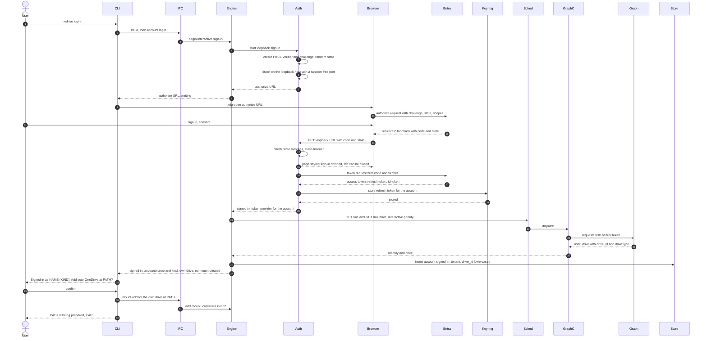
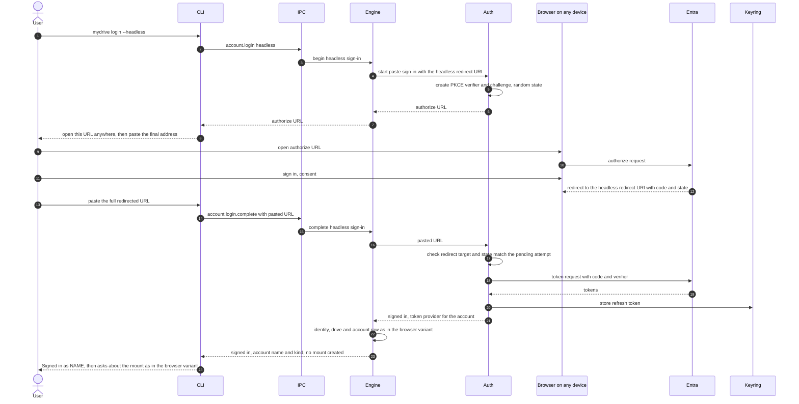
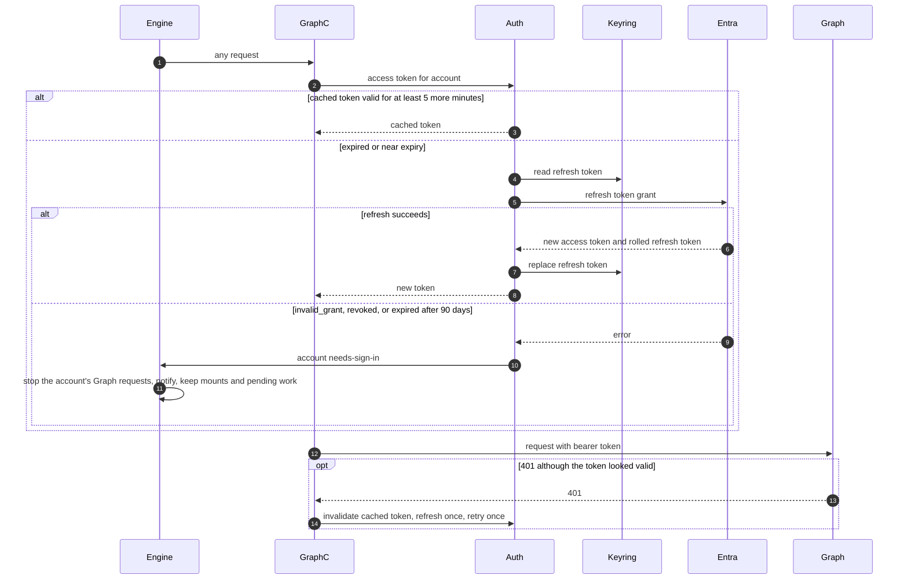

# F01 Sign-in

**Purpose.** Signs an account in with the system browser and a loopback redirect using PKCE, stores
the refresh token in Secret Service, and returns the signed-in account to the client. Sign-in never
creates a mount: the client shows which account was signed in and asks, and the mount for the
account's own drive is created by a separate, confirmed step (F02). A headless variant replaces
the loopback with pasting the redirect URL. Token refresh and sign-out are included because they
share the same components.

## Preconditions

- `mydrived` is running as a systemd user service; the CLI can reach
  `$XDG_RUNTIME_DIR/mydrive/daemon.sock` and has completed `hello`.
- A Secret Service provider (gnome-keyring on Omarchy, or KWallet) is reachable on the session bus.
- Browser variant: the CLI runs inside a graphical session where `xdg-open` works.
- The app registration (own registration, ADR-0010) lists the loopback redirect URI and the
  redirect URI used by the headless variant. Which URIs those are is settled with the app
  registration (Q22, Q30).
- The daemon reaches the token store, the state store and Graph only through the engine facade
  (ADR-0023). In the diagrams the IPC server talks only to `Engine`; `Auth` is the engine's sign-in
  and token-store component.

## Diagram: browser with loopback redirect

`Entra` is the Microsoft identity platform (`login.microsoftonline.com`), which is not Graph.
Replies from `Engine` to `CLI` travel through the IPC server.

## Diagram: headless variant

## Diagram: token refresh during normal use

## Steps

1. The CLI only relays. The daemon owns the PKCE verifier, the state value, the loopback listener
   and the tokens (principle 3), and within the daemon they are reached only through the engine
   facade: the IPC server maps `account.login` and `account.login.complete` to facade calls and
   never touches the token store, the state store or Graph itself (ADR-0023 R1, R2). The CLI opens
   the browser because it runs in the user's graphical session; the daemon, a systemd user
   service, may not have the session's display environment.
2. Scopes for the first sign-in are exactly `Files.ReadWrite.All offline_access User.Read`
   (ADR-0010 R5). `Sites.Read.All` is requested incrementally only from site search (F09). The
   challenge uses method `S256` (ADR-0010 R1).
3. The redirect is `http://<loopback host>:<port>` with a random port per sign-in. The code's
   default host is `localhost`; whether Entra accepts `127.0.0.1` for our registration, which
   RFC 8252 recommends, is Q30. The listener binds the loopback interface only, accepts exactly
   one redirect whose `state` matches, and closes (ADR-0010 R2). Any other request gets a 400 and
   is ignored. The attempt times out after 10 minutes and is discarded.
4. Step 16 (browser diagram): the code is redeemed with the PKCE verifier. No client secret exists
   (public client).
5. Step 18: the refresh token goes only to Secret Service, one entry per account. The access token
   stays in daemon memory. No token, code or verifier is written to disk, logs or IPC responses
   (ADR-0010 R6). With no Secret Service the sign-in fails naming `mydrive doctor` and nothing is
   persisted (ADR-0010 R7, open-questions D3).
6. Steps 21 to 26: `drive_id` is normalised to lowercase by the Graph client as the response is
   parsed, so nothing above it sees mixed case (ADR-0007 R1). The tenant is taken from the id
   token's `tid` claim; personal accounts get their own budget key in the Request scheduler
   (F10). No claims reader exists yet and the mapping for personal accounts is not fixed (new
   question 4).
7. Steps 27 to 31, **sign-in never creates a mount** (overview "Rulings on details"). Sign-in
   returns the account: its user name, its kind (personal or work) and its own drive. The CLI
   shows which account was signed in and asks whether to add the own drive at the default mount
   point, `~/OneDrive` (personal) or `~/OneDrive - <Org>` (work). Only on confirmation does it
   send a separate `mount.add` request, which runs F02 with that flow's checks, including the
   refusal of a mount point that exists and is not empty. If the user declines, the account stays
   `signed-in` with no mount, and `mydrive mount add` adds it later. Showing the account before
   anything is attached is what stops a planted sign-in on a shared machine from silently
   attaching someone else's account (Q27). `mydrive login` returns once the account is signed in
   and the answer is given; the enumeration continues in the background and `mydrive mount list`
   shows its progress.
8. Headless (ADR-0010 R10): the authorize URL uses the headless redirect URI. The code takes the
   redirect URI as a parameter and does not choose it; which one is used is decided with the app
   registration (Q30, Q22). The two candidates:
   - the native-client URI (`https://login.microsoftonline.com/common/oauth2/nativeclient`), where
     the browser ends on a blank page whose address holds the code, on any device;
   - `http://localhost:<port>`, where the browser on another device shows that the page cannot be
     reached, and the address bar holds the code.

   Either way the user pastes the whole address. The daemon keeps the pending attempt (verifier,
   state) for 10 minutes and rejects a URL that is not a redirect to the attempt's redirect URI or
   whose `state` does not match. A malformed address, or one carrying an `error` parameter, leaves
   the attempt pending so the user can paste again; a `state` mismatch cancels it. Headless
   sign-in creates no mount either; the CLI asks as in step 7.
9. Refresh: every refresh replaces the stored refresh token (ADR-0010 R8). Refresh tokens are not
   revoked on use, so if the Keyring write fails the daemon keeps the new token in memory, retries
   the write, and reports a keyring warning in `mydrive doctor`. It never falls back to a file.
10. A failed refresh puts only that account into `needs-sign-in`: its mounts stop issuing Graph
    requests and other accounts keep syncing (ADR-0010 R9).
11. Signing an account in again (the "already signed in" case below) first closes the account's
    existing token provider and waits for it, as in sign-out step 2, so a late keyring write from
    the old provider cannot overwrite the new sign-in's token.

### Sign-out (`mydrive logout <account>`, J15)

1. Engine stops the account's mount workers after the current request finishes and stops their
   wake-up sources (F05).
2. The engine closes the account's token provider and waits for it. A keyring write in progress
   is stopped and none starts afterwards. A refresh already in flight is not cancelled: callers
   already waiting for it still receive its access token, but the refresh token it rolls is never
   stored. Then Auth deletes the account's Secret Service entry and drops the access token, so a
   late write cannot bring a token back after sign-out.
3. Mounts stay configured and mounted. Hydrated content stays readable. Reads of non-local ranges
   fail with `EIO` (as in F08 offline). Writes still land durably in the backing directory as
   `PendingUpload` and upload after the account signs in again.
4. Removing the mounts is a separate step (`mydrive mount remove`, F12). Logout never deletes local
   or remote content.

## Failure paths

| Failure | What the user sees | Resulting state |
|---|---|---|
| User closes the browser or never finishes | CLI says the sign-in timed out after 10 minutes and how to retry | No account row, nothing in Keyring |
| `xdg-open` fails or no graphical session | CLI prints the URL and suggests `mydrive login --headless` | Attempt stays pending until timeout |
| No free loopback port, or bind refused | CLI reports it and suggests `--headless` | No account |
| `state` mismatch on loopback or pasted URL | "This sign-in response does not belong to this attempt"; attempt cancelled | No account |
| Pasted URL is malformed, is not a redirect to the attempt's redirect URI, or carries an `error` parameter | The error text from Entra (for example consent refused), or that the address is not the sign-in redirect | Attempt stays pending so the user can paste again |
| Tenant refuses the app (for example AADSTS65005), or admin consent required | Plain message: the organisation has not allowed this app; who to ask; link to the admin consent URL | No account |
| Conditional Access requires a compliant device | Message naming organisation policy; `mydrive doctor` explains the Intune route is not supported yet | No account |
| Secret Service unavailable, or the unlock prompt dismissed | Error naming `mydrive doctor`; doctor explains how to provide a keyring | No account, nothing persisted |
| User declines adding the own drive | Signed in; a line saying how to add it later with `mydrive mount add` | Account `signed-in`, no mount |
| Default mount point exists and is not empty, after the user confirmed | Signed in; the mount add is refused by F02 with "PATH is not empty" and how to add one with `--at` | Account `signed-in`, no mount |
| Token refresh fails (`invalid_grant`, revoked, 90 days unused) | Notification and tray "Sign in again"; `mydrive status` shows `needs-sign-in` | Account `needs-sign-in`. Mounts stay mounted; hydrated files readable; non-local reads `EIO`; local changes recorded as `PendingUpload` and uploaded after sign-in |
| Same account signed in twice | "Already signed in as NAME" | Old token provider closed first; existing tokens replaced by the new ones; mounts unchanged |

## Invariants

- No token, code or verifier is ever written to disk in plain text or to the journal.
- The loopback listener never binds a non-loopback address and never serves more than one valid
  response.
- No embedded web view: sign-in happens in the user's own browser.
- Sign-in never creates a mount; a mount is created only by a separate request the user confirmed
  after being shown the signed-in account.
- A failed or revoked sign-in never removes a mount, a pending upload or local content.
- The CLI never sees the refresh token.
- The IPC server never reaches the token store, the state store or Graph except through the
  engine facade (ADR-0023).
- After sign-out returns, no write by the closed token provider can restore a token.

## Open questions

Existing: Q2 (device-code flow, gate G5; not offered until it passes), Q22 (app registration,
including whether it accepts a random loopback port), Q27 (answered by the overview ruling "Sign-in
never creates a mount"; step 7 follows it), Q30 (loopback host, and which headless redirect URI the
registration uses), D3 (no token file fallback, so headless machines need a keyring).

New:

1. **Headless redirect URI.** Moved to Q30: the code takes the redirect URI as a parameter, and
   the choice between the native-client URI and `http://localhost:<port>` is made with the app
   registration (step 8). J14 says the same.
2. **Organisation name for `~/OneDrive - <Org>`.** Reading the organisation's display name may
   need more than `User.Read` (unverified). Fallback: the tenant's primary domain. J01 asks the
   same.
3. **Protocol methods.** `account.login`, `account.login.complete`, `mount.add` and a logout
   method are not in the protocol catalogue (`docs/protocol/README.md`) yet; the names here are
   provisional.
4. **Account identity.** No claims reader exists for the id token's `tid`, nothing yet defines
   what an account ID is, and whether a personal account's `tid` maps to a stored tenant of
   `NULL` is unsettled. The refresh token is stored per account (step 18) before `/me` has named
   the account (steps 21 to 25); the order must be fixed with the identity rule.
5. **Asking without a terminal.** How the CLI asks about the mount when standard input is not a
   terminal, or under `--json`, is undecided. It must never create the mount without an answer
   (step 7) and never wait forever for input it cannot get (J14).

## Related

- Journeys: J01, J14, J15.
- ADRs: 0004, 0007 (account coupling), 0009, 0010 (R1, R2, R5 to R10), 0011, 0023 (R1, R2).
- Gates: G5.
- Flows: F02 (adding the first mount, after confirmation), F08 (behaviour while sign-in is
  required), F09 (incremental `Sites.Read.All`), F10 (tenant budget), F12 (mount removal).
