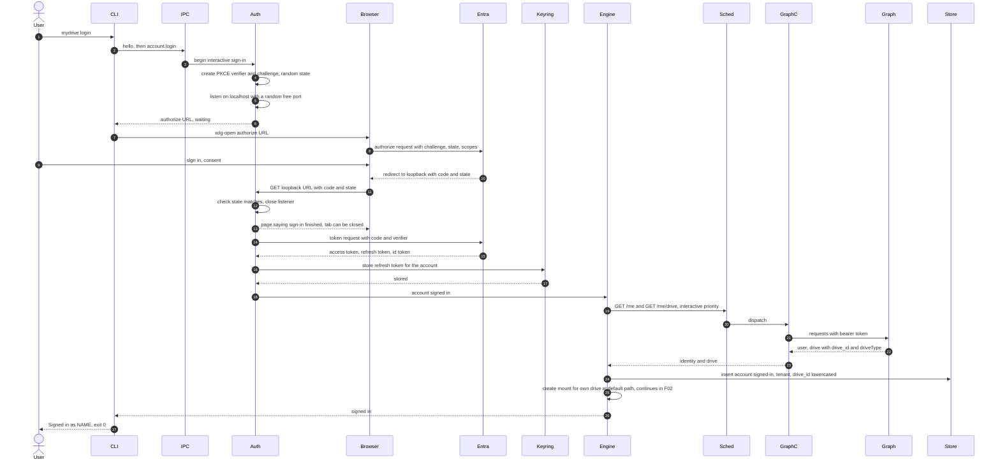
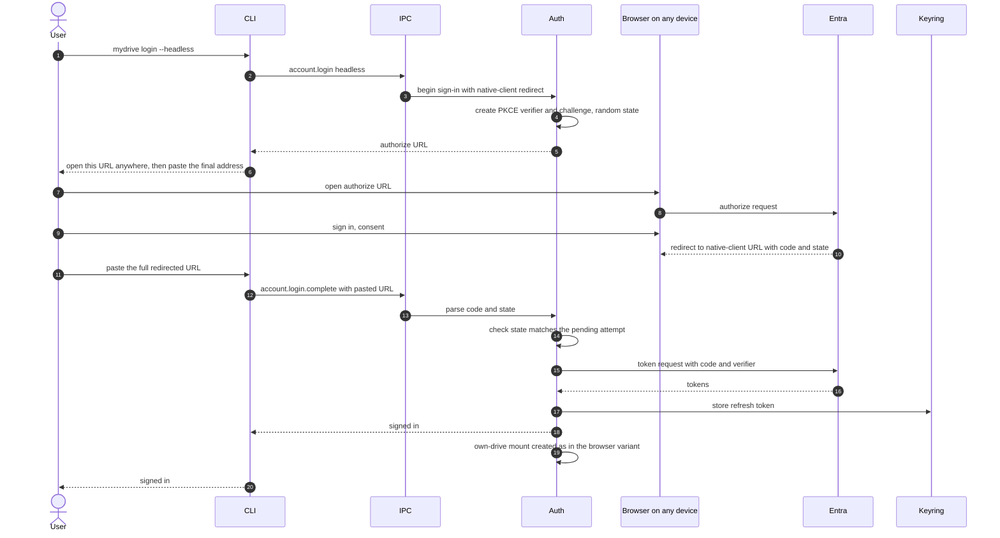
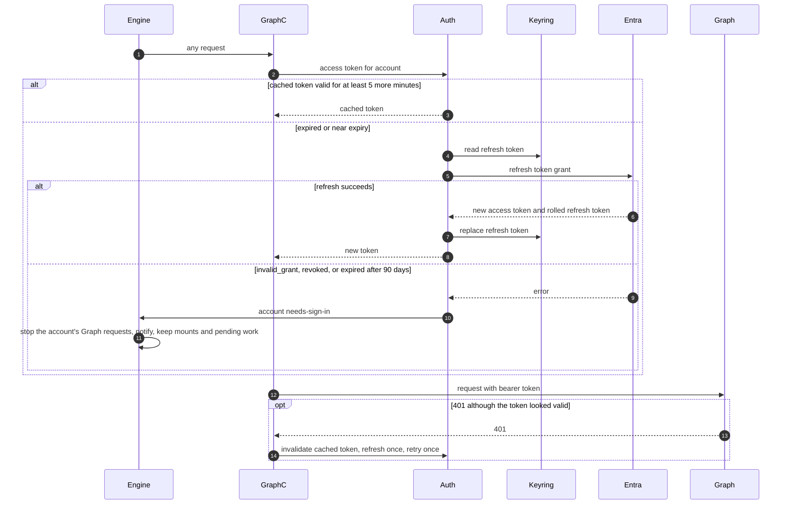

# F01 Sign-in

**Purpose.** Signs an account in with the system browser and a loopback redirect using PKCE, stores
the refresh token in Secret Service, and creates the mount for the account's own drive (F02). A headless variant
replaces the loopback with pasting the redirect URL. Token refresh and sign-out are included
because they share the same components.

## Preconditions

- `mydrived` is running as a systemd user service; the CLI can reach
  `$XDG_RUNTIME_DIR/mydrive/daemon.sock` and has completed `hello`.
- A Secret Service provider (gnome-keyring on Omarchy, or KWallet) is reachable on the session bus.
- Browser variant: the CLI runs inside a graphical session where `xdg-open` works.
- The app registration (own registration, ADR-0010) lists a loopback redirect URI and the
  native-client redirect URI used by the headless variant.

## Diagram: browser with loopback redirect

`Entra` is the Microsoft identity platform (`login.microsoftonline.com`), which is not Graph.

## Diagram: headless variant

## Diagram: token refresh during normal use

## Steps

1. The CLI only relays. The daemon's Auth component owns the PKCE verifier, the state value, the
   loopback listener and the tokens (principle 3). The CLI opens the browser because it runs in
   the user's graphical session; the daemon, a systemd user service, may not have the session's
   display environment.
2. Scopes for the first sign-in are exactly `Files.ReadWrite.All offline_access User.Read`
   (ADR-0010 R5). `Sites.Read.All` is requested incrementally only from site search (F09). The
   challenge uses method `S256` (ADR-0010 R1).
3. The redirect is `http://localhost:<port>` with a random port per sign-in. The listener binds
   the loopback interface only, accepts exactly one redirect whose `state` matches, and closes
   (ADR-0010 R2). Any other request gets a 400 and is ignored. The attempt times out after
   10 minutes and is discarded.
4. Step 14 (browser diagram): the code is redeemed with the PKCE verifier. No client secret exists
   (public client).
5. Step 16: the refresh token goes only to Secret Service, one entry per account. The access token
   stays in daemon memory. No token, code or verifier is written to disk, logs or IPC responses
   (ADR-0010 R6). With no Secret Service the sign-in fails naming `mydrive doctor` and nothing is
   persisted (ADR-0010 R7, open-questions D3).
6. Steps 19 to 23: `drive_id` is normalised to lowercase by the Graph client as the response is
   parsed, so nothing above it sees mixed case (ADR-0007 R1). The tenant is taken from the id token's `tid` claim; personal
   accounts get their own budget key in the Request scheduler (F10).
7. Steps 24 and 25: on first sign-in the daemon creates the mount for the account's own drive at
   `~/OneDrive` (personal) or `~/OneDrive - <Org>` (work) and starts F02 without asking, as in J01.
   `mydrive login` returns once the account is signed in; the enumeration continues in the
   background and `mydrive mount list` shows its progress. If the default mount point exists and
   is not empty, the account is still signed in but no mount is created, and the CLI says to run
   `mydrive mount add` with `--at`.
8. Headless (ADR-0010 R10): the authorize URL uses the native-client redirect
   (`https://login.microsoftonline.com/common/oauth2/nativeclient`). After sign-in the browser shows
   a blank page whose address holds the code. The user pastes the whole address. The daemon keeps
   the pending attempt (verifier, state) for 10 minutes and rejects a URL whose `state` does not
   match. Headless sign-in creates the own-drive mount the same way as step 7.
9. Refresh: every refresh replaces the stored refresh token (ADR-0010 R8). Refresh tokens are not
   revoked on use, so if the Keyring write fails the daemon keeps the new token in memory, retries
   the write, and reports a keyring warning in `mydrive doctor`. It never falls back to a file.
10. A failed refresh puts only that account into `needs-sign-in`: its mounts stop issuing Graph
    requests and other accounts keep syncing (ADR-0010 R9).

### Sign-out (`mydrive logout <account>`, J15)

1. Engine stops the account's mount workers after the current request finishes and closes their
   notification sockets.
2. Auth deletes the account's Secret Service entry and drops the access token.
3. Mounts stay configured and mounted. Hydrated content stays readable. Reads of non-local ranges
   fail with `EIO` (as in F08 offline). Writes still land durably in the backing directory as
   `PendingUpload` and upload after the account signs in again.
4. Removing the mounts is a separate step (`mydrive mount remove`, F12). Logout never deletes local
   or remote content.

## Failure paths

| Failure | What the user sees | Resulting state |
|---|---|---|
| User closes the browser or never finishes | CLI says the sign-in timed out after 10 minutes and how to retry | No account row, nothing in Keyring |
| `xdg-open` fails or no graphical session | CLI prints the URL and suggests `mydrive login --headless` | Attempt stays pending until timeout |
| No free loopback port, or bind refused | CLI reports it and suggests `--headless` | No account |
| `state` mismatch on loopback or pasted URL | "This sign-in response does not belong to this attempt"; attempt cancelled | No account |
| Pasted URL is malformed or carries an `error` parameter | The error text from Entra, for example consent refused | Attempt stays pending so the user can paste again |
| Tenant refuses the app (for example AADSTS65005), or admin consent required | Plain message: the organisation has not allowed this app; who to ask; link to the admin consent URL | No account |
| Conditional Access requires a compliant device | Message naming organisation policy; `mydrive doctor` explains the Intune route is not supported yet | No account |
| Secret Service unavailable, or the unlock prompt dismissed | Error naming `mydrive doctor`; doctor explains how to provide a keyring | No account, nothing persisted |
| Default mount point exists and is not empty | Signed in; message that no mount was created and how to add one with `--at` | Account `signed-in`, no mount |
| Token refresh fails (`invalid_grant`, revoked, 90 days unused) | Notification and tray "Sign in again"; `mydrive status` shows `needs-sign-in` | Account `needs-sign-in`. Mounts stay mounted; hydrated files readable; non-local reads `EIO`; local changes recorded as `PendingUpload` and uploaded after sign-in |
| Same account signed in twice | "Already signed in as NAME" | Existing tokens replaced by the new ones; mounts unchanged |

## Invariants

- No token, code or verifier is ever written to disk in plain text or to the journal.
- The loopback listener never binds a non-loopback address and never serves more than one valid
  response.
- No embedded web view: sign-in happens in the user's own browser.
- A failed or revoked sign-in never removes a mount, a pending upload or local content.
- The CLI never sees the refresh token.

## Open questions

Existing: Q2 (device-code flow, gate G5; not offered until it passes), Q22 (app registration,
including whether it accepts a random loopback port), D3 (no token file fallback, so headless
machines need a keyring).

New:

1. **Headless redirect URI.** ADR-0010 says the user pastes "the URL the browser was redirected
   to" but not which redirect URI the headless request uses. This file uses the native-client URI
   (as abraunegg does), so the code is visible in the address bar on any device. The loopback URI
   would also work if the user copies the address of the page that failed to load, but that is
   confusing on a second device.
2. **Organisation name for `~/OneDrive - <Org>`.** Reading the organisation's display name may
   need more than `User.Read` (unverified). Fallback: the tenant's primary domain. J01 asks the
   same.

## Related

- Journeys: J01, J14, J15.
- ADRs: 0004, 0007 (account coupling), 0009, 0010 (R1, R2, R5 to R10), 0011.
- Gates: G5.
- Flows: F02 (adding the first mount), F08 (behaviour while sign-in is required), F09 (incremental
  `Sites.Read.All`), F10 (tenant budget).
