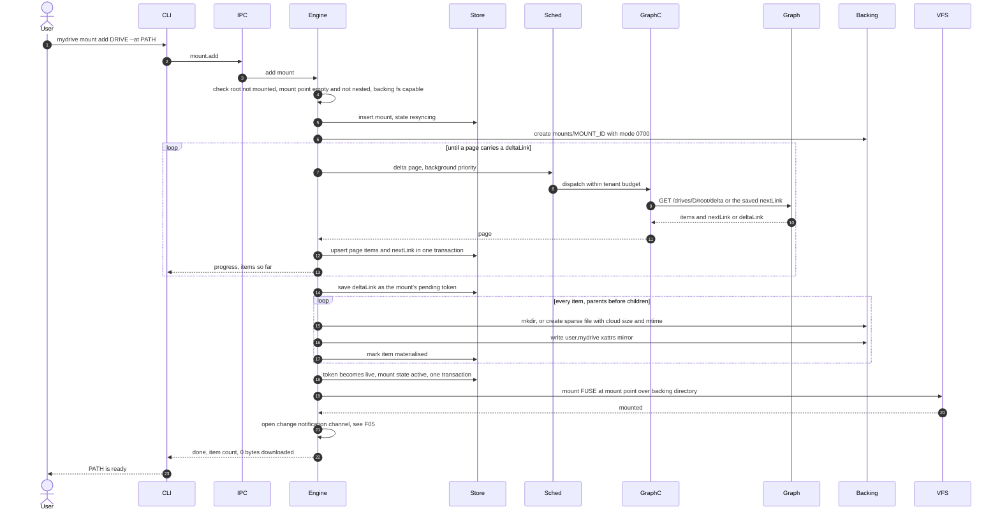

# F02 Add a mount and run the initial sync

**Purpose.** Turns a known drive into a mount: enumerates the drive with delta into the State
store, creates placeholders in the backing directory, brings the FUSE mount up at the mount point,
and saves the delta token. No file content is downloaded.

## Preconditions

- The account is signed in (F01) and the drive's `drive_id` is known: the account's own drive
  (F01), a library resolved in F09, or a drive ID typed by the user.
- No existing mount has the same root (`drive_id`, `item_id`) (ADR-0007 R4).
- The mount point (`~/OneDrive`, `~/OneDrive - <Org>`, `~/<Org>/<Site> - <Library>`, or `--at`)
  either does not exist or is an empty directory, is not inside another mount (nested and
  overlapping mounts are refused, overview "Rulings on details"), and is not inside
  `$XDG_DATA_HOME/mydrive/mounts/` (ADR-0005 R2).
- The filesystem holding `$XDG_DATA_HOME/mydrive/mounts/` supports sparse files and `user.*`
  xattrs (`mydrive doctor` checks this).

## Diagram

## Steps

1. Steps 4 to 6: the mount row and the backing directory exist before any Graph call, so a crash
   from here on is resumed by F08's recovery scan instead of leaving orphans. The backing
   directory is mode 0700 so only the FUSE view is reachable by other tools. A `CACHEDIR.TAG` is
   written in `$XDG_DATA_HOME/mydrive/mounts/` so backup tools skip the sparse files.
2. Step 9: delta with no token enumerates the whole drive. Paging `children` is not used: it can
   miss items if writes happen during the walk. Delta without a token costs 2 resource units per
   page (F10), so the initial sync runs at background priority and yields to interactive work on
   other mounts of the same tenant.
3. Step 12, page handling:
   - The same item can appear more than once; the last occurrence wins (upsert by
     `drive_id`, `item_id`).
   - Items carrying the `deleted` facet are dropped.
   - `drive_id` values arrive already lowercased by the Graph client (ADR-0007 R1).
   - Timestamps are truncated to whole seconds (ADR-0011 R5).
   - Stored per item: `item_id`, parent `item_id`, name, size, eTag, cTag where present (business
     delta omits it), quickXorHash as `server_hash`, `lastModifiedDateTime`, file or folder facet,
     `shared` facet. Hydration is `Placeholder` for files with size > 0, `Full` for empty files and
     for folders. Pin is `Inherit` (root `Unpinned`). Sync is `InSync`.
   - The saved `nextLink` lets a crash resume the enumeration. If the saved `nextLink` is rejected
     on resume, enumeration restarts from no token; upserts make this harmless.
4. Steps 15 to 17: paths are never stored; the tree is rebuilt from parent IDs. Placeholders are created
   only after the full enumeration, parent first, because delta does not guarantee parents arrive
   before children.
5. Step 15: a placeholder is a regular file created with `ftruncate` to the cloud size, so
   `st_size` is the cloud size and `st_blocks` is 0. mtime is set from `lastModifiedDateTime`.
6. Step 16: the xattr mirror is written after the store row; if the two ever disagree the store
   wins and the mirror is rewritten (ADR-0006).
7. Steps 18 and 19: the token becomes live and the mount becomes `active` in one transaction,
   after every placeholder exists. Only then is FUSE mounted, so a user never sees a half-built
   tree, and before this point the mount point is an empty directory.
8. Step 21: notifications are opened per mount (F05). Changes that happened during the enumeration
   are picked up by the first delta call with the saved token.
9. If thumbnail seeding is enabled (ADR-0013), a background job then fetches Graph thumbnails for
   image and video placeholders into `~/.cache/thumbnails` (see F03).
10. A drive whose item count, added to the other mounts, would exceed the configured threshold
    near 300,000 triggers a warning (ADR-0015 R7). For libraries the count is shown in F09's
    preview before confirmation; for the own drive it is reported during enumeration, where the
    user can cancel.
11. While the mount is `resyncing` for its first enumeration, `mydrive mount list` shows it with
    the count of items listed so far, and the mount point is an empty directory (J01).

## Failure paths

| Failure | What the user sees | Resulting state |
|---|---|---|
| Mount point not empty, or inside another mount | Refused before any work: "PATH is not empty" | Nothing created |
| Same root already mounted, or mount point nested in another mount | Error naming the existing mount (ADR-0007 R4) | Nothing created |
| Backing filesystem lacks sparse files or user xattrs | Refused, with the `mydrive doctor` explanation | Nothing created |
| Network lost during enumeration | Progress stops; status "waiting for network"; resumes on reconnect | Mount `resyncing`, store holds the pages so far and the `nextLink` |
| Daemon crash during enumeration or materialisation | After restart the add resumes automatically (F08) | Mount `resyncing`; resumed from `nextLink` or from the store |
| `403` that matches the organisation-policy pattern | "Blocked by your organisation's policy" | Mount `blocked` with reason, not mounted; see F09. Depends on G2 (Q13) |
| `404` or `403 accessDenied` on the drive | "You no longer have access to this drive" | Mount row and backing directory removed (nothing was local) |
| `429` or `503` with `Retry-After` | Progress pauses; status shows "throttled, resuming in N s" | Unchanged; F10 |
| Auth refresh fails | "Sign in again" (F01) | Account `needs-sign-in`; mount `resyncing`, resumes after sign-in |
| Remote name longer than 255 bytes in UTF-8, or containing a byte Linux cannot represent | Item listed in `mydrive activity` as not shown locally | Item in store with sync `Error`, no placeholder |
| Disk full while creating placeholders | "Not enough space for file metadata" | Mount `resyncing`; resumes when space is available |
| FUSE mount fails (no `fusermount3`, `/dev/fuse` missing) | Error naming the cause; `mydrive doctor` | Mount `active` in the store but not mounted; mount point stays empty; retried on next daemon start |

## Invariants

- Initial sync downloads no file content.
- The mount point is never mounted over a non-empty directory.
- The delta token is live only after every item it covers is in the store and materialised.
- No path is used as an identity; every row is keyed by (`drive_id`, `item_id`).
- Nothing in this flow writes to the server.
- A placeholder never reads as zeros: before FUSE is up the mount point is empty, and after it is
  up reads go through F03.

## Open questions

Existing: Q10 (a mount of a folder inside a business drive may need a whole-drive delta; this flow
covers drive roots), Q13 (policy errors, gate G2), Q14 (two accounts in one tenant both wanting
`~/<Org>`).

New:

1. **Backing directory layout.** ADR-0005 and ADR-0006 say the backing directory holds sparse
   files but not whether it mirrors the tree by name or is keyed by item ID. These flows assume a
   name-mirrored tree, so remote renames and moves become renames in the backing directory.
2. **Mount state during the first enumeration.** The overview has no `initialising` state; these
   flows use `resyncing` (F13 new question 2).
3. **Progressive mount for large drives.** This flow mounts only after the full enumeration, which
   can take minutes for 300,000 items; Windows shows the tree as it fills. Mounting early needs
   `readdir` to tell "not yet enumerated" from "empty".
4. **Remote names Linux cannot hold** (over 255 bytes in UTF-8) are shown as errors rather than
   truncated, since a truncated name could collide with a real one.
5. **Shortcuts and OneNote packages** (`remoteItem`, `package` facets) are not materialised before
   M5; whether they appear as stubs or are hidden is for ADR-0015.

## Related

- Journeys: J01, J02, J11, J16.
- ADRs: 0005 (R2, R3, R8), 0006 (R4, R6), 0007 (R1, R2, R4, R5), 0008, 0011 (R2, R5), 0015 (R1, R7).
- Gates: G2 (policy errors during enumeration), G3 (FUSE design input).
- Flows: F01 (before), F05 (after), F08 (resume after crash), F09 (libraries), F10 (budget).
