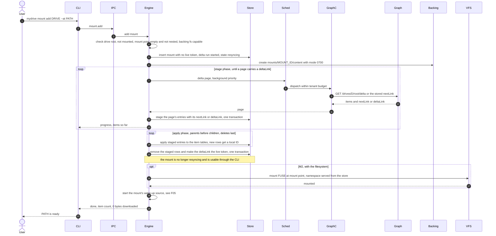

# F02 Add a mount and run the initial sync

**Purpose.** Turns a known drive into a mount: enumerates the drive with delta, staging every page
durably and applying the complete run to the State store when its delta link arrives (ADR-0022),
and makes the delta link the mount's live token. No file is created in the backing directory for
folders or placeholders, and no file content is downloaded (ADR-0021). The mount is usable once
the first run has been applied: in M1 through the CLI, and from M2 through the FUSE mount, which
is brought up only then.

## Preconditions

- The account is signed in (F01) and the drive's `drive_id` is known: the account's own drive
  (F01, after the user confirmed adding it), a library resolved in F09, or a drive ID typed by the
  user.
- The root is a drive root: M1 mounts drive roots only, and a link to a folder inside a library
  mounts the library (overview "Rulings on details", Q10).
- No existing mount has the same root (`drive_id`, `item_id`) (ADR-0007 R4).
- The mount point (`~/OneDrive`, `~/OneDrive - <Org>`, `~/<Org>/<Site> - <Library>`, or `--at`)
  either does not exist or is an empty directory, is not inside another mount (nested and
  overlapping mounts are refused, overview "Rulings on details"), and is not inside
  `$XDG_DATA_HOME/mydrive/mounts/` (ADR-0005 R2).
- The filesystem holding `$XDG_DATA_HOME/mydrive/mounts/` supports sparse files (`mydrive doctor`
  checks this). It needs no `user.*` xattr support: xattrs are served from the store and are not
  written on content files (ADR-0021).

## Diagram

## Steps

1. Steps 4 to 6: the mount row and the backing directory exist before any Graph call, so a crash
   from here on is resumed by F08 instead of leaving orphans. The backing directory holds only
   content files, one per file that has or has had local content, at
   `mounts/<mount_id>/content/<local_id>` (overview "On disk", ADR-0021). It does not mirror names
   or folders. It is mode 0700 so only the FUSE view is reachable by other tools. A
   `CACHEDIR.TAG` is written in `$XDG_DATA_HOME/mydrive/mounts/` so backup tools skip the sparse
   files.
2. Step 9: delta with no token enumerates the whole drive. Paging `children` is not used: it can
   miss items if writes happen during the walk. Delta without a token costs 2 resource units per
   page (F10), so the initial sync runs at background priority and yields to interactive work on
   other mounts of the same tenant.
3. Step 12, **stage phase** (ADR-0022). The first enumeration is an ordinary delta run:
   - Each page's entries are written to the staging table, keyed by mount and item ID, in the
     same transaction as the link to the next page, or as the delta link on the last page
     (ADR-0022 R1).
   - The same item can appear more than once; a later entry replaces the staged earlier one, so
     the apply phase sees only the last occurrence (ADR-0011 R2, ADR-0022 R2). An entry carrying
     the `deleted` facet is staged as a delete, so it replaces an earlier entry for that item.
   - Nothing in the item tables changes during this phase (ADR-0022 R3).
   - An entry the Graph client reports as a problem is staged as a problem and resolved in the
     apply phase by fetching the item; it is never guessed (ADR-0022 R6).
   - `drive_id` values arrive already lowercased by the Graph client (ADR-0007 R1).
   - Timestamps are truncated to whole seconds (ADR-0011 R5).
4. Step 14, **apply phase**, once the page carrying the delta link has been staged. The staged set
   is applied parents before children and deletes last; a staged delete of an item the store does
   not hold changes nothing. Applying an entry is idempotent (ADR-0022 R5).
   - Stored per item: `item_id`, parent `item_id`, name, size, eTag, cTag where present (business
     delta omits it), quickXorHash as `server_hash`, `createdDateTime` and
     `lastModifiedDateTime`, kind (file or folder). Hydration is `Placeholder` for files with
     size > 0, `Full` for empty files and for folders. Pin is `Inherit` (root `Unpinned`). Sync is
     `InSync`.
   - Each new row is given a `local_id` that is never changed or reused (ADR-0021 R1).
   - Paths are never stored; the tree is the parent IDs (store invariant 1).
   - No file or directory is created in the backing directory, for folders or for placeholders
     (ADR-0021 R4). There is no materialisation step.
5. Step 15: the staged rows are removed and the delta link becomes the mount's live token in one
   transaction, after a complete apply and only then (ADR-0022 R4). From then the mount is no
   longer `resyncing` (overview "Rulings on details", "First enumeration").
6. Steps 16 and 17 (M2): only then is FUSE mounted, so a user never sees a half-built tree, and
   before this point the mount point is an empty directory. The VFS serves names, sizes and
   times from the store, so a placeholder shows its cloud size although no content file exists.
   In M1 there is no FUSE mount; once the run is applied the mount's items can be listed,
   hydrated (`item.hydrate`) and exported (`item.export`), and files imported (`item.import`)
   through the CLI (overview "Rulings on details").
7. **Crash and resume** (F08). A run interrupted in the stage phase resumes from the stored next
   link; if that link is refused, the run restarts from no token (new question 6). A run
   interrupted in the apply phase is applied again from the staged set. Because the live token
   moves only after a complete apply, a crash at any point leaves the mount `resyncing`, never
   with a token covering items the store does not hold.
8. Step 18: the mount's wake-up source starts (F05); in M1 it is polling. Changes that happened
   during the enumeration are picked up by the first run from the live token.
9. If thumbnail seeding is enabled (ADR-0013), a background job then fetches Graph thumbnails for
   image and video placeholders into `~/.cache/thumbnails` (see F03).
10. A drive whose item count, added to the other mounts, would exceed the configured threshold
    near 300,000 triggers a warning (ADR-0015 R7). For libraries the count is shown in F09's
    preview before confirmation; for the own drive it is reported during enumeration, where the
    user can cancel.
11. While the mount is `resyncing` for its first enumeration, `mydrive mount list` shows it with
    the count of items listed so far, and the mount point is an empty directory (J01).

## Failure paths

| Failure | What the user sees | Resulting state |
|---|---|---|
| Mount point not empty, or inside another mount | Refused before any work: "PATH is not empty" | Nothing created |
| Same root already mounted, or mount point nested in another mount | Error naming the existing mount (ADR-0007 R4) | Nothing created |
| A folder inside a drive given as the root | The library or drive is offered instead (M1 mounts drive roots only) | Nothing created until confirmed |
| Backing filesystem lacks sparse files | Refused, with the `mydrive doctor` explanation | Nothing created |
| Network lost during enumeration | Progress stops; status "waiting for network"; resumes on reconnect | Mount `resyncing`; the store holds the staged pages so far and the next link; no item rows yet |
| Daemon crash during the stage phase | After restart the add resumes automatically (F08) | Mount `resyncing`; resumed from the stored next link, or restarted if it is refused |
| Daemon crash during the apply phase | After restart the add completes automatically (F08) | Mount `resyncing`; the staged set is applied again; the token becomes live only at the end |
| `403` that matches the organisation-policy pattern | "Blocked by your organisation's policy" | Mount `blocked` with reason, not mounted; see F09. Depends on G2 (Q13) |
| `404` or `403 accessDenied` on the drive | "You no longer have access to this drive" | Mount row and backing directory removed (nothing was local) |
| `429` or `503` with `Retry-After` | Progress pauses; status shows "throttled, resuming in N s" | Unchanged; F10 |
| Auth refresh fails | "Sign in again" (F01) | Account `needs-sign-in`; mount `resyncing`, resumes after sign-in |
| Remote name longer than 255 bytes in UTF-8, or containing a byte Linux cannot represent | Item listed in `mydrive activity` as not shown locally | Item in store with sync `Error`; the VFS does not list it (M2) |
| Disk full while staging or applying | "Not enough space for file metadata" | The failed transaction leaves nothing behind; mount `resyncing`; resumes when space is available |
| FUSE mount fails (M2: no `fusermount3`, `/dev/fuse` missing) | Error naming the cause; `mydrive doctor` | Run applied and token live, but not mounted; mount point stays empty; retried on next daemon start |

## Invariants

- Initial sync downloads no file content.
- The mount point is never mounted over a non-empty directory.
- No item row changes while a run is in its stage phase (ADR-0022 R3).
- The delta token is live only after every staged entry of its run has been applied, and changes
  only in the transaction that removes the staged set (ADR-0022 R4).
- No file or directory is created in the backing directory for a folder or a never-hydrated
  placeholder (ADR-0021 R4).
- No path is used as an identity; every row is keyed by (`drive_id`, `item_id`), and no backing
  path is built from an item name (ADR-0021 R3).
- Nothing in this flow writes to the server.
- A placeholder never reads as zeros: before FUSE is up the mount point is empty, and after it is
  up reads go through F03.

## Open questions

Existing: Q10 (a mount of a folder inside a business drive may need a whole-drive delta; M1 mounts
drive roots only, by the overview's ruling, so this waits until after M1), Q13 (policy errors,
gate G2), Q14 (two accounts in one tenant both wanting `~/<Org>`).

New:

1. **Backing directory layout.** Resolved by ADR-0021: content files are keyed by local ID; there
   is no name-mirrored tree, no placeholder file and no on-disk form for folders, and remote
   renames and moves change only the store.
2. **Mount state during the first enumeration.** Resolved by the overview ruling "First
   enumeration": the mount is `resyncing` until its first full delta has been applied, and is
   not mounted until then.
3. **Progressive mount for large drives.** This flow mounts only after the full enumeration, which
   can take minutes for 300,000 items; Windows shows the tree as it fills. Mounting early needs
   `readdir` to tell "not yet enumerated" from "empty".
4. **Remote names Linux cannot hold** (over 255 bytes in UTF-8) are shown as errors rather than
   truncated, since a truncated name could collide with a real one.
5. **Shortcuts and OneNote packages** (`remoteItem`, `package` facets) are not shown before M5;
   whether they appear as stubs or are hidden is for ADR-0015.
6. **Restarting a run whose next link is refused.** ADR-0022 says the run restarts but not
   whether the entries staged by the abandoned attempt are discarded first. Kept, an entry for an
   item deleted in the meantime would be applied as if it still existed (no data is lost; the
   item would be removed by a later run or resync). This flow proposes discarding them.
7. **Size of the apply.** Whether the apply of a 300,000-item run is one transaction or several
   is not settled. Several are safe because each entry's apply is idempotent and the token still
   moves only at the end (ADR-0022 R4, R5).
8. **Empty files.** A file of size 0 is `Full` without ever having had a content file. F08's
   recovery rule (a clean item whose content file is missing becomes a placeholder) must not turn
   it into a placeholder, or must create the empty content file; ADR-0021 does not say which.

## Related

- Journeys: J01, J02, J11, J16.
- ADRs: 0005 (R2, R3, R8), 0006 (R4, R6), 0007 (R1, R2, R4, R5), 0008, 0011 (R2, R5), 0015 (R1,
  R7), 0021 (R1, R3, R4), 0022 (R1 to R6).
- Gates: G2 (policy errors during enumeration), G3 (FUSE design input).
- Flows: F01 (before), F05 (after; the same run model), F08 (resume after crash), F09
  (libraries), F10 (budget).
