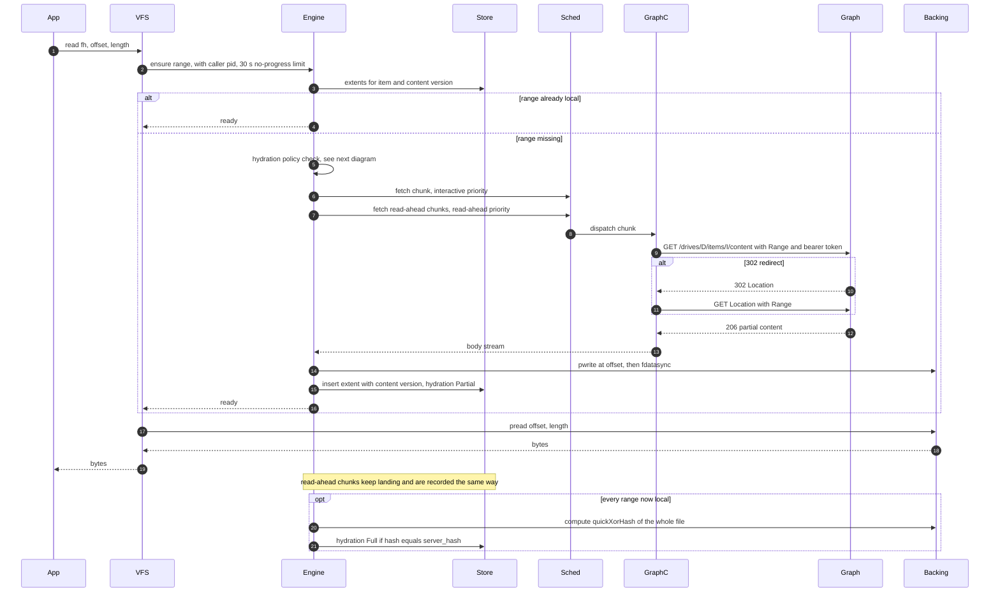
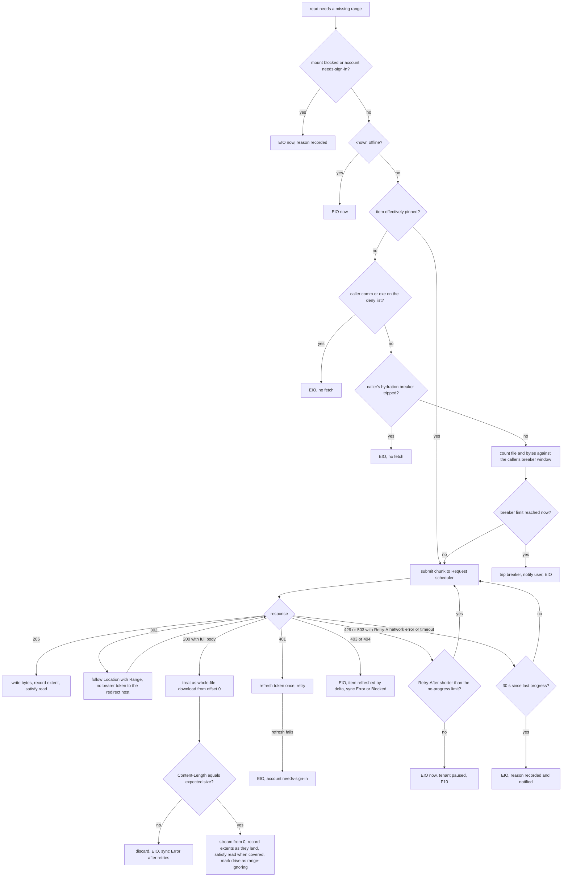

# F03 Hydrate on read

**Purpose.** Serves a `read` on a file whose requested bytes are not local: applies the hydration
policy, fetches the byte range plus read-ahead from Graph, writes it into the sparse backing file,
records the extent, and returns the data. If the content cannot be fetched the read fails with
`EIO` once no progress has been made for 30 seconds (default), or at once when the failure is
already known; it never returns zeros and never blocks indefinitely (ADR-0005 R4).

## Preconditions

- The mount is `active` and FUSE is up (F02).
- The item is a file with hydration `Placeholder` or `Partial`, and the requested range is not
  fully covered by extent records for the item's current content version.
- `readdir`, `lookup`, `getattr` (`stat`), `open` and `getxattr`/`listxattr` have already been
  served from the State store and the backing directory; none of them hydrate.

## Diagram: range fetch

## Diagram: policy and response handling

## Steps

1. Step 2: the VFS layer does not call Graph; it asks the Sync engine through the `Hydrator` trait
   in `mydrive-core`, passing the caller's pid from the FUSE request header. The read waits while
   bytes for its range keep arriving and fails with `EIO` once 30 s pass with no progress
   (ADR-0005 R4). When the failure is known up front (offline, `needs-sign-in`, `blocked`, denied
   caller) it fails at once. Every `EIO` leaves a status entry and a notification naming the reason.
   Reads issued for mmap page faults take the same path (Q5).
2. Step 3: an extent record is (`drive_id`, `item_id`, content version, offset, length). The content
   version is the item's `server_hash` (quickXorHash), falling back to eTag where no hash is
   reported. Extents for any other version are ignored and deleted. Sparse holes in the backing file
   are never used to decide what is local.
3. Step 5, chunking (initial defaults, tunable in ADR-0005):
   - Requests are rounded out to 1 MiB-aligned chunks. Files of 4 MiB or less are fetched whole
     on first read, which avoids one request per small read (throttling, F10).
   - Sequential access (each read starting where the last ended) grows the read-ahead window from
     1 MiB up to 16 MiB. Random access keeps it at one chunk.
   - Only the chunk that covers the requested offset is interactive priority. Read-ahead chunks run
     at the lower read-ahead priority and are dropped from the queue if the file is closed.
   - Concurrent reads of the same missing chunk share one request.
4. Steps 8 to 11: downloads always carry a bearer token. The response may be a `302` to a
   pre-authenticated URL (today) or the content directly (after the April 2027 retirement). The
   Graph client handles both and decides per response; the bearer token is never forwarded to a
   redirect host (ADR-0011 R10). Whether `Range` is honoured on authenticated `/content` requests
   is **gate G1** (Q1); if G1 fails, ADR-0005 falls back to whole-file hydration and this flow
   fetches the whole file on first read.
5. Step 11: the Graph client checks the status code of every ranged response. `206` is the normal
   case. A `200` means the server ignored `Range` and is sending the whole body: see note 9
   (ADR-0005 R6, ADR-0011 R11).
6. Steps 13 and 14: bytes are made durable (`fdatasync`, batched per chunk) before the extent
   record is committed (ADR-0005 R5). A crash between the two loses only the record, so the bytes are fetched
   again; the reverse order could make the store claim bytes that read as zeros.
7. Steps 16 to 18: the VFS reads the backing file only after the engine reports the range ready.
8. Steps 20 and 21: once every range is local the engine hashes the whole file. A match makes the
   item `Full`. A mismatch drops every extent (`Placeholder`), sets sync `Error`, and fetches the
   item's metadata again in case the version changed mid-hydration.
9. `200` with the whole body: the engine writes the stream from offset 0, recording extents as
   they land, and satisfies the waiting read as soon as its range is covered. The rest of the body
   continues at read-ahead priority and counts against the breaker. The engine marks the drive as
   "range ignored" so later reads of that drive fetch whole files (and logs it for G1).
10. Version safety: a ranged response belongs to whichever version the server holds at that
    moment. If delta reports a new version while chunks are in flight, those chunks are discarded
    and the read is retried against the new version. Where the response carries an `ETag` header
    it is compared with the expected version (whether ranged responses carry one is part of G1).

### Hydration policy (ADR-0013)

11. **Deny list** (ADR-0013 R2, R3). The pid from the FUSE request is resolved through
    `/proc/<pid>/comm` and `/proc/<pid>/exe`, matched against the deny list in `config.toml`
    (default: indexers such as `localsearch`/`tracker-miner-*`, `baloo_file`, `updatedb`/`plocate`;
    thumbnailers such as `gdk-pixbuf-thumbnailer`, `ffmpegthumbnailer`; the `sushi` previewer). A
    denied caller receives `EIO` for any range that is not local; local ranges are served normally.
    If the pid lookup fails (pid 0 from another pid namespace, or the process has exited), the
    caller is treated as unknown: not denied, still counted by the breaker (ADR-0013 R8).
12. **Circuit breaker** (ADR-0013 R4, R5). Per process, a sliding 60 s window counts files hydrated
    and bytes fetched. Exceeding 50 files or 1 GiB pauses hydration for that process: its next
    hydrating read and every later one fails with `EIO`, and exactly one notification is raised,
    offering "allow once" (for the life of that process) or "always allow" (adds it to the allow
    list). User commands (`mydrive hydrate`, `mydrive pin`) are not reads and are not counted.
13. **Exemptions** (ADR-0013 R6). Reads of items whose effective pin is `Pinned`, and reads of
    local content, are never refused by the deny list or the breaker.
14. **Thumbnail seeding** (ADR-0013 R7). A background job at the lowest priority fetches Graph
    thumbnails for placeholders and writes them into `~/.cache/thumbnails` under the path and keys
    the shared freedesktop cache expects (URI under the mount point, mtime), so a file manager that
    uses the cache shows a preview without hydrating. Seeded thumbnails are replaced when F05
    reports a content change. Details are Q19.

## Failure paths

| Failure | What the user sees | Resulting state |
|---|---|---|
| Offline (known before the request) | The app reports an I/O error immediately; tray shows offline | No change; item stays `Placeholder`/`Partial` |
| Network drops mid-fetch and nothing arrives for 30 s | The app reports an I/O error; notification names the reason | Extents for bytes that landed are kept; rest stays missing |
| Server sends `200` with the whole body | Read succeeds, perhaps slower | Whole-file download; drive flagged range-ignored; item becomes `Full` when done |
| `200` body length does not match the item size | I/O error; activity entry | Bytes discarded; metadata refreshed; sync `Error` if it repeats |
| Hash mismatch after the last range | I/O error on the next read of a dropped range; activity entry | Extents dropped, hydration `Placeholder`, sync `Error` |
| Access token expired | Nothing, if refresh works | Request retried once with the new token |
| Refresh token invalid | I/O error; notification "Sign in again" | Account `needs-sign-in` (F01); later non-local reads fail at once |
| `403` (no download permission, malware block) | I/O error; `mydrive status PATH` shows the reason | sync `Error` |
| `403` matching organisation policy | I/O error; notification about policy | Mount `blocked`, or item sync `Blocked` (F09). Depends on G2 (Q13) |
| `404` (deleted remotely) | I/O error | Delta applies the delete (F05) |
| Throttled with `Retry-After` longer than 30 s | I/O error now, not after 30 s | Tenant's requests held until Retry-After expires (F10, ADR-0011 R6) |
| Caller on the deny list | Thumbnail or index missing for that file; the app gets an I/O error | No change, no request made |
| Breaker trips | One notification naming the process, with "allow once" and "always allow" | That process's non-local reads fail until allowed or it exits |
| Disk full while writing the chunk | I/O error; notification "disk full" | No extent recorded |
| Mount `blocked` | I/O error | No request made |

## Invariants

- `readdir`, `stat`, `open` and xattr calls never trigger a download.
- A read never returns zeros or short data for bytes that are not local.
- A read never waits more than 30 s without progress; when failure is already known it fails
  at once.
- An extent is recorded only after its bytes are durable.
- Bytes from different content versions are never combined in one backing file.
- `Full` is set only after a whole-file quickXorHash match.
- A process on the deny list never causes a download, and reads of pinned or local content are
  never refused by the policy.
- The status code of every download response is checked; `206` is never assumed.
- The bearer token is never forwarded to a redirect host.

## Open questions

Existing: Q1 (gate G1, `Range` on authenticated `/content`), Q5 (mmap page faults), Q17 and Q19
(thumbnail hook and cache layout), Q20 (whether the deny list works in practice).

New:

1. **Whole-file fallback and the no-progress limit.** If G1 fails, a read far into a large file
   must wait for every earlier byte. It keeps making progress, so it does not fail, but it can
   take minutes. ADR-0005 should say whether that is acceptable or whether such reads fail fast.
2. **Continuing a `200` body after the read is satisfied** costs bandwidth for large files. This
   flow continues it (the bytes are already arriving and are the whole file); the alternative is
   to abort after the read-ahead window and mark the drive range-ignored.
3. **Version check on ranged responses.** Whether ranged responses carry an `ETag` header that
   can confirm the bytes belong to the expected version is unverified; add it to the G1
   experiment. Without it, a version change is detected only through delta or the final hash.

## Related

- Journeys: J02, J03, J09, J17, J18.
- ADRs: 0005 (R1, R4 to R6, R8), 0006 (R6), 0008, 0011 (R6, R10, R11), 0013 (R1 to R8).
- Gates: G1, G2 (policy errors), G3, G4 (thumbnail hook).
- Flows: F05 (version changes), F06 (pin uses the same fetch path at background priority), F08
  (offline), F10 (priorities and throttling), F13 (hydration transitions).
