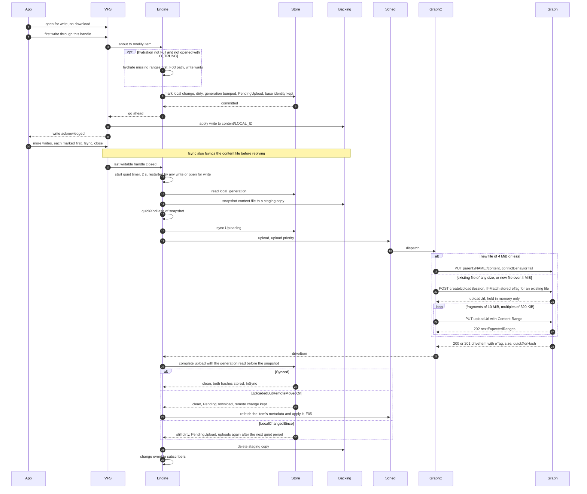
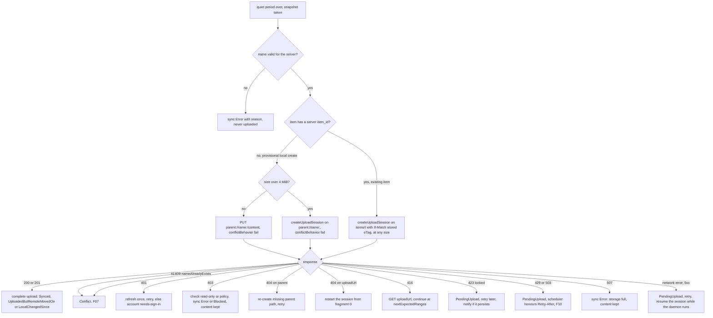

# F04 Local write and upload

**Purpose.** Takes a local change (write, create, mkdir, rename, move) through the durable dirty
mark, the content file, the quiet period and the upload, ending with both hashes stored. Covers
simple and session uploads, save-via-rename, and `item.import`, the way M1 brings a single file in
before the filesystem exists. Deletes are F12; conflicts are F07.

## Preconditions

- The mount is `active` (or `paused`, in which case everything up to the upload happens and the
  upload waits) and is not read-only. In a read-only library the VFS refuses `write`, `create`,
  `mkdir`, `rename`, `unlink` and content-changing `setattr` with `EROFS` (ADR-0015 R5) and this
  flow does not start.
- For an existing item, the State store holds its eTag, `local_hash` and `server_hash`.
- The item's content file, if it has one, is `mounts/<mount_id>/content/<local_id>` (ADR-0021).

## Diagram: write, quiet period, upload

## Diagram: upload request choice and response handling

## Steps

1. Step 1: `open` never downloads (ADR-0005 R1), whatever its flags.
2. Steps 3 and 4: a partial write to a `Placeholder` or `Partial` file waits until the file is
   `Full`, or fails with `EIO` under F03's no-progress rule; it never writes into an unhydrated
   region (ADR-0005 R7, ADR-0012 R1). The store refuses to mark a file that is not fully local,
   so the engine hydrates first (store-schema "What the engine must do"). An open with `O_TRUNC`
   needs no download (ADR-0012 R2): `truncate_local` to 0 clears the ranges and the file is `Full`
   and empty.
3. Steps 5 to 9, **durable dirty mark** (ADR-0012 R3): the engine commits `mark_local_change`
   (or `set_local_size` / `truncate_local`, which mark too) **before** each write, truncate or
   other modification reaches the content file. The mark sets `local_dirty`, bumps
   `local_generation`, moves the item to `PendingUpload`, and on the clean-to-dirty transition
   records the base identity. The stored eTag stays the one the change is based on, which is the
   next upload's `If-Match`. Only then is the write applied and acknowledged. A crash at any
   later point leaves a dirty item that the recovery pass (F08) must not discard or overwrite. A
   write landing while an upload may be reading the file bumps the generation again with its own
   committed mark, so that upload cannot complete as `Synced` (store-schema "What the engine must
   do").
4. Step 10 and the note: `fsync` on the file also fsyncs the content file before replying
   (ADR-0012).
5. Steps 11 and 12: the upload starts only after the last writable handle has closed and the quiet
   period (default 2 s) has passed with no write or open-for-write (ADR-0012 R4). An editor that
   saves in several steps produces one upload. A file held open for writing is not uploaded until
   it is closed.
6. Steps 13 to 15: the engine reads `local_generation` **before** it reads the bytes, and passes
   that generation to the completion in step 26; reading it afterwards could attribute newer
   bytes to the upload. The upload reads from a snapshot (a reflink copy where the backing
   filesystem supports it, otherwise a full copy in the backing directory, named from the local
   ID and never from the item name, ADR-0021 R3), never from the live file, so a write during the
   upload cannot tear it.
7. **No shortcut for unchanged content.** Even when the snapshot's hash equals `local_hash` (the
   user saved without changes), the item is uploaded: the store as built has no operation that
   returns a dirty item to `InSync` without an upload of its current generation or a discard
   (new question 6). The upload costs bandwidth and loses nothing.
8. Steps 19 to 23, **request choice** (overview "Rulings on details"): replacing an existing file
   always uses an upload session, where the `If-Match` check is documented, at any size, until a
   real-account experiment shows the simple upload honours it (Q36). The simple `PUT` is used
   only to create a new file of 4 MiB or less, with conflictBehavior `fail`; a new file above
   4 MiB uses a session too (ADR-0012 R5, open-questions D5). Fragments are multiples of 327,680
   bytes, default 10 MiB, under 60 MiB (ADR-0011 R12). Whether a `PUT` to `uploadUrl` carries
   `Authorization` is decided per session from the server's responses (ADR-0011). Every content
   upload of an existing item carries `If-Match` with the stored eTag (ADR-0012 R6). **The upload
   link is never written to the state store** (overview "Rulings on details"): it is a bearer
   capability. It is held in memory, so a network failure while the daemon runs resumes from
   `nextExpectedRanges`, and a session interrupted by a crash restarts from the beginning (F08).
9. Steps 26 to 30, **completion and two hashes.** `complete_upload` runs in one savepoint with the
   generation from step 13 and the uploaded hash (store-schema "Uploads"). `local_hash` becomes
   the quickXorHash of the snapshot that was sent; eTag, cTag, server hash, parent and name come
   from the response, so the next `If-Match` is the uploaded version's eTag (ADR-0012 R8). Then:
   - **`Synced`**: the generation did not move and the server has not moved on; the item is
     clean and `InSync`.
   - **`UploadedButRemoteMovedOn`**: our bytes are on the server, but a different remote change
     was reported meanwhile. The item is clean but `PendingDownload`; the engine refetches its
     metadata and applies it, which replaces the content as for any clean item (F05).
   - **`LocalChangedSince`**: the user wrote during the upload. The item stays dirty and
     `PendingUpload`, and the next quiet period uploads again. Upload 1 can never mark version 2
     as synced.

   The staging copy is deleted only after the completion has committed. The engine never applies
   a delta page fetched before a completion after that completion has committed: it could describe
   an older version as current (store-schema "What the engine must do"). `local_hash` and
   `server_hash` can differ in SharePoint libraries, which rewrite some Office files after upload.
   The local bytes stay as they are; a later delta that reports that `server_hash` leaves the item
   `InSync` with no download. On drives where no rewrite is expected (personal), a mismatch causes
   one re-upload and then `Error`.
10. Timestamps: the local mtime is sent in `fileSystemInfo` at whole-second precision (ADR-0011
    R5) as part of the upload request where the endpoint allows it.

### Create, mkdir, rename and move

11. `create` and `mkdir` refuse names that are not valid UTF-8 (overview "Rulings on details").
    Otherwise they commit a provisional item (dirty, `PendingUpload`, a file `Full`) under a
    provisional key, with its own `local_id`, before the content file is written. Folders have no
    on-disk form (ADR-0021). When the server assigns an ID, the completion re-keys the item; its
    `local_id`, and so its content file, does not change (ADR-0021 R2). Files are uploaded as above
    once their quiet period ends; folders are created with `POST /drives/D/items/P/children`,
    conflictBehavior `fail`. A `409` for a folder means a folder of that name already exists
    remotely: the engine adopts the remote folder's `item_id` and moves the local children under
    it (folders merge; files go through F07). The store has no "adopt server item" operation yet
    (Q28).
12. Names are validated before upload: reserved characters `" * : < > ? / \ |`, leading or
    trailing spaces, trailing period, reserved names, `~$` prefix, `_vti_`, `forms` at a library
    root, a case-insensitive collision with a sibling, and the 400-character server path. An
    invalid name is never uploaded; the item has sync `Error` with the reason and stays local until
    renamed (ADR-0015 R6).
13. `rename` and moves within one mount change only the store (`move_item_local`); nothing on disk
    is renamed (ADR-0021). The engine then sends `PATCH /drives/D/items/I` with the new `name` and
    `parentReference` and `If-Match`. On `412` the engine fetches the item: if only its content or
    other metadata changed remotely it re-sends the `PATCH` with the new eTag; content conflicts
    are F07. Renames across mounts fail with `EXDEV` from the kernel. Until local moves are
    recorded as pending operations (Q28), a server report, an upload completion or a discard
    writes the server's name and parent and can revert a local rename that has not reached the
    server; no content is lost.
14. Pending records not yet dispatched are coalesced per item within the quiet period: create then
    delete cancels out; create then several writes is one create; rename then rename is one move.
    This needs the pending-operation records the store does not have yet (Q28).

### Save via rename (ADR-0012 R9)

15. Editors often write a temporary file and rename it over the original. When `rename(T, D)`
    replaces an existing synced item `D` in the same mount:
    - `D` keeps its `item_id` and version history. Its pending record becomes `update-content`
      with `D`'s eTag as the base, and its content is the content that was `T`.
    - `T`'s pending `create` record is dropped, so `T` is never uploaded as an item of its own.
    - The upload follows the normal quiet period and `If-Match`, so a remote change to `D` in the
      meantime is a conflict (F07), not an overwrite.
16. The "rename away, write new, delete old" pattern (`D` renamed to `D~`, new `D` created and
    written, `D~` deleted, all within the quiet period) is coalesced the same way: the new content
    becomes an `update-content` of the original `item_id`, and nothing is deleted remotely.
17. If `T` had already been uploaded before the rename (its quiet period had passed), see Q8.

### Import in M1

18. Before the filesystem exists (M2), `item.import` is how M1 brings a single file in, and
    `item.export` how it copies one out (overview "Rulings on details"; both are advertised as a
    capability so they can be withdrawn). Import of a new file creates a provisional item as in
    step 11; import over an existing file hydrates it first if needed, as in step 2. In both cases
    the mark is committed before the bytes are copied into the content file, and the upload
    follows steps 11 to 30 of the first diagram. Export reads only local content, hydrating first
    through F03's fetch path.

## Failure paths

| Failure | What the user sees | Resulting state |
|---|---|---|
| First write to a placeholder while offline | The write fails with an I/O error; nothing changed | Item unchanged; not dirty |
| Hydration before a partial write makes no progress for 30 s | The write fails with an I/O error | Not dirty if the write never applied |
| Store commit of the dirty mark fails (disk full) | The write fails with `ENOSPC` or `EIO` | Content file untouched |
| Content file write fails after the mark (`ENOSPC`) | The write fails with `ENOSPC` | Item stays dirty and `PendingUpload`; it is uploaded later even if its content did not change (step 7) |
| Invalid name | `mydrive status` shows `error` with "name not allowed by OneDrive: REASON" | sync `Error`; content kept locally |
| Non-UTF-8 name | `create` fails at once | Nothing created |
| `412` or `409` on create | Conflict notification (F07) | Two items afterwards |
| `403` in a library that turned read-only | Notification "LIBRARY is read-only; your change is kept at PATH" | sync `Error`, mount marked read-only; content kept |
| `423` (checked out or locked) | `syncing` for a while, then a notification | `PendingUpload`, retried |
| `507` storage full | Notification "OneDrive is full" | sync `Error`; content kept |
| Network lost during upload | `syncing` | `PendingUpload`; while the daemon runs, a session resumes from `nextExpectedRanges` |
| Daemon killed during upload | Nothing until restart | F08 uploads the item again; the session restarts from the beginning, since its link was never stored (ADR-0012 R11) |
| Account `needs-sign-in` | `syncing`; tray asks to sign in | `PendingUpload` until signed in |

## Invariants

- No local byte differs from the server's version while the item is recorded as `InSync`
  (ADR-0012 R3).
- No write lands in an unhydrated region (ADR-0012 R1).
- No upload starts within the quiet period (ADR-0012 R4), and no upload reads the live content
  file.
- Every content upload of an existing item carries `If-Match` (ADR-0012 R6) and uses an upload
  session; no upload uses conflictBehavior `replace`.
- No upload link is written to the state store.
- An upload completion never marks a later generation as synced.
- After an upload both hashes are stored (ADR-0012 R8).
- Rename over an existing item keeps the target's `item_id` (ADR-0012 R9); the temporary file is
  never uploaded as its own item.
- A rename or move never renames a file in the backing directory (ADR-0021).
- An invalid name is never sent to the server (ADR-0015 R6).
- Local content of a dirty item is never discarded by any failure in this flow.

## Open questions

Existing: Q8 (save-via-rename after the temporary file was already uploaded), Q28 (local renames
and moves are not yet recorded as pending; no "adopt server item" operation), Q34 (gate G3; see new
question 7), Q36 (the proposed write-side gate, which may show that the simple upload honours
`If-Match`), D5 (4 MiB session threshold).

New:

1. **Files held open for a long time** (databases, some editors) are never uploaded while open,
   because the upload waits for the last close. Windows uploads such files periodically. A
   maximum deferral, if any, needs a ruling in ADR-0012.
2. **Snapshot cost.** Without reflink support a snapshot is a full copy, doubling disk use for
   large files while they upload.
3. **`If-Match` on the simple `PUT /content`.** Closed by the overview ruling: replacing an
   existing file always uses an upload session until a real-account experiment (Q36) shows the
   simple upload honours `If-Match`.
4. **Transient local files.** Editor swap and lock files (`.swp`, `~` backups, LibreOffice
   `.~lock.*#`) that outlive the quiet period are uploaded or, if the name is invalid, show
   `error`. Windows skips some of these (`.tmp`). Whether to keep an ignore list is undecided.
5. **Concurrent renames.** When both sides renamed the same item, this flow lets the local rename
   win on retry. No data is lost either way, but the choice needs confirming; until Q28 is
   settled the store lets the server's rename win instead.
6. **Returning unchanged content to `InSync`.** The store has no operation that clears the dirty
   mark when the content turns out unchanged (only `complete_upload` of the current generation
   and `discard_local_changes` clear it). Step 7 therefore uploads it. An operation for this is
   needed in the store's next schema version if the cost matters; F08 has the same need.
7. **Namespace operations on placeholders (Q34, G3 pitfall 4).** `rename`, `unlink`, `rmdir`,
   `link` and non-size `setattr` on a placeholder must never hydrate it; a rename of a placeholder
   is a server-side move only. ADR-0005 R1 is to be extended before M2.

## Related

- Journeys: J04, J05, J09, J10, J12.
- ADRs: 0005 (R1, R7), 0006, 0011 (R5, R12), 0012 (R1 to R6, R8, R9, R11), 0015 (R5, R6), 0021
  (R2, R3).
- Gates: G1 (hydration before a partial write), G3 (namespace operations on placeholders).
- Flows: F03 (hydration before write), F05 (applying metadata after `UploadedButRemoteMovedOn`),
  F07 (conflicts), F08 (offline and recovery), F10 (scheduling), F12 (deletes), F13 (transitions).
