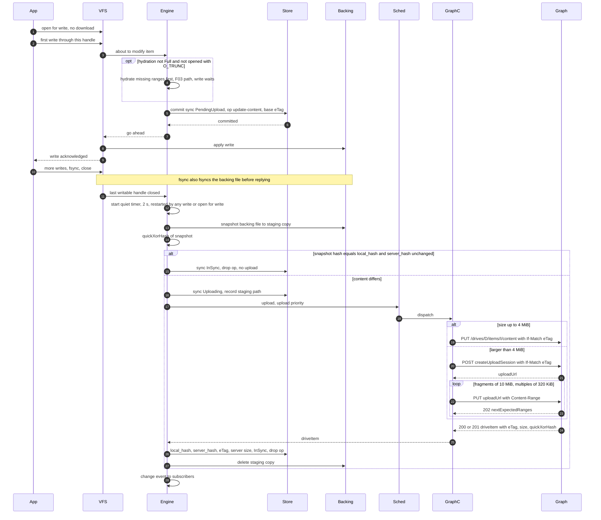
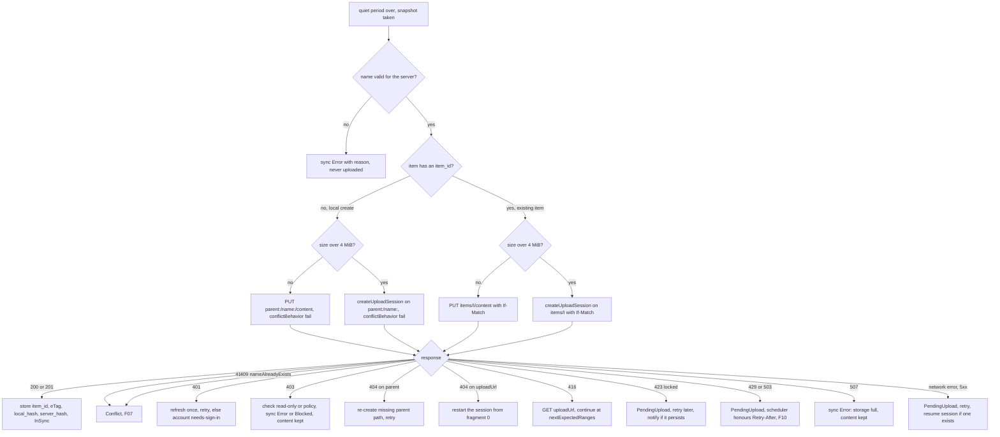

# F04 Local write and upload

**Purpose.** Takes a local change (write, create, mkdir, rename, move) through the durable dirty
mark, the backing file, the quiet period and the upload, ending with both hashes stored. Covers
simple and session uploads and save-via-rename. Deletes are F12; conflicts are F07.

## Preconditions

- The mount is `active` (or `paused`, in which case everything up to the upload happens and the
  upload waits) and is not read-only. In a read-only library the VFS refuses `write`, `create`,
  `mkdir`, `rename`, `unlink` and content-changing `setattr` with `EROFS` (ADR-0015 R5) and this
  flow does not start.
- For an existing item, the State store holds its eTag, `local_hash` and `server_hash`.

## Diagram: write, quiet period, upload

## Diagram: upload request choice and response handling

## Steps

1. Step 1: `open` never downloads (ADR-0005 R1), whatever its flags.
2. Steps 3 and 4: a partial write to a `Placeholder` or `Partial` file waits until the file is
   `Full`, or fails with `EIO` under F03's no-progress rule; it never writes into an unhydrated
   region (ADR-0005 R7, ADR-0012 R1). An open with `O_TRUNC` needs no download (ADR-0012 R2):
   the old extents are dropped and the file is `Full` and empty.
3. Steps 5 to 9, **durable dirty mark** (ADR-0012 R3): the engine commits sync = `PendingUpload`
   and the pending operation record (with the base eTag, the eTag the change is made against)
   **before** the first write, truncate or other modification through the handle is applied to the
   backing file. Only then is the write applied and acknowledged. A crash at any later point
   leaves an item that the recovery pass (F08) must not discard or overwrite. Later writes in the
   same dirty cycle need no further store commit.
4. Step 10 and the note: `fsync` on the file also fsyncs the backing file before replying (ADR-0012).
5. Steps 11 and 12: the upload starts only after the last writable handle has closed and the quiet
   period (default 2 s) has passed with no write or open-for-write (ADR-0012 R4). An editor that
   saves in several steps produces one upload. A file held open for writing is not uploaded until
   it is closed.
6. Step 13: the upload reads from a snapshot (a reflink copy where the backing filesystem supports
   it, otherwise a full copy in the backing directory), never from the live file, so a write during
   the upload cannot tear it. A write during the upload sends the item back to `PendingUpload` once
   the in-flight request ends; the finished upload still records its hashes and eTag as the new
   base.
7. Steps 14 and 15: if the content equals the last uploaded content (for example the user saved
   without changes) there is no upload.
8. Steps 19 to 23: up to 4 MiB uses a simple `PUT`; above 4 MiB an upload session (ADR-0012 R5,
   open-questions D5). Fragments are multiples of 327,680 bytes, default 10 MiB, under 60 MiB
   (ADR-0011 R12). Whether a `PUT` to `uploadUrl` carries `Authorization` is decided per session
   from the server's responses (ADR-0011). Every content upload of an existing item carries
   `If-Match` with the stored eTag (ADR-0012 R6). The upload session's `uploadUrl` is stored so a
   restart can resume it.
9. Step 26, **two hashes** (ADR-0012 R8): `local_hash` is the quickXorHash of the snapshot that was
   sent; `server_hash` is what the server reports. They can differ in SharePoint libraries, which
   rewrite some Office files after upload. The local bytes stay as they are; a later delta that
   reports `server_hash` leaves the item `InSync` with no download. On drives where no rewrite is
   expected (personal), a mismatch causes one re-upload and then `Error`.
10. Timestamps: the local mtime is sent in `fileSystemInfo` at whole-second precision (ADR-0011
    R5) as part of the upload request where the endpoint allows it.

### Create, mkdir, rename and move

11. `create` and `mkdir` refuse names that are not valid UTF-8 (overview "Rulings on details").
    Otherwise they commit a pending `create` record under a provisional local key (F13 new
    question 4) before the backing entry is created. Files are uploaded as above once their quiet
    period ends; folders are created with `POST /drives/D/items/P/children`, conflictBehavior
    `fail`. A `409` for a folder means a folder of that name already exists remotely: the engine
    adopts the remote folder's `item_id` and moves the local children under it (folders merge;
    files go through F07).
12. Names are validated before upload: reserved characters `" * : < > ? / \ |`, leading or
    trailing spaces, trailing period, reserved names, `~$` prefix, `_vti_`, `forms` at a library
    root, a case-insensitive collision with a sibling, and the 400-character server path. An
    invalid name is never uploaded; the item has sync `Error` with the reason and stays local until
    renamed (ADR-0015 R6).
13. `rename` and moves within one mount commit a `move` record, then rename in the backing
    directory, then send `PATCH /drives/D/items/I` with the new `name` and `parentReference` and
    `If-Match`. On `412` the engine fetches the item: if only its content or other metadata changed
    remotely it re-sends the `PATCH` with the new eTag; content conflicts are F07. Renames across
    mounts fail with `EXDEV` from the kernel.
14. Pending records not yet dispatched are coalesced per item within the quiet period: create then
    delete cancels out; create then several writes is one create; rename then rename is one move.

### Save via rename (ADR-0012 R9)

15. Editors often write a temporary file and rename it over the original. When `rename(T, D)`
    replaces an existing synced item `D` in the same mount:
    - `D` keeps its `item_id` and version history. Its pending record becomes `update-content`
      with `D`'s eTag as the base, and its content is the content that was `T`.
    - `T`'s pending `create` record is dropped, so `T` is never uploaded as an item of its own.
    - The upload follows the normal quiet period and `If-Match`, so a remote change to `D` in the
      meantime is a conflict (F07), not an overwrite.
16. The "rename away, write new, delete old" pattern (`D` renamed to `D~`, new `D` created and
    written, `D~` deleted, all within the quiet period) is coalesced the same way: the new content
    becomes an `update-content` of the original `item_id`, and nothing is deleted remotely.
17. If `T` had already been uploaded before the rename (its quiet period had passed), see Q8.

## Failure paths

| Failure | What the user sees | Resulting state |
|---|---|---|
| First write to a placeholder while offline | The write fails with an I/O error; nothing changed | Item unchanged; no `PendingUpload` |
| Hydration before a partial write makes no progress for 30 s | The write fails with an I/O error | No `PendingUpload` record if the write never applied |
| Store commit of the dirty mark fails (disk full) | The write fails with `ENOSPC` or `EIO` | Backing file untouched |
| Backing write fails after the mark (`ENOSPC`) | The write fails with `ENOSPC` | `PendingUpload` stays; the recovery check finds the content equal to `local_hash` and returns it to `InSync` |
| Invalid name | `mydrive status` shows `error` with "name not allowed by OneDrive: REASON" | sync `Error`; content kept locally |
| Non-UTF-8 name | `create` fails at once | Nothing created |
| `412` or `409` on create | Conflict notification (F07) | Two items afterwards |
| `403` in a library that turned read-only | Notification "LIBRARY is read-only; your change is kept at PATH" | sync `Error`, mount marked read-only; content kept |
| `423` (checked out or locked) | `syncing` for a while, then a notification | `PendingUpload`, retried |
| `507` storage full | Notification "OneDrive is full" | sync `Error`; content kept |
| Network lost during upload | `syncing` | `PendingUpload`; a session resumes from `nextExpectedRanges` |
| Daemon killed during upload | Nothing until restart | F08 resumes the upload (ADR-0012 R11) |
| Account `needs-sign-in` | `syncing`; tray asks to sign in | `PendingUpload` until signed in |

## Invariants

- No local byte differs from the server's version while the item is recorded as `InSync`
  (ADR-0012 R3).
- No write lands in an unhydrated region (ADR-0012 R1).
- No upload starts within the quiet period (ADR-0012 R4), and no upload reads the live backing
  file.
- Every content upload of an existing item carries `If-Match` (ADR-0012 R6); no upload uses
  conflictBehavior `replace`.
- After an upload both hashes are stored (ADR-0012 R8).
- Rename over an existing item keeps the target's `item_id` (ADR-0012 R9); the temporary file is
  never uploaded as its own item.
- An invalid name is never sent to the server (ADR-0015 R6).
- Local content with a pending record is never discarded by any failure in this flow.

## Open questions

Existing: Q8 (save-via-rename after the temporary file was already uploaded), D5 (4 MiB session
threshold).

New:

1. **Files held open for a long time** (databases, some editors) are never uploaded while open,
   because the upload waits for the last close. Windows uploads such files periodically. A
   maximum deferral, if any, needs a ruling in ADR-0012.
2. **Snapshot cost.** Without reflink support a snapshot is a full copy, doubling disk use for
   large files while they upload.
3. **`If-Match` on the simple `PUT /content`** is documented for `createUploadSession`, but the
   research did not confirm it for the simple upload. If it is not honoured, every existing-item
   upload must use a session.
4. **Transient local files.** Editor swap and lock files (`.swp`, `~` backups, LibreOffice
   `.~lock.*#`) that outlive the quiet period are uploaded or, if the name is invalid, show
   `error`. Windows skips some of these (`.tmp`). Whether to keep an ignore list is undecided.
5. **Concurrent renames.** When both sides renamed the same item, this flow lets the local rename
   win on retry. No data is lost either way, but the choice needs confirming.

## Related

- Journeys: J04, J05, J09, J10, J12.
- ADRs: 0005 (R1, R7), 0006, 0011 (R5, R12), 0012 (R1 to R6, R8, R9, R11), 0015 (R5, R6).
- Gates: G1 (hydration before a partial write).
- Flows: F03 (hydration before write), F07 (conflicts), F08 (offline and recovery), F10
  (scheduling), F12 (deletes), F13 (transitions).
