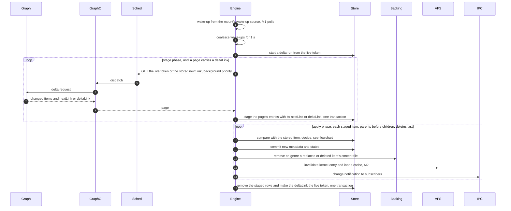
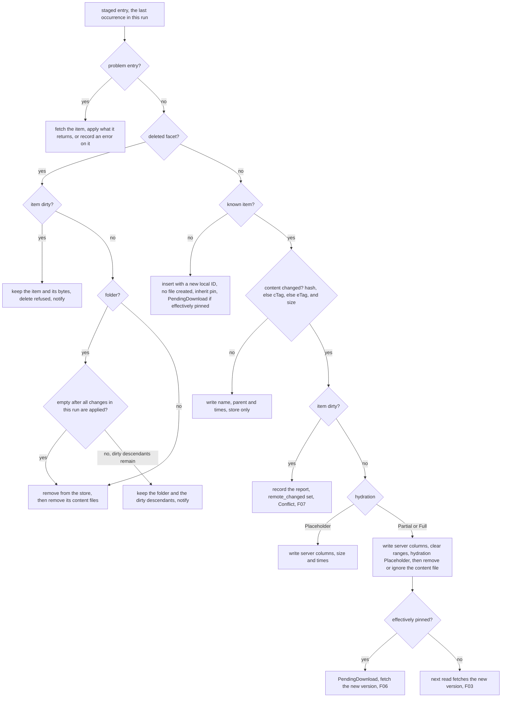

# F05 A change arrives from the server

**Purpose.** Turns a change made elsewhere into local state: the mount's wake-up source (in M1, a
poll) wakes the mount's worker, a delta run stages the changed items durably and applies them when
its delta link arrives (ADR-0022), and the engine applies metadata changes, content changes,
creates and deletes without ever overwriting a local change. Covers the `410 Gone` resync, which
is an ordinary run plus an anti-join.

## Preconditions

- The mount is `active` with a live delta token (F02).
- The account is `signed-in`.

## Diagram: wake-up and delta

## Diagram: applying one item

## Steps

1. Step 1, **wake-up source.** Each mount has one wake-up source; whatever it is, a wake-up only
   starts a delta run and never changes item state by itself (ADR-0011 R9). In M1 the wake-up
   source is polling: change notifications over the push protocol are deferred, because that
   protocol is undocumented and waits for observation on a real account (overview "Rulings on
   details").
2. Step 2: several wake-ups within 1 s cause one delta run.
3. Polling: the worker runs a delta every 5 minutes (slow polling, ADR-0011), and immediately after
   a reconnect (F08). If a push notification channel is added later, it becomes the wake-up source,
   polling falls back to the same interval while the channel is down, and a low-priority delta
   still runs every 30 minutes in case a notification is missed.
4. Steps 3 to 9, **stage phase** (ADR-0022). The run starts from the live token. Each page's
   entries are staged, keyed by mount and item ID, in the same transaction as the next link, or as
   the delta link on the last page (R1). A later entry for an item replaces the staged earlier
   one, so only the last occurrence is applied (ADR-0011 R2, ADR-0022 R2). No item row changes
   during this phase (R3). Delta with a token costs 1 resource unit (F10).
5. Steps 10 to 14, **apply phase**, once the delta link has been staged. Staged entries are applied
   parents before children and deletes last; applying an entry twice gives the same result as
   applying it once (R5). A problem entry from the Graph client is resolved by fetching the item,
   or recorded as an error on it; it is never applied as a best guess (R6).
6. Step 15: the staged rows are removed and the delta link becomes the live token in one
   transaction, only after a complete apply (R4). The live token never covers a change the store
   has not applied.
7. **Content-change detection** (step 10) follows the store's rule (store-schema "Remote
   metadata"): two reports name the same content when their sizes are equal and the hashes are
   equal if either side has one; else the cTags are equal if both have one; else the eTags are
   equal. A cTag is read only when there is no hash (overview "Rulings on details", which
   clarifies ADR-0011 R4). A change of kind always counts. An eTag change with the same content
   is a metadata-only change. A delta reporting the stored `server_hash` after our own upload
   leaves the item `InSync` (ADR-0012 R8). The engine never applies a page fetched before an
   upload completion after that completion has committed (store-schema "What the engine must
   do").
8. Store first, then disk (steps 11 and 12). A remote rename or move changes only the store; no
   file is renamed (ADR-0021). For a clean item whose content changed, the store writes the server
   columns, clears the ranges and sets hydration `Placeholder` in one savepoint; only then is the
   content file removed, or left in place and ignored, since the ranges say nothing in it is
   local. A crash between the two leaves at most an ignored content file, which F08's recovery
   scan tidies. Seeded thumbnails for the item are replaced.
9. Content change while handles are open (M2): open handles must not see a mix of two versions.
   How that combines with the store clearing the ranges in the same operation that records the
   new version is open (Q34, new question 3).
10. Content change, pinned: the ranges are cleared as for any clean item, sync becomes
    `PendingDownload`, and the new version is fetched and verified against the new quickXorHash
    (ADR-0008 R6, F06). With the store as built the old content is not kept readable while the new
    version downloads (new question 5).
11. Content change on a dirty item (`local_dirty`, whatever its sync value): never overwritten
    (ADR-0008 R7, ADR-0012 R11). The store writes parent and name, records the report as the last
    remote identity and sets `remote_changed` durably, but writes nothing describing content, so
    the stored eTag stays the base version's and the next upload fails with `412` even if the
    engine crashes first. It is a conflict, handled in F07 without waiting for that `412`.
12. Metadata change: renames and moves are applied by item ID, in the store only. If a local item
    already holds the new name in the target folder, the local item is the one that moves aside,
    using F07's conflict naming. The intended rule is that a pending local move wins and is sent
    on the next upload pass; until the store records local moves as pending (Q28), the server's
    name and parent are written over a local rename that has not reached the server.
13. Remote delete (`deleted` facet; business delta may omit the name): applied only to an item
    that is not dirty, with `delete_item` and its refusals, and then the item's content file is
    removed. A dirty item is never removed by a remote delete: the store refuses it. The intended
    handling keeps the local bytes and re-creates the item on the server as a new item at the
    same path, telling the user; the store has no operation for that yet ("remote deleted while
    locally modified", Q28), so until it exists the item stays dirty, its delete is refused, and
    the user is told. Folders are removed only if empty once every change in the run has been
    applied (Graph's guidance); dirty descendants keep the folder (Q31 for folders whose contents
    are not reported). A deleted file that is open stays readable through its open handles for
    ranges already local.
14. Step 13 (M2): the VFS sends FUSE inode and entry invalidations so the kernel drops cached
    pages and directory entries; otherwise apps could read the old version from the page cache.
15. **Crash and resume.** A run interrupted in the stage phase resumes from the stored next link,
    or restarts from the live token if that link is refused. A run interrupted in the apply phase
    is applied again from the staged set. Either way the live token has not moved, so no change
    is lost and none is applied from a superseded occurrence.

### `410 Gone` resync

16. A delta request that returns `410 Gone` carries a code, `resyncChangesApplyDifferences` or
    `resyncChangesUploadDifferences`, and usually a fresh link in `Location`; the Graph client
    passes the link on only when it is on its own Graph origin, and otherwise enumeration restarts
    from the drive root. The mount becomes `resyncing`; other mounts are unaffected
    (ADR-0007 R3).
17. The resync is an ordinary delta run (ADR-0022), recorded as a resync so a restart repeats it
    in full. It stages the whole set from the new link, and in its apply phase:
    - Staged items are applied with the rules above: content changes with steps 8 to 11.
    - **Anti-join:** items in the store that the staged set does not contain are remote deletes,
      applied with the rules of step 13; a dirty item is never removed.
    - Local items with local changes are uploaded afterwards (`UploadDifferences` says so
      explicitly; with `ApplyDifferences` they are uploaded too, because local changes are never
      discarded).
    - Where local and server content differ and neither is known to be newer (a file that is
      `Full`, not dirty, but whose local hash no longer matches `local_hash`), both copies are
      kept using F07's conflict naming (ADR-0011 R3).
18. When the apply, including the anti-join, completes, the staged rows are removed and the new
    delta link becomes live in one transaction, and the mount returns to `active`. Reads and
    writes keep working during the resync.

## Failure paths

| Failure | What the user sees | Resulting state |
|---|---|---|
| A poll fails (network) | Nothing | Live token unchanged; retried at the next poll or on reconnect (F08) |
| Delta page fails mid-run | Nothing | Run stays in its stage phase; resumes from the stored next link |
| Daemon crash during a run | Nothing until restart | Stage phase resumes; apply phase is applied again from the staged set (F08) |
| `410 Gone` | `mydrive status` shows the mount `resyncing` | Resync as above |
| `401` and refresh fails | Notification "Sign in again" | Account `needs-sign-in`; no delta until signed in |
| `403` matching organisation policy | Notification about policy | Mount `blocked` (F09); depends on G2 (Q13) |
| Remote delete of an item with local changes | Notification "FILE was deleted elsewhere; your changed copy was kept" | Item stays dirty and its delete is refused; re-creating it on the server waits for the store operation (step 13) |
| Remote change to an item with local changes | Conflict notification | F07 |
| Pinned re-download fails | `syncing`, then `error` if it persists | Item `Placeholder`; sync `Error` (step 10) |
| Disk full during a pinned re-download | Notification "disk full" | Item `Placeholder`; sync `Error` |
| Remote rename collides with a local name | Notification naming the renamed local file | Local item renamed with conflict naming |

## Invariants

- A wake-up never changes item state by itself (ADR-0011 R9).
- A remote change never overwrites, truncates or dehydrates a dirty item (ADR-0008 R7,
  ADR-0012 R11).
- A remote delete never removes local content that has not reached the server.
- A folder is never removed locally while it still has dirty descendants after the whole run is
  applied.
- A reader never sees bytes of two versions in one file.
- No item row changes during a run's stage phase, and the live delta token changes only in the
  transaction that removes a completely applied staged set (ADR-0022 R3, R4).
- A remote rename or move never renames a file in the backing directory (ADR-0021).
- `410 Gone` on one mount never stalls another (ADR-0007 R3).

## Open questions

Existing: Q28 (local moves not recorded as pending; no "remote deleted while locally modified"
operation), Q31 (folder deletes that do not report their contents), Q34 (gate G3; see new questions
3 and 6).

New:

1. **Remote mass deletes.** The mass-delete guard (F12) covers local deletes. Whether a delta or
   resync that removes many hydrated or pinned items should also pause and ask is undecided (J05
   asks the same). Removing them loses no data, since the server holds them in its recycle bin.
2. **Polling intervals** (5 minutes, and 30 minutes as a safety poll once push notifications
   exist) are proposals; ADR-0011 says only "slow polling".
3. **Remote change to an open file (Q34, G3 pitfall 9).** A clean file open for reading when its
   content is replaced: G3 suggests deferring the replacement to the last close, as the Windows
   client does. The store as built clears the ranges in the same operation that records the new
   version, so deferring needs either a store operation or a VFS rule. Decide in the ADR-0005
   amendment, or in ADR-0012, before M2. A maximum deferral may be needed.
4. **Push notifications.** Deferred by the overview ruling; M1 polls. Their lifetime, reconnection
   and whether they arrive per mount are undocumented, to be observed on a real account (Q36)
   before a notification wake-up source is designed.
5. **Keeping a pinned file readable during its re-download.** The previous design downloaded the
   new version beside the old one and swapped it in, so a pinned file stayed readable offline
   throughout. The store as built clears the ranges when the new version is recorded, and has no
   operation that records a new version while keeping the old content until the new one is in
   place.
6. **File managers learn of daemon-side changes (Q34, G3 pitfall 2).** Changes the engine makes
   behind the mount (remote updates, hydration, frees) produce no inotify events on the FUSE
   mount. Adapters have the change stream (F11); for plain file managers the ADR-0005 amendment
   must state a mechanism, or an accepted limitation with a test, before M2.

## Related

- Journeys: J08, J09, J10, J16.
- ADRs: 0007 (R3), 0008 (R6, R7), 0011 (R2 to R5, R9), 0012 (R8, R11), 0021, 0022 (R1 to R6).
- Gates: G2 (policy errors in delta, shortcut stubs), G3 (pitfalls 2 and 9).
- Flows: F02 (the same run model for the first enumeration), F03 (re-hydration after
  invalidation), F06 (pinned re-download), F07 (conflicts), F08 (missed changes while offline,
  resuming a run), F10 (cost of delta), F12 (deletes), F13.
