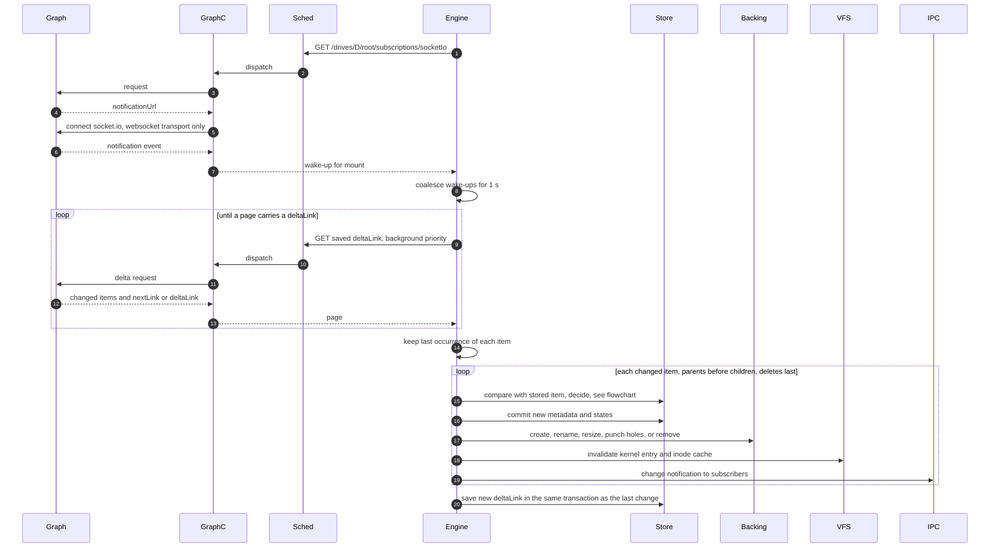
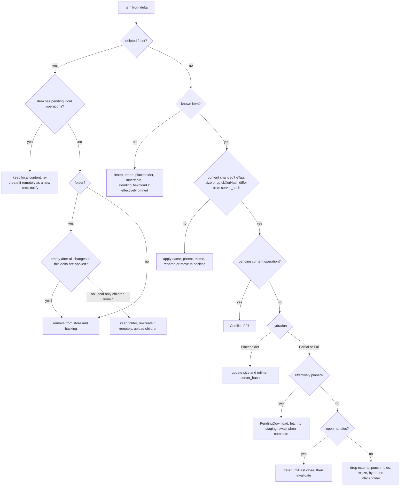

# F05 A change arrives from the server

**Purpose.** Turns a change made elsewhere into local state: a socket.io notification (or a slow
poll) wakes the mount's worker, delta returns the changed items, and the engine applies metadata
changes, content changes, creates and deletes without ever overwriting a local change. Covers the
`410 Gone` resync.

## Preconditions

- The mount is `active` with a live delta token (F02).
- The account is `signed-in`.

## Diagram: wake-up and delta

## Diagram: applying one item

## Steps

1. Steps 1 to 5: each mount obtains its own socket.io endpoint and connects with the websocket
   transport (the polling transport is not supported). A notification is only a wake-up; it never
   changes item state by itself (ADR-0011 R9).
2. Step 8: several notifications within 1 s cause one delta call.
3. Fallback: while the socket is down the worker polls delta every 5 minutes (slow polling,
   ADR-0011), and tries to reconnect the socket with backoff, fetching a new endpoint if the old
   one is refused. A low-priority delta also runs every 30 minutes while the socket is up, in case
   a notification is missed.
4. Steps 9 to 13: delta with a token costs 1 resource unit (F10). Pages accumulate before
   anything is applied, because one item can appear several times and only its last occurrence
   counts (ADR-0011 R2).
5. Step 15, content change detection uses eTag, size and quickXorHash, never cTag
   (ADR-0011 R4). An eTag change with the same quickXorHash and size is a metadata-only change.
   A delta reporting the stored `server_hash` after our own upload leaves the item `InSync`
   (ADR-0012 R8).
6. Step 16 then step 17: the store is committed first, then the backing directory is changed, so a
   crash between the two is repaired from the store by F08's recovery scan.
7. Content change, not locally modified, not pinned: the local content is invalidated (holes
   punched, extents dropped, `st_size` set to the new cloud size), and the next read fetches the new
   version (F03). Seeded thumbnails for the item are replaced.
8. Content change while handles are open: open handles keep reading the old, consistent content;
   the invalidation runs at the last close. New opens before then see the old content too. This
   avoids handing a reader a mix of two versions.
9. Content change, pinned: the new version is downloaded into a staging file in the backing
   directory, verified against the new quickXorHash, then renamed over the old backing file, so
   the item stays readable offline throughout (ADR-0008 R6). Sync is `PendingDownload` meanwhile.
10. Content change with a pending local content operation (`PendingUpload` or `Uploading`): never
    overwritten (ADR-0008 R7, ADR-0012 R11); it is a conflict, handled in F07 without waiting for
    the upload's `412`.
11. Metadata change: renames and moves are applied by item ID. If a local item already holds the
    new name in the target folder, the local item is the one that moves aside, using F07's
    conflict naming. If the item has a pending local `move`, the local move wins and is sent on
    the next upload pass.
12. Remote delete (`deleted` facet; business delta may omit the name): applied only if the item
    has no pending local operation. A deleted file with local changes is kept and uploaded as a new
    item at the same path, and the user is told. Folders are removed only if empty once every
    change in the delta has been applied (Graph's guidance); local-only children keep the folder,
    which is re-created remotely. A deleted file that is open stays readable through its open
    handles for ranges already local.
13. Step 18: the VFS sends FUSE inode and entry invalidations so the kernel drops cached pages and
    directory entries; otherwise apps could read the old version from the page cache.
14. Step 20: the new deltaLink is committed in the same transaction as the last applied change, so
    a crash re-applies at most the last batch, which is idempotent.

### `410 Gone` resync

15. A delta request that returns `410 Gone` carries a fresh `nextLink` in `Location` and a code,
    `resyncChangesApplyDifferences` or `resyncChangesUploadDifferences`. The mount state becomes
    `resyncing`; other mounts are unaffected (ADR-0007 R3).
16. The engine enumerates from the new link into a fresh set, then reconciles against the store:
    - Items in the store but not in the set are remote deletes, applied with the rules of step 12.
    - Items whose content differs are remote content changes, applied with steps 7 to 10.
    - Local items with pending operations are uploaded afterwards (`UploadDifferences` says so
      explicitly; with `ApplyDifferences` they are uploaded too, because local changes are never
      discarded).
    - Where local and server content differ and neither is known to be newer (a file that is
      `Full`, has no pending record, but whose local hash no longer matches `local_hash`), both
      copies are kept using F07's conflict naming (ADR-0011 R3).
17. When reconciliation completes, the new deltaLink becomes live and the mount returns to
    `active`. Reads and writes keep working during the resync.

## Failure paths

| Failure | What the user sees | Resulting state |
|---|---|---|
| Socket cannot connect or drops | Nothing; changes arrive within the polling interval | Slow polling; reconnect attempts |
| Delta request fails (network) | Nothing | Token unchanged; retried on the next wake-up or poll |
| `410 Gone` | `mydrive status` shows the mount `resyncing` | Resync as above |
| `401` and refresh fails | Notification "Sign in again" | Account `needs-sign-in`; no delta until signed in |
| `403` matching organisation policy | Notification about policy | Mount `blocked` (F09); depends on G2 (Q13) |
| Remote delete of an item with local changes | Notification "FILE was deleted elsewhere; your changed copy was kept and uploaded" | Item re-created remotely, new `item_id` |
| Remote change to an item with local changes | Conflict notification | F07 |
| Pinned re-download fails | `syncing`, then `error` if it persists | Old content stays in place; sync `Error` |
| Disk full during a pinned re-download | Notification "disk full" | Old content stays; sync `Error` |
| Remote rename collides with a local name | Notification naming the renamed local file | Local item renamed with conflict naming |

## Invariants

- A notification never changes item state by itself (ADR-0011 R9).
- A remote change never overwrites, truncates or dehydrates an item with a pending local operation
  (ADR-0008 R7, ADR-0012 R11).
- A remote delete never removes local content that has not reached the server.
- A folder is never removed locally while it still has children after the whole delta is applied.
- A reader never sees bytes of two versions in one file.
- The delta token advances only together with the changes it covers.
- `410 Gone` on one mount never stalls another (ADR-0007 R3).

## Open questions

New:

1. **Remote mass deletes.** The mass-delete guard (F12) covers local deletes. Whether a delta or
   resync that removes many hydrated or pinned items should also pause and ask is undecided (J05
   asks the same). Removing them loses no data, since the server holds them in its recycle bin.
2. **Polling intervals** (5 minutes fallback, 30 minutes safety poll) are proposals; ADR-0011 says
   only "slow polling".
3. **Deferring invalidation until last close** means a long-running reader keeps the old version
   indefinitely. A maximum deferral may be needed.
4. **Socket.io notification lifetime and reconnection** are undocumented (research gap); the
   reconnect behaviour above is a guess to be checked against the Graph simulator and a live
   account.

## Related

- Journeys: J08, J09, J10, J16.
- ADRs: 0007 (R3), 0008 (R6, R7), 0011 (R2 to R5, R9), 0012 (R8, R11).
- Gates: G2 (policy errors in delta, shortcut stubs).
- Flows: F03 (re-hydration after invalidation), F07 (conflicts), F08 (missed changes while
  offline), F10 (cost of delta), F12 (deletes), F13.
