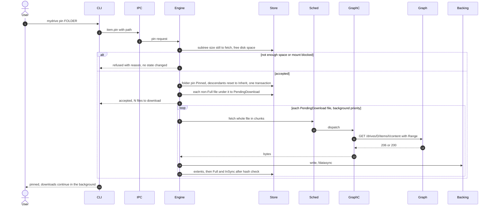
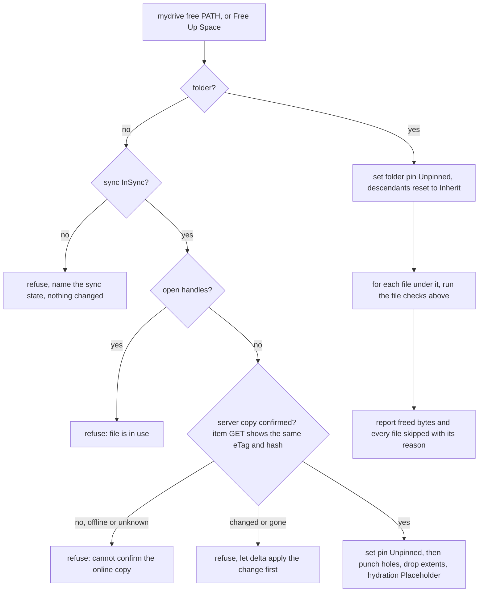

# F06 Pin, unpin and free up space

**Purpose.** Defines "Always keep on this device" (pin), unpin, and "Free up space" (dehydrate) for
files and folders: how a folder's pin is inherited, how pinned content is fetched and kept, and
when a request is refused.

## Preconditions

- The path is under a mount point of an `active` or `paused` mount.
- The request comes from `mydrive pin|unpin|free|hydrate`, an adapter (`item.pin`, `item.unpin`,
  `item.dehydrate`, `item.hydrate` over IPC, ADR-0009), or `setxattr` on `user.mydrive.pin`, which
  queues a pin request (ADR-0006 R7).

## Diagram: pin a folder

## Diagram: free up space

## Steps

1. **Pin a file**: pin becomes `Pinned`. If hydration is not `Full`, sync becomes
   `PendingDownload` and the engine schedules a whole-file fetch at background priority
   (ADR-0008 R6). Pinned files are fetched in chunks through the F03 fetch path but are exempt
   from the deny list and the breaker (ADR-0013 R6).
2. **Pin a folder** (steps 6 and 7): the folder's pin becomes `Pinned` and every descendant's
   explicit pin is reset to `Inherit`, so the whole subtree follows the folder, as on Windows.
   Effective pin is computed by ADR-0008 R4. New items that delta later adds under the folder
   inherit the pin and go to `PendingDownload` when they arrive (F05).
3. Step 4: before accepting, the engine compares the bytes still to fetch with free space on the
   backing filesystem, keeping a reserve. If they do not fit, the request is refused and nothing
   changes.
4. Steps 9 to 15: downloads run at background priority, below interactive reads (F10). Each
   file becomes `Full` and `InSync` only after its quickXorHash matches.
5. Display: a pinned file not yet `Full` shows `syncing`; once `Full` it shows `pinned` (F13).
6. **Unpin** (`mydrive unpin`): the item's pin returns to `Inherit`. Nothing is dehydrated:
   `Unpinned` and `Inherit` mean "may be dehydrated", not "dehydrate now" (overview). The display
   changes from `pinned` to `local` (or stays `pinned` if an ancestor is pinned). Pending downloads
   that are no longer effectively pinned are cancelled.
7. **Hydrate** (`mydrive hydrate`): like a pin without changing the pin: `PendingDownload`, fetch,
   `Full`. Not subject to the breaker.
8. **Free up space on a pinned item** (overview "Rulings on details"): the engine itself never
   dehydrates an item whose effective pin is `Pinned` (ADR-0008 R5). The user action is an
   explicit request, so it first sets the item's pin to `Unpinned` and then dehydrates, as Windows
   does. On a file inside a pinned folder this sets the file's own pin to `Unpinned`, which
   overrides the inherited `Pinned`.
9. **Free up space refusals**: anything not `InSync` is refused with the reason and no state
   change (ADR-0008 R5, R7), including `PendingUpload`, `Uploading`, `Conflict`, `Error`,
   `PendingDownload` and `Blocked`. A file with open handles is refused, since its readers or
   mmaps would lose their content. The refusal happens before the pin is changed, so a refused
   request changes nothing.
10. **Confirming the online copy**: before dehydrating, the engine fetches the item's metadata
    (one request, 1 resource unit) and requires the same eTag and quickXorHash as `server_hash`.
    This guards against freeing the last copy of a file that was deleted or changed remotely since
    the last delta. Offline, free is refused. For a folder the check is batched per folder.
11. Dehydration punches holes over the whole file (`fallocate` with `FALLOC_FL_PUNCH_HOLE`, or
    truncate and re-extend where punching is unsupported), deletes the extents, and sets hydration
    `Placeholder`. `st_size` stays the cloud size; `st_blocks` drops (ADR-0005 R8). The VFS
    invalidates the kernel's cached pages for the file.
12. **Free a folder**: the folder's pin becomes `Unpinned`, descendants are reset to `Inherit`, and
    each file is checked as above. Files that cannot be freed are skipped and listed; the rest are
    freed. The command reports bytes freed and every skipped file with its reason.

## Failure paths

| Failure | What the user sees | Resulting state |
|---|---|---|
| Not enough free space to pin | "Not enough space: need N, have M" | Nothing changed |
| Pin while offline | Accepted; files show `syncing` | `PendingDownload`; downloads start on reconnect (J06) |
| Pin in a `blocked` mount | Refused, naming organisation policy | Nothing changed |
| Download refused (`403`) for a pinned file | `error` on that file; `mydrive activity` gives the reason | sync `Error`; pin kept; retried later |
| Disk fills during pinned downloads | Notification "disk full; N files not downloaded" | Remaining files stay `PendingDownload` |
| Free on a file not `InSync` | "Not freed: FILE has changes not yet uploaded" (or the actual state) | Nothing changed |
| Free on a file in use | "Not freed: FILE is open in PROCESS" where known | Nothing changed |
| Free while offline | "Not freed: cannot confirm the online copy while offline" | Nothing changed |
| Free when the server copy changed or vanished | "Not freed: FILE changed online; try again after sync" | Nothing changed; delta applies the change |
| `setxattr` with an invalid pin value | `setxattr` fails with `EINVAL` | Nothing changed; other `user.mydrive.*` names fail with `EPERM` (ADR-0006 R7) |
| Path outside any mount | Error from the CLI | Nothing changed |

## Invariants

- The engine never dehydrates an item whose effective pin is `Pinned`; only the explicit user
  action, after setting `Unpinned`, does (ADR-0008 R5).
- A file with sync other than `InSync` is never dehydrated (ADR-0008 R5, R7).
- A file is never dehydrated while it has open handles.
- A file is never dehydrated unless the server's copy has just been confirmed to match.
- A refused request changes no state.
- Unpin never dehydrates.
- A pinned file that loses content is re-hydrated (ADR-0008 R6).

## Open questions

New:

1. **Folder pin and free override descendants.** This flow resets every descendant's explicit pin
   to `Inherit` when a folder is pinned or freed, as Windows does. The alternative (keep explicit
   descendant pins) would leave a "pinned" folder with online-only files inside it.
2. **Confirming the online copy before freeing** (step 10) is stricter than ADR-0008 and costs one
   request per file; it is a principle-1 reading, since a stale delta could otherwise free the last
   copy of a file deleted remotely.
3. **Refusing free on open files** is not in ADR-0008; it protects mmaps and readers in progress.
4. **Free-space reserve** for pinning is unspecified (size, and whether it is a percentage).

## Related

- Journeys: J06, J07, J09, J17.
- ADRs: 0005 (R8), 0006 (R7), 0008 (R4 to R7), 0009, 0013 (R6).
- Gates: G1 (pinned downloads use ranged chunks; whole-file requests if G1 fails).
- Flows: F03 (fetch path), F05 (new items under a pinned folder), F10 (priority), F11 (adapter
  actions), F13.
