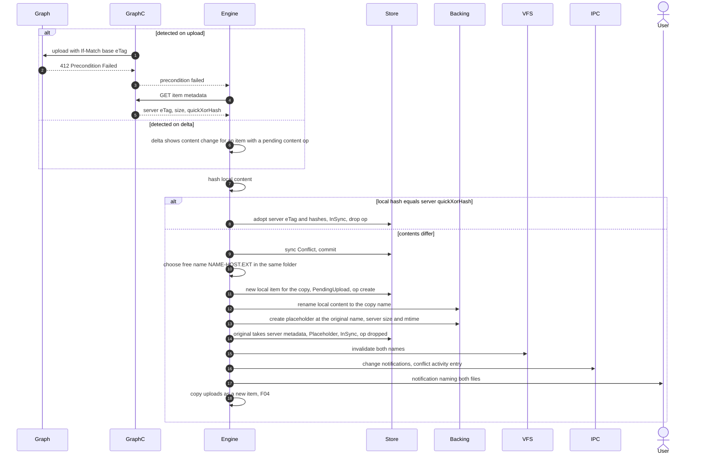

# F07 Conflict

**Purpose.** Handles a file changed both locally and on the server since the last sync, detected
either by a `412` on upload or by delta, so that afterwards both versions exist: the server version
under the original name and the local version as `<name>-<hostname>.<ext>`, uploaded as a new item.
Neither version is ever discarded (ADR-0012).

## Preconditions

- The item has a pending content operation (sync `PendingUpload` or `Uploading`) with a base eTag.
- The server holds a different version: its eTag differs from the base and its quickXorHash
  differs from the local content's hash.

## Diagram

## Steps

1. Steps 1 to 5: a `412` alone does not prove a content conflict (the eTag also changes on
   rename or metadata edits). The engine fetches the item to compare content.
2. Step 6: delta detection happens when the remote change arrives before or during the upload
   (F05 step 10); the engine does not wait for a `412`.
3. Steps 7 and 8: if the local content already equals the server's (both sides made the same
   change, or a crash lost the response to our own upload) there is no conflict. With SharePoint's
   post-upload rewriting a lost response can still look like a conflict; that produces a harmless
   extra copy, never a loss.
4. If the server change was metadata only (same quickXorHash and size as `server_hash`), the
   upload is simply retried with the new eTag (F04); this is not a conflict.
5. Steps 9 to 15, the split. Every step is committed to the store before the matching backing
   change, so a crash in the middle is finished by F08's recovery pass:
   - Sync becomes `Conflict` on detection and stays until the split completes (Q7).
   - The copy's name is `<name>-<hostname>.<ext>`, splitting at the last dot; with no extension,
     `<name>-<hostname>`. `<hostname>` is the short host name.
   - The copy is a new local item with the local bytes; it inherits the original's explicit pin.
     The rename inside the backing directory keeps the inode, so an editor that still has the
     file open keeps writing into the copy, which is the user's version.
   - The original name becomes a placeholder for the server version. If the original is
     effectively pinned it goes to `PendingDownload` instead and is fetched (F06).
   - The original leaves `Conflict` for `InSync` once the copy exists; the copy then follows F04
     (`PendingUpload` to `InSync`).
6. Steps 16 to 18: the conflict is recorded in `mydrive activity` with both paths and the time,
   and a desktop notification says: "FILE was changed here and elsewhere. Your version was saved as
   COPY." The entry stays until the user dismisses it.
7. **Name conflicts on create.** A local create whose upload gets `409 nameAlreadyExists` (another
   device created the same name, including names differing only by case) is handled the same way:
   the server item takes the original name and the local file becomes the copy. Folders merge
   instead (F04 step 11).

### Other both-sides cases

| Local | Remote | Outcome | Flow |
|---|---|---|---|
| Content changed | Content changed | Split as above | F07 |
| Content changed | Deleted | Local kept and uploaded as a new item at the same path | F05 |
| Deleted | Content changed | Delete refused by `If-Match`; server version restored locally as a placeholder; user told | F12 |
| Renamed | Content changed | No conflict: rename and new content both apply | F04, F05 |
| Renamed | Renamed | Local rename re-sent with the new eTag | F04 |
| Created | Created with the same name | Server keeps the name; local becomes the copy | F07 |

## Failure paths

| Failure | What the user sees | Resulting state |
|---|---|---|
| Copy name already taken | Copy saved as `<name>-<hostname>-2.<ext>` (next free number) | Normal split |
| Copy name invalid on the server (for example the host name holds a reserved character) | Copy saved locally with the invalid characters replaced | Normal split; see Q7 |
| Mount read-only (library became read-only) | Notification: your version is kept locally at COPY but cannot be uploaded | Copy sync `Error`, content kept |
| Disk full during the split | Notification | Original stays `Conflict` with the local bytes untouched; retried |
| Crash during the split | Nothing until restart | F08 completes the split from the store |
| Upload of the copy fails | `error` on the copy | Copy sync `Error`; content kept |

## Invariants

- After a conflict both versions exist: the server's under the original name, the local one as
  the copy (ADR-0012 R7).
- The local bytes are never deleted, truncated or overwritten during the split; they are renamed.
- No upload in this flow uses conflictBehavior `replace` or omits `If-Match` on an existing item.
- Identical contents never produce a conflict copy.
- The original name always ends up holding the server version, never an empty or zero-filled file.

## Open questions

Existing: Q7 (existing or invalid copy names; when `Conflict` is set and cleared). This flow
proposes: next free number for a taken name, invalid characters replaced, `Conflict` set on
detection and cleared when the split completes.

New:

1. **Pin of the copy.** This flow copies the original's explicit pin to the copy; the alternative
   is `Inherit`.
2. **Acknowledging conflicts.** With the split automatic, `Conflict` is visible only briefly and
   the lasting signal is the activity entry and notification. Whether the copy should keep showing
   `error` until dismissed cannot be expressed on a single-valued sync axis (F13).

## Related

- Journeys: J04, J09, J10.
- ADRs: 0008 (R7), 0011 (R3, R4), 0012 (R6, R7).
- Gates: none.
- Flows: F04 (upload and retry), F05 (delta detection), F08 (crash during split), F12 (local
  delete against remote change), F13.
