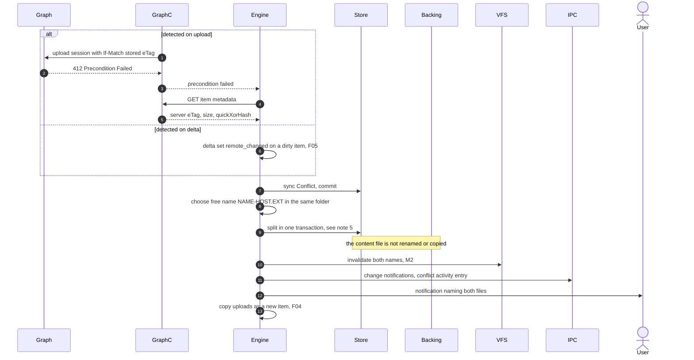

# F07 Conflict

**Purpose.** Handles a file changed both locally and on the server since the last sync, detected
either by a `412` on upload or by delta, so that afterwards both versions exist: the server version
under the original name and the local version as `<name>-<hostname>.<ext>`, uploaded as a new item.
Neither version is ever discarded (ADR-0012). The split is one store transaction; no file is
renamed (ADR-0021).

## Preconditions

- The item is dirty (`local_dirty`; sync `PendingUpload` or `Uploading`), and its stored eTag is
  that of the version the local change was based on.
- The server holds a different version: an upload with `If-Match` on that eTag was refused, or a
  delta reported different content and the store set `remote_changed` (F05 step 11).

## Diagram

## Steps

1. Steps 1 to 5: a `412` alone does not prove a content conflict (the eTag also changes on
   rename or metadata edits). The engine fetches the item's current metadata, which the split
   needs in any case.
2. Step 6: delta detection happens when the remote change arrives before or during the upload
   (F05 step 11); the engine does not wait for a `412`. The store has already set
   `remote_changed` durably, so the conflict survives a restart.
3. **Same content on both sides.** If the local content already equals the server's (both sides
   made the same change, or a crash lost the response to our own upload), there is no real
   conflict. The store as built has no operation that adopts the server version while keeping
   equal local bytes, and `discard_local_changes` takes no generation, so a write landing after
   the hash check would be lost if it were used here. Until such an operation exists the item
   takes the split path, which produces a copy whose content equals the server's: an extra file,
   never a loss (new question 3). With SharePoint's post-upload rewriting a lost response looks
   like a conflict anyway; that too produces a harmless extra copy.
4. **Metadata-only server changes.** The engine sends `If-Match` with the stored eTag, which on a
   dirty item is the base version's (store-schema "What the engine must do", ADR-0012 R6). A remote
   rename or metadata edit changes the server's eTag, so the upload meets `412` and the split
   happens even though the content did not change. That is safe, not lossy (store-schema "Remote
   metadata"). Retrying with the newer eTag instead would need a change to the `If-Match` rule
   (new question 4).
5. Steps 7 to 9, **the split.**
   - Sync becomes `Conflict` on detection and stays until the split completes (Q7).
   - The copy's name is `<name>-<hostname>.<ext>`, splitting at the last dot; with no extension,
     `<name>-<hostname>`. `<hostname>` is the short host name. Characters the server forbids are
     replaced with `_`; a host name with no usable characters becomes `device`; a taken name gets
     `-2`, `-3` (overview "Rulings on details").
   - The split is **one store transaction** that points the content at the copy's row (ADR-0021):
     the copy is a new provisional item, dirty and `PendingUpload`, holding the local bytes, and it
     inherits the original's explicit pin; the original takes the server's current metadata as a
     clean placeholder, `InSync`, with no local content. No file in the backing directory is
     renamed or copied, so there is no window in which the user's bytes sit under a name the
     store does not expect. A crash leaves the store before or after the split, never between.
   - In M2, an editor that still has the file open keeps writing into the content, which now
     belongs to the copy, the user's version.
   - If the original is effectively pinned it goes to `PendingDownload` and is fetched (F06).
   - The copy then follows F04 (`PendingUpload` to `InSync`).
   - The store as built has no split operation (new question 1).
6. Steps 11 and 12: the conflict is recorded in `mydrive activity` with both paths and the time,
   and a desktop notification says: "FILE was changed here and elsewhere. Your version was saved as
   COPY." The entry stays until the user dismisses it.
7. **Name conflicts on create.** A local create whose upload gets `409 nameAlreadyExists` (another
   device created the same name, including names differing only by case) is handled the same way:
   the server item takes the original name and the local file becomes the copy. Folders merge
   instead (F04 step 11).

### Other both-sides cases

| Local | Remote | Outcome | Flow |
|---|---|---|---|
| Content changed | Content changed | Split as above | F07 |
| Content changed | Deleted | Intended: local kept and uploaded as a new item at the same path. Until the store has the operation, the item stays dirty, its delete is refused, and the user is told | F05 |
| Deleted (M2) | Content changed | Delete refused by `If-Match`; server version restored locally as a placeholder; user told | F12 |
| Renamed | Content changed | No conflict: rename and new content both apply | F04, F05 |
| Renamed | Renamed | Intended: local rename re-sent with the new eTag. Until local moves are recorded as pending (Q28), the server's rename overwrites the local one | F04 |
| Content changed | Renamed or metadata edited | Split, because the upload's `If-Match` carries the base eTag (step 4) | F07 |
| Created | Created with the same name | Server keeps the name; local becomes the copy | F07 |

## Failure paths

| Failure | What the user sees | Resulting state |
|---|---|---|
| Copy name already taken | Copy saved as `<name>-<hostname>-2.<ext>` (next free number) | Normal split |
| Copy name invalid on the server (for example the host name holds a reserved character) | Copy saved with each forbidden character replaced by `_` | Normal split |
| Mount read-only (library became read-only) | Notification: your version is kept locally at COPY but cannot be uploaded | Copy sync `Error`, content kept |
| Fetching the server's metadata fails | Nothing yet | Original stays `Conflict` and dirty with the local bytes untouched; retried |
| Crash during the split | Nothing until restart | The split either committed or did not; if not, the original is still dirty with `remote_changed` set and the split is retried |
| Upload of the copy fails | `error` on the copy | Copy sync `Error`; content kept |

## Invariants

- After a conflict both versions exist: the server's under the original name, the local one as
  the copy (ADR-0012 R7).
- The local bytes are never deleted, truncated, overwritten or renamed during the split; the store
  points them at the copy in one transaction (ADR-0021).
- At every moment the user's bytes belong to at least one dirty row.
- No upload in this flow uses conflictBehavior `replace` or omits `If-Match` on an existing item.
- A conflict copy whose content equals the server's is possible only through steps 3 and 4, and
  never loses data.
- The original name always ends up holding the server version, never an empty or zero-filled file.

## Open questions

Existing: Q7 (existing or invalid copy names; when `Conflict` is set and cleared). The naming part
is answered by the overview ruling "Conflict copy names" (step 5). This flow proposes, for the
rest, `Conflict` set on detection and cleared when the split completes. Q28 (local moves and
"remote deleted while locally modified").

New:

1. **The split operation and the local ID.** ADR-0021 makes the split one store transaction that
   points the content at the copy's row. The store as built has no such operation; its "What the
   engine must do" section instead prescribes copying the bytes into the backing directory,
   inserting the copy as a provisional item, then discarding the original, which ADR-0021
   replaces. Also, the content path is a pure function of the mount and the local ID, and a row's
   local ID never changes (ADR-0021 R1, R2), so how the content follows the copy's row, for
   example whether the copy takes over the original's local ID and the original receives a new
   one, is not stated.
2. **Pin of the copy.** This flow copies the original's explicit pin to the copy; the alternative
   is `Inherit`.
3. **Equal content without a copy.** Step 3 needs a store operation that, for a given generation,
   adopts the server's current metadata for an item whose local bytes equal it and clears the
   dirty mark, keeping the bytes. F04 and F08 need the same operation.
4. **`If-Match` after a remote rename.** Sending the last reported eTag when the server reported
   no content change (`remote_changed` not set) would avoid the extra copy of step 4, but it is a
   change to the rule in the store schema's "What the engine must do" and ADR-0012 R6; the lead
   decides.
5. **Acknowledging conflicts.** With the split automatic, `Conflict` is visible only briefly and
   the lasting signal is the activity entry and notification. Whether the copy should keep showing
   `error` until dismissed cannot be expressed on a single-valued sync axis (F13).

## Related

- Journeys: J04, J09, J10.
- ADRs: 0008 (R7), 0011 (R3, R4), 0012 (R6, R7), 0021 (R1, R2).
- Gates: none.
- Flows: F04 (upload and retry), F05 (delta detection), F08 (crash during split), F12 (local
  delete against remote change), F13.
