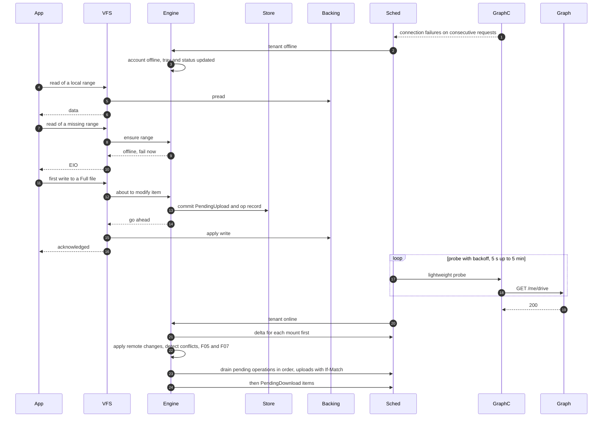
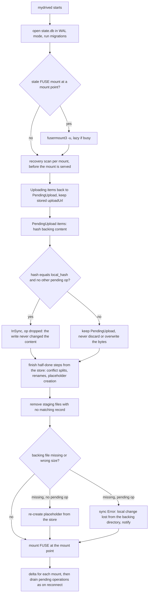

# F08 Offline, reconnect, and crash recovery

**Purpose.** Defines how the daemon behaves while Graph is unreachable (reads fail fast, writes are
kept), how it drains queued work on reconnect, and how it recovers after a daemon crash or reboot
so that no local change is lost and no placeholder reads as zeros.

## Preconditions

- At least one mount exists. For the offline part, the daemon is running; for recovery, it is
  starting after an unclean stop.

## Diagram: offline and reconnect

## Diagram: daemon start after a crash

## Steps

### Offline

1. Steps 1 to 3: the account is treated as offline after consecutive connection failures (DNS,
   connect, TLS) rather than after one. Offline is an account condition shown in `mydrive status`
   and the tray, not an item state.
2. Steps 4 to 10: local ranges read normally. Reads of missing ranges fail with `EIO` at once
   (F03), with a status entry naming the reason. Reads already waiting when the network went
   away fail once 30 s pass without progress (ADR-0005 R4).
3. Steps 11 to 16: writes keep working on content that is `Full` and follow the durable dirty mark
   order exactly as in F04: the `PendingUpload` record is committed before the write is applied to
   the backing file, then the write is acknowledged (ADR-0012 R3). A partial write to a file that
   is not `Full` needs a download first, so it fails with `EIO`.
4. Creates, mkdir, renames and moves are recorded the same way. Deletes are recorded and still
   pass through the mass-delete guard (F12). Pins are accepted and wait as `PendingDownload`.
   Free up space is refused (F06), because the online copy cannot be confirmed.
5. Steps 17 to 19: the probe is one cheap request, retried with backoff from 5 s up to 5 minutes,
   and immediately when the system reports a network change.
6. Steps 21 to 24, **drain order**: delta first for every mount, so remote changes and conflicts
   are known before anything is pushed; then pending operations per mount in the order they were
   recorded, parents before children (a folder create before its files); then downloads.
   Interactive reads take priority over all of it (F10). Every content upload carries `If-Match`,
   so changes made remotely while offline become conflicts (F07), never overwrites.
7. Offline longer than the refresh-token lifetime (90 days unused) ends in `needs-sign-in` (F01);
   pending operations stay until the user signs in.

### Crash and reboot recovery

8. The daemon is a systemd user service and starts at login. Until it has mounted a mount point,
   the mount point is an empty directory (ADR-0005 R3), so nothing can read a placeholder as zeros.
9. After a crash the mount point may report "Transport endpoint is not connected". On start the
   daemon unmounts stale mounts before anything else (overview "Rulings on details"); the systemd
   unit also unmounts on stop. Apps that had files open get errors and must reopen them.
10. The store is SQLite in WAL mode (ADR-0006 R2); every state change was a committed transaction,
    so the store is consistent at start.
11. **Recovery scan**, per mount, before the mount is served (ADR-0006):
    - Every `Uploading` item returns to `PendingUpload`. If an `uploadUrl` was stored, the upload
      resumes from `nextExpectedRanges`; a `404` restarts it.
    - Every `PendingUpload` item's backing content is hashed. Because the record is committed
      before any byte changes (ADR-0012 R3), every modified file is in this set. If the content
      still equals `local_hash` (the crash came after the mark but before the write), the item
      returns to `InSync`. Otherwise it stays `PendingUpload` and is uploaded (ADR-0012 R11).
    - Content of a `PendingUpload` or `Uploading` item is never deleted, truncated or overwritten,
      even where the backing file disagrees with the store; metadata is taken from the store and
      the bytes are kept (ADR-0006 R8). None of these items is dehydrated or overwritten by a
      remote change before its upload (ADR-0012 R11).
    - Steps recorded in the store but not yet applied to the backing directory (a conflict split,
      a remote rename, a placeholder creation) are completed.
    - Extent records are trusted only for bytes made durable before they were recorded (F03), so
      at worst some bytes are fetched again.
    - Staging files with no matching record are removed.
    - A backing file missing for an item with no pending operation is re-created as a placeholder.
      Missing content is never treated as a delete and never sent to the server.
12. Mounts still `resyncing` from F02 or a `410` resume their enumeration.
13. Held mass deletes (F12) are still held and the question is asked again.
14. Then each mount is mounted, delta runs, and the pending work drains as in step 6.

## Failure paths

| Failure | What the user sees | Resulting state |
|---|---|---|
| Read of a missing range while offline | Immediate I/O error; tray shows offline | No change |
| Partial write to a non-`Full` file while offline | I/O error | No change |
| Write to a `Full` file while offline | Nothing unusual; file shows `syncing` | `PendingUpload`, uploaded on reconnect |
| Remote change to the same file while offline | Conflict notification after reconnect | F07 split |
| Remote delete of a file changed offline | Notification; local copy kept and uploaded | Re-created remotely (F05) |
| Captive portal: requests return HTML or redirects | Same as offline; `mydrive doctor` reports it | Offline until a valid Graph response |
| Daemon crash with uploads pending | Mount point errors until the daemon restarts | Uploads resume after the recovery scan |
| Stale FUSE mount cannot be unmounted (busy) | `mydrive doctor` names the processes holding it | Lazy unmount; remounted when free |
| Backing file of a changed item deleted by hand | Notification: the local change was lost outside my-drive | sync `Error`; nothing deleted remotely |
| `state.db` corrupt | Daemon refuses to serve mounts; `mydrive doctor` explains | Mount points stay empty; backing directories untouched |

## Invariants

- While offline, no read waits on the network for a range that cannot arrive; it fails at once.
- No write is acknowledged before its `PendingUpload` record is committed (ADR-0012 R3).
- No local change is lost or overwritten across offline periods, crashes or reboots
  (ADR-0006 R8, ADR-0012 R11).
- After reconnect, delta runs before pending uploads.
- Missing backing content is never turned into a remote delete.
- A mount point is never served before its recovery scan has finished.

## Open questions

New:

1. **When the account counts as offline** (how many failures, which errors) and the probe backoff
   are proposals.
2. **Corrupt `state.db`.** Since the store is the source of truth, there is no rebuild path from
   the backing directory. A rebuild from a fresh delta plus a scan of backing files for content
   with no record would protect unsynced changes, but it needs designing.
3. **Hashing every `PendingUpload` item on start** costs time for many large files; it is the price
   of telling "marked but never written" from "written".

## Related

- Journeys: J09, J15, J16.
- ADRs: 0005 (R3, R4), 0006 (R2, R8), 0010, 0011 (R6), 0012 (R3, R11).
- Gates: none.
- Flows: F03 (fail-fast reads), F04 (write order), F05 (delta after reconnect), F07 (conflicts),
  F10 (probe and priorities), F12 (held deletes), F13.
