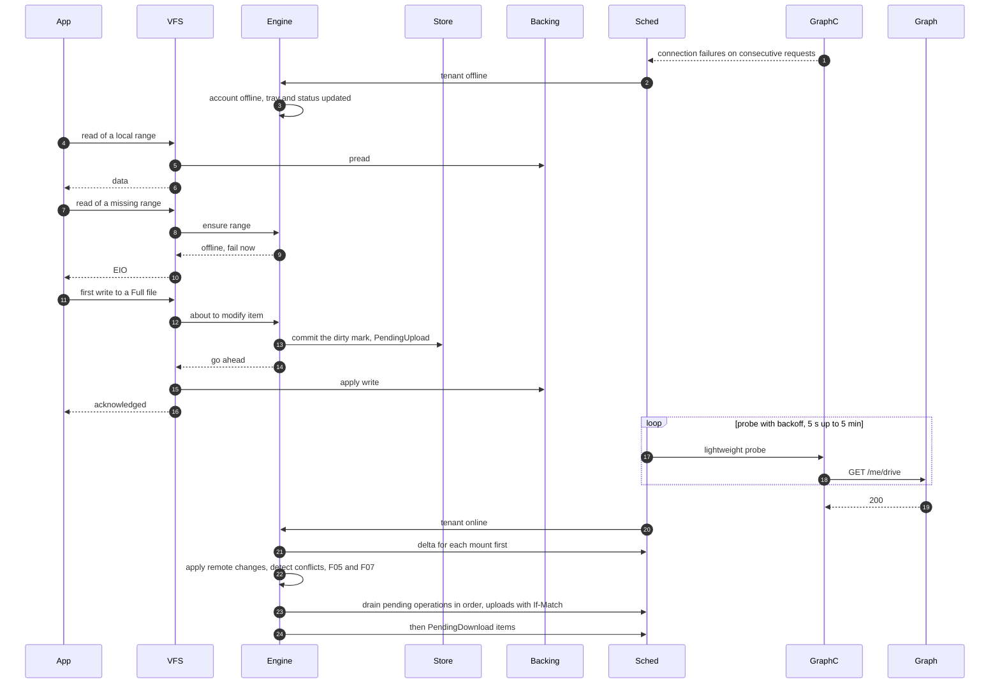
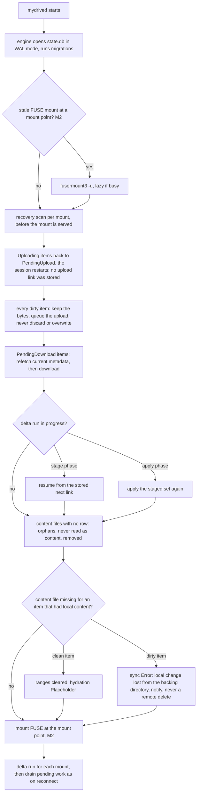

# F08 Offline, reconnect, and crash recovery

**Purpose.** Defines how the daemon behaves while Graph is unreachable (reads fail fast, writes are
kept), how it drains queued work on reconnect, and how it recovers after a daemon crash or reboot
so that no local change is lost and no placeholder reads as zeros.

## Preconditions

- At least one mount exists. For the offline part, the daemon is running; for recovery, it is
  starting after an unclean stop.

## Diagram: offline and reconnect

## Diagram: daemon start after a crash

## Steps

### Offline

1. Steps 1 to 3: the account is treated as offline after consecutive connection failures (DNS,
   connect, TLS) rather than after one. Offline is an account condition shown in `mydrive status`
   and the tray, not an item state.
2. Steps 4 to 10: local ranges read normally. Reads of missing ranges fail with `EIO` at once
   (F03), with a status entry naming the reason. Reads already waiting when the network went
   away fail once 30 s pass without progress (ADR-0005 R4).
3. Steps 11 to 16: writes keep working on content that is `Full` and follow the durable dirty mark
   order exactly as in F04: the mark is committed before the write is applied to the content
   file, then the write is acknowledged (ADR-0012 R3). A partial write to a file that is not
   `Full` needs a download first, so it fails with `EIO`.
4. Creates, mkdir, renames and moves are recorded the same way (renames and moves only in the
   store, ADR-0021). Deletes (M2) are recorded and still pass through the mass-delete guard
   (F12); local deletes are not sent to the server before M2. Pins are accepted and wait as
   `PendingDownload`. Free up space is refused (F06), because the online copy cannot be
   confirmed.
5. Steps 17 to 19: the probe is one cheap request, retried with backoff from 5 s up to 5 minutes,
   and immediately when the system reports a network change.
6. Steps 21 to 24, **drain order**: a delta run first for every mount (F05), so remote changes and
   conflicts are known before anything is pushed; then pending work per mount in the order it was
   recorded, parents before children (a folder create before its files); then downloads.
   Interactive reads take priority over all of it (F10). Every content upload carries `If-Match`,
   so changes made remotely while offline become conflicts (F07), never overwrites.
7. Offline longer than the refresh-token lifetime (90 days unused) ends in `needs-sign-in` (F01);
   pending operations stay until the user signs in.

### Crash and reboot recovery

8. The daemon is a systemd user service and starts at login. Until it has mounted a mount point,
   the mount point is an empty directory (ADR-0005 R3), so nothing can read a placeholder as zeros.
9. After a crash the mount point may report "Transport endpoint is not connected". On start the
   daemon unmounts stale mounts before anything else (overview "Rulings on details"); the systemd
   unit also unmounts on stop. Apps that had files open get errors and must reopen them. Telling
   a dead mount from a hung or live one first is new question 4.
10. The store is SQLite in WAL mode (ADR-0006 R2), opened only by the engine on its owning thread
    (ADR-0023 R2); every state change was a committed transaction, so the store is consistent at
    start.
11. **Recovery scan**, per mount, before the mount is served (ADR-0006), following the store's
    "What the engine must do":
    - Every `Uploading` item returns to `PendingUpload`. No upload link was ever written to the
      store (overview "Rulings on details"), so an interrupted session restarts from the
      beginning; that costs a re-upload and loses nothing.
    - Every dirty item, listed by `dirty_items()` whatever its sync value, is queued for upload
      (ADR-0012 R11). Because the mark is committed before any byte changes (ADR-0012 R3), every
      modified file is in this set. An item whose content turns out unchanged (the crash came
      after the mark but before the write) is uploaded too: the store has no operation that
      returns it to `InSync` without an upload (new question 3).
    - Content of a dirty item is never deleted, truncated or overwritten, even where the content
      file disagrees with the store; metadata is taken from the store and the bytes are kept
      (ADR-0006 R8). None of these items is dehydrated or overwritten by a remote change before
      its upload (ADR-0012 R11).
    - Every item in `PendingDownload`, including those an upload completion left there
      (`UploadedButRemoteMovedOn`), has its current metadata refetched and applied before its
      download resumes.
    - A delta run in progress resumes: from the stored next link if it was in its stage phase
      (or from the start if that link is refused), or by applying its staged set again if it was
      in its apply phase (ADR-0022). The live token has not moved in either case.
    - Renames, moves and conflict splits are store transactions, so there is nothing half-done
      on disk to finish (ADR-0021).
    - Recorded ranges are trusted only for bytes made durable before they were recorded (F03), so
      at worst some bytes are fetched again.
    - A content file with no row is an orphan. It is never read as an item's content (ADR-0021 R5)
      and is removed; so are upload snapshots, since their sessions restart.
    - A content file missing for an item that had local content: a clean item becomes a
      placeholder (its ranges are cleared); a dirty item is put in sync `Error`, the user is told
      that the local change was lost outside my-drive, and the row is kept. Missing content is
      never treated as a delete and never sent to the server (ADR-0021 R5).
12. Mounts still `resyncing` from F02 or a `410` resume their run as above.
13. Held mass deletes (F12, M2) are still held and the question is asked again.
14. Then each mount is mounted (M2), a delta run follows, and the pending work drains as in
    step 6.

## Failure paths

| Failure | What the user sees | Resulting state |
|---|---|---|
| Read of a missing range while offline | Immediate I/O error; tray shows offline | No change |
| Partial write to a non-`Full` file while offline | I/O error | No change |
| Write to a `Full` file while offline | Nothing unusual; file shows `syncing` | `PendingUpload`, uploaded on reconnect |
| Remote change to the same file while offline | Conflict notification after reconnect | F07 split |
| Remote delete of a file changed offline | Notification; local copy kept and uploaded | Re-created remotely (F05) |
| Captive portal: requests return HTML or redirects | Same as offline; `mydrive doctor` reports it | Offline until a valid Graph response |
| Daemon crash with uploads pending | Mount point errors until the daemon restarts | Uploads run again after the recovery scan; interrupted sessions restart from the beginning |
| Daemon crash during a delta run | Nothing until restart | The run resumes or its staged set is applied again; the live token never moved |
| Stale FUSE mount cannot be unmounted (busy) | `mydrive doctor` names the processes holding it | Lazy unmount; remounted when free |
| Content file of a changed item deleted by hand | Notification: the local change was lost outside my-drive | sync `Error`; nothing deleted remotely |
| Content file of a clean item deleted by hand | Nothing | Item becomes a placeholder; fetched again on the next read or pin |
| `state.db` corrupt | Daemon refuses to serve mounts; `mydrive doctor` explains | Mount points stay empty; backing directories untouched |

## Invariants

- While offline, no read waits on the network for a range that cannot arrive; it fails at once.
- No write is acknowledged before its `PendingUpload` record is committed (ADR-0012 R3).
- No local change is lost or overwritten across offline periods, crashes or reboots
  (ADR-0006 R8, ADR-0012 R11).
- After reconnect, delta runs before pending uploads.
- Missing backing content is never turned into a remote delete (ADR-0021 R5).
- A content file with no row is never read as an item's content.
- No upload link is read from or written to the state store.
- A mount point is never served before its recovery scan has finished.

## Open questions

Existing: Q34 (gate G3 pitfalls; see new questions 4 to 7).

New:

1. **When the account counts as offline** (how many failures, which errors) and the probe backoff
   are proposals.
2. **Corrupt `state.db`.** Since the store is the source of truth, there is no rebuild path from
   the backing directory. A rebuild from a fresh delta plus a scan of backing files for content
   with no record would protect unsynced changes, but it needs designing.
3. **Unchanged dirty items after a crash.** Closed in its old form: the scan no longer hashes
   every dirty item to return unchanged ones to `InSync`, because the store has no operation for
   that (F04 new question 6, F07 new question 3). Each is uploaded instead, which costs a
   re-upload. If that operation is added, hashing on start becomes worth reconsidering.
4. **Stale mounts (Q34, G3 pitfall 7).** A mount found at start may be dead (`ENOTCONN`), hung, or
   live and owned by a second daemon. Unmounting a live one, or hanging on a stuck one, are both
   possible; classify before unmounting (overview or ADR-0005, before M2).
5. **Mount namespace (Q34, G3 pitfall 6).** The systemd user unit must not use `PrivateMounts=`,
   `ProtectHome=`, `PrivateTmp=` or another mount-namespace option, or the mount is hidden from
   the user's session (ADR-0016, before M2).
6. **Pinned files while the daemon is down (Q34, G3 pitfall 5).** With the backing directory
   separate from the mount point, pinned files are unreachable whenever the daemon is not
   running. ADR-0005 must record this cost, and `mydrive doctor` and the journeys should cover
   "the daemon will not start and I need my pinned file" (export, F04 step 18, needs the daemon
   too).
7. **A missing backing file is never a delete (Q34, G3 pitfall 8).** Answered by ADR-0021: a clean
   item becomes a placeholder, a dirty one an error, and neither becomes a remote delete.
8. **Orphans and the store's conflict order.** Removing orphans is safe only because no content
   file holds the only copy of unsynced bytes without a row. The store schema's prescribed
   conflict order (copy the bytes first, then insert the copy) can leave an orphan copy after a
   crash, but the original is still dirty with the bytes then. ADR-0021's single-transaction
   split (F07) removes the case.
9. **Empty files** are `Full` with no content file (F02 new question 8). The missing-content rule
   above must not treat them as lost.

## Related

- Journeys: J09, J15, J16.
- ADRs: 0005 (R3, R4), 0006 (R2, R8), 0010, 0011 (R6), 0012 (R3, R11), 0021 (R5), 0022, 0023
  (R2).
- Gates: G3 (pitfalls 5 to 8).
- Flows: F03 (fail-fast reads), F04 (write order), F05 (delta after reconnect), F07 (conflicts),
  F10 (probe and priorities), F12 (held deletes), F13.
