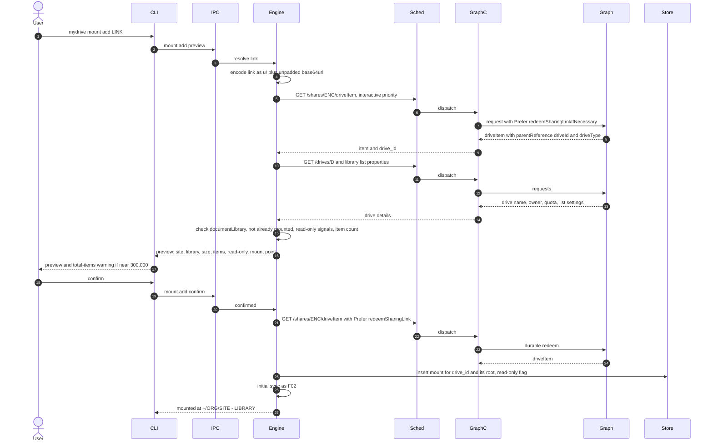
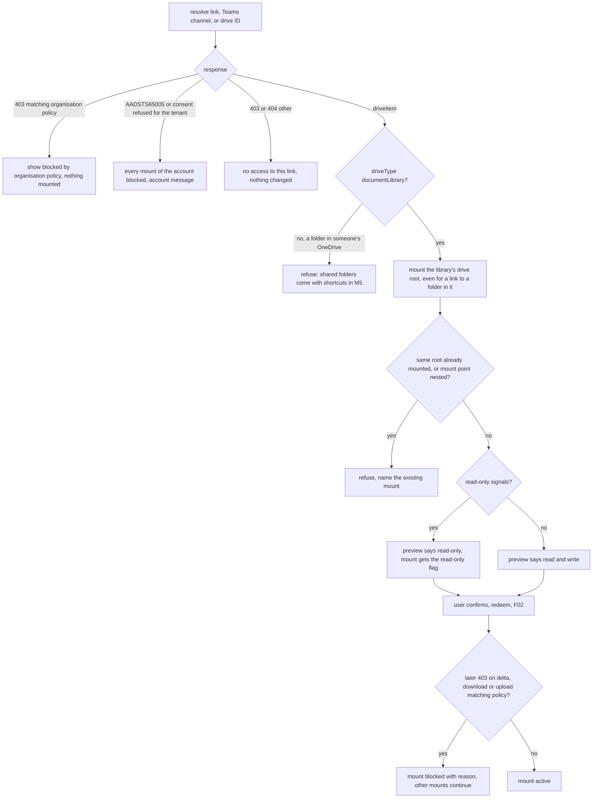

# F09 Add a SharePoint library

**Purpose.** Adds a SharePoint document library as its own mount from a pasted sharing link, a
Teams channel, or a drive ID: resolve, preview without changing access, confirm, redeem, mount.
Defines the `blocked` (organisation policy) and read-only outcomes.

## Preconditions

- A work or school account is `signed-in` (F01).
- The user has a sharing link or library URL, a team they belong to, or a drive ID.

## Diagram: link, preview, confirm

## Diagram: outcomes

## Steps

1. Steps 4 to 7: the link is base64-encoded, converted to unpadded base64url (`=` stripped, `/` to
   `_`, `+` to `-`) and prefixed with `u!`. The preview uses
   `Prefer: redeemSharingLinkIfNecessary`, which grants access only for that request and leaves
   the user's permissions unchanged (ADR-0015 R2).
2. Step 8: `parentReference.driveId` names the library; `driveType` must be `documentLibrary`.
   M1 mounts drive roots only (overview "Rulings on details"): a link to a folder inside a library
   mounts the whole library, and the preview says so. A mount of one folder is Q10, after M1.
3. Steps 10 to 14: the preview gathers the library and site names (for the mount point
   `~/<Org>/<Site> - <Library>`), size and item count. The item count is shown, and the CLI warns
   when the total across all mounts would exceed the configured threshold near 300,000
   (ADR-0015 R7).
4. Step 15, **read-only detection**: required check-out, validation columns, draft-item security
   and required columns are checked once per library (ADR-0015); how to read them through Graph
   is Q12. A library detected as read-only is mounted with the read-only flag.
5. Steps 21 to 24: only after explicit confirmation is the link redeemed durably with
   `Prefer: redeemSharingLink`, which is equivalent to the user opening the link in a browser
   (ADR-0015 R2).
6. Step 25: the mount gets its own `mount_id`, delta token and backing directory (ADR-0015 R1),
   then F02 runs. The new mount shares the tenant's Request scheduler (F10).
7. **Teams.** The user picks a team and a channel; the engine calls
   `GET /teams/{team}/channels/{channel}/filesFolder` and mounts whatever driveItem it returns,
   which for migrated private channels is a drive root in another site. It never derives a path
   (ADR-0015 R3). Listing the user's teams and channels may need a scope beyond the baseline (Q11),
   requested incrementally.
8. **Drive ID.** `mydrive mount add <drive-id>` calls `GET /drives/{id}` and continues at the
   preview. A drive ID cannot be redeemed; access must already exist.
9. **Site search** is optional and requests `Sites.Read.All` incrementally when the user opens it
   (ADR-0010 R5); it ends in a drive ID and the same preview.

### Blocked by organisation policy

10. A `403` whose error matches the unmanaged-device policy pattern (exact shape: gate G2, Q13)
    puts the mount into `blocked` with the reason "organisation policy". At preview time nothing is
    mounted and the user is told why. On an existing mount the block can appear up to 24 hours
    after a policy change.
11. A per-site policy blocks only that mount; other mounts, including others of the same account,
    keep syncing (ADR-0015 R4, ADR-0007 R3). A tenant-wide refusal (for example consent refused,
    AADSTS65005) blocks every mount of the account (overview "Account and mount states").
12. In a `blocked` mount every item's sync is `Blocked` and displays `blocked`; pending operation
    records stay (F13). Local content stays readable. Reads of missing ranges fail with `EIO` at
    once. New writes, creates, renames and deletes are refused with `EACCES`, so changes that may
    never upload do not pile up; changes already pending are kept.
13. The engine re-probes a blocked mount hourly and on `mydrive doctor`. When access returns, the
    mount becomes `active`, items return to `PendingUpload` or `InSync` (F13), and delta runs.

### Read-only libraries

14. In a read-only mount the VFS refuses `write`, `create`, `mkdir`, `rename`, `unlink` and
    content-changing `setattr` with `EROFS` (ADR-0015 R5). Reads, hydration, pin and free work
    normally. Items carry the `read-only` modifier.
15. A library can become read-only after it was mounted. The first upload refused with `403`
    (or a check-out error) marks the mount read-only; the refused local change is kept with sync
    `Error` and the user is told where it is. Nothing local is discarded.

## Failure paths

| Failure | What the user sees | Resulting state |
|---|---|---|
| Link not resolvable (expired, wrong tenant, plain browser URL not accepted) | "This link could not be opened" with the Graph reason | Nothing changed |
| Link points to a folder in a person's OneDrive | "Shared folders are not supported yet" | Nothing changed |
| Library already mounted | Error naming the existing mount (ADR-0007 R4) | Nothing changed |
| Policy block at preview | "Blocked by your organisation's policy on this device" and what an admin can change | Nothing mounted |
| Policy block on an existing mount | Notification; mount shows `blocked` | Mount `blocked`, pending records kept |
| Tenant refuses the app | Account message; every mount of the account `blocked` | Account mounts `blocked` |
| User declines at the preview | Nothing | Link never redeemed; access unchanged |
| Redeem fails after confirmation | Error; nothing mounted | No mount; preview can be retried |
| Write in a read-only library | The app gets "Read-only file system" | No change |
| Write in a blocked library | The app gets "Permission denied" | No change |
| Library became read-only with a change pending | Notification naming the kept file | Mount read-only, item `Error`, content kept |
| Mount point name collides (two libraries with the same site and library names) | Mount point gets a numeric suffix | Normal mount (two accounts in one tenant: Q14) |

## Invariants

- The preview never changes the user's access; only explicit confirmation redeems (ADR-0015 R2).
- One mount's block never stalls another mount (ADR-0015 R4).
- A read-only library never receives an upload attempt for a new local change; the VFS refuses it
  first (ADR-0015 R5).
- No outcome in this flow deletes local or remote content.
- The Teams path never derives a library from a channel name (ADR-0015 R3).

## Open questions

Existing: Q10 (mounting one folder of a library; not in M1, which mounts drive roots only), Q11 (scope for browsing Teams), Q12 (detecting
read-only libraries), Q13 (policy errors, gate G2), Q14 (two accounts in one tenant).

New:

1. **Writes in a blocked mount.** This flow refuses new writes with `EACCES` while keeping pending
   changes. The alternative, accepting writes and queuing them, keeps editors working but builds
   up changes that may never upload. Needs a ruling.
2. **Plain library URLs** (not sharing links) may not resolve through `/shares` (research gap). If
   they do not, the CLI must say "use Share, Copy link" rather than fail obscurely.
3. **Re-probe interval** for blocked mounts (hourly) is a proposal.

## Related

- Journeys: J11, J12, J13.
- ADRs: 0007 (R3, R4), 0010 (R5), 0011, 0015 (R1 to R5, R7).
- Gates: G2.
- Flows: F02 (initial sync), F04 (uploads in read-only libraries), F10 (shared tenant budget),
  F12 (removing a library mount), F13 (blocked transitions).
