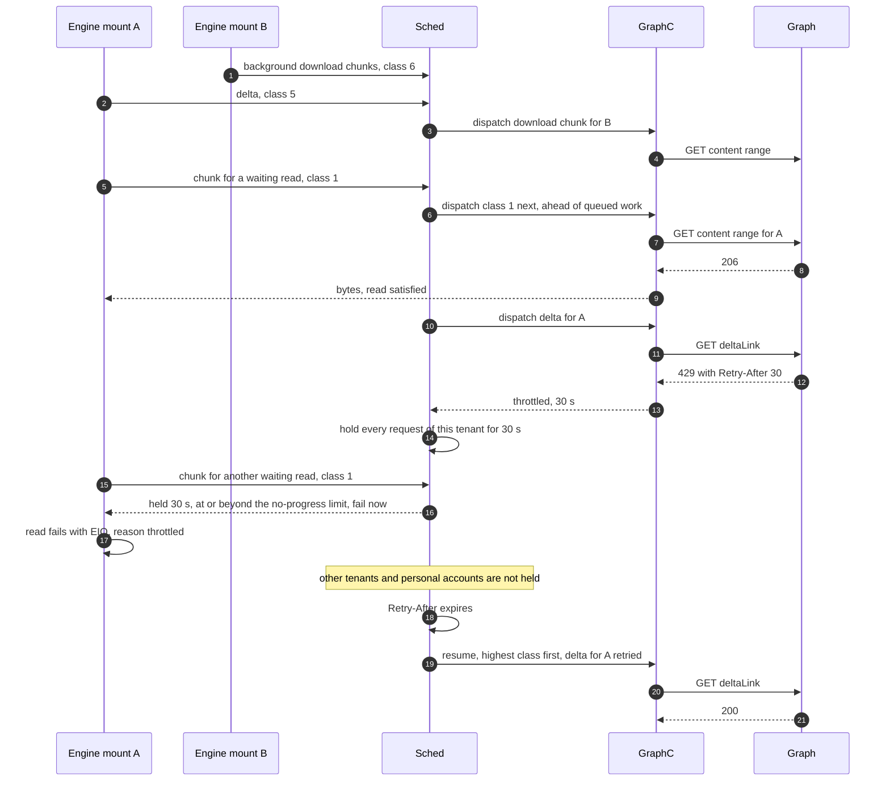
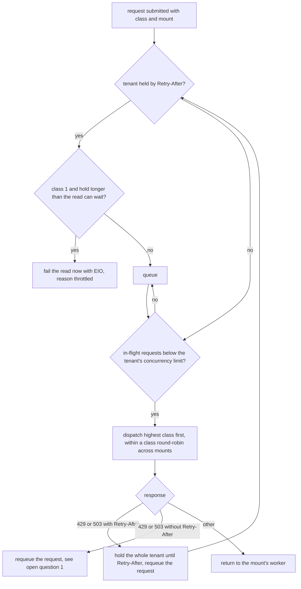

# F10 Request scheduler and throttling

**Purpose.** Shows how requests from several mounts share one tenant's request budget through one
Request scheduler, how interactive hydration is served before background sync, and how a `429` or
`503` with `Retry-After` holds every request of that tenant.

## Preconditions

- One Request scheduler exists per tenant, or per account for personal accounts (ADR-0011). Every
  Graph request from every mount of that tenant goes through it (ADR-0011 R6). Mount workers never
  back off on their own.

## Priority classes

| Class | Examples | Notes |
|---|---|---|
| 1 Interactive read | The chunk a waiting `read` needs (F03); partial-write hydration (F04) | A process is blocked on it |
| 2 Interactive command | Link preview and redeem (F09), sign-in follow-up (F01), free-up-space confirmation (F06), `mydrive status` lookups that need Graph | A user is waiting at a prompt |
| 3 Read-ahead | Read-ahead chunks (F03) | Dropped when the file is closed |
| 4 Upload | Content uploads, creates, moves, deletes (F04, F12) | |
| 5 Delta | Delta runs started by the mount's wake-up source: polling in M1 (F05) | Cheap: 1 resource unit with a token |
| 6 Background download | Pinned and `mydrive hydrate` downloads (F06), initial enumeration (F02) | |
| 7 Housekeeping | Thumbnail seeding (F03), safety-net polls, blocked-mount probes | |

## Diagram: two mounts, one tenant, a 429

## Diagram: dispatch decision

## Steps

1. Steps 1 to 4: the scheduler has a bounded number of requests in flight per tenant (initial
   default 8, of which at most 2 are class 6 or 7, so background work never fills every slot).
2. Steps 5 to 9: a waiting read's chunk goes ahead of everything queued. It does not cancel a
   request already in flight.
3. Within a class, requests are taken round-robin by mount, so one mount with a large backlog
   (for example a 300,000-item library enumerating) cannot starve another (Q9).
4. Steps 12 to 14: a `429` or `503` with `Retry-After` seen by any mount holds every request of
   that tenant until it expires (ADR-0011 R6). `Retry-After` is the only back-off signal; RateLimit
   headers are ignored (ADR-0011 R7). The throttled request is requeued, not dropped.
5. Steps 15 to 17: a read that cannot be served within F03's 30 s no-progress limit fails at once
   with `EIO` and a status entry "throttled by Microsoft", instead of waiting for the limit
   (ADR-0005 R4).
6. The note after step 17: the hold is per tenant. Other tenants, and personal accounts, have their own scheduler
   and are not delayed. Two accounts in one tenant share it (ADR-0007).
7. Steps 18 to 21: when the hold ends, queued requests resume in class order.
8. Every request carries the User-Agent `ISV|<company>|<app>/<version>` (ADR-0011 R8); the company
   and app values wait for the product name (Q21).
9. Request cost, for sizing read-ahead and polling: 1 resource unit for a single item, delta with
   a token, or a download; 2 for delta without a token, listing children, and create, update,
   delete or upload; 5 for permission operations. Business limits include 3,000 requests per user
   per 5 minutes; this is why reads are chunked and small files fetched whole (F03).
10. Mount isolation: a mount in `resyncing` or `blocked`, or one whose worker failed, only uses the
    shared scheduler; it cannot hold the scheduler except through a genuine `Retry-After`
    (ADR-0007 R3).

## Failure paths

| Failure | What the user sees | Resulting state |
|---|---|---|
| `429` or `503` with `Retry-After` | Transfers pause; `mydrive activity` shows "throttled, resuming in N s" | Tenant held; nothing lost |
| Read during a long hold | Immediate I/O error with reason "throttled" | No change |
| Repeated throttling over minutes | Tray shows "throttled by Microsoft" | Background classes slowed by the holds themselves |
| `503` without `Retry-After` | As above, briefly | See open question 1 |
| Persistent `503` (tenant blocked for abuse) | `mydrive doctor` reports it | All requests of the tenant held |
| Scheduler for one tenant stalls | Other tenants unaffected | — |

## Invariants

- No Graph request bypasses the tenant's scheduler (ADR-0011 R6).
- A `Retry-After` seen by one mount holds every mount of that tenant, and no other tenant.
- RateLimit headers never change scheduling (ADR-0011 R7).
- A waiting read is never queued behind background work.
- A throttled request is retried, never silently dropped; an upload is never lost to throttling.

## Open questions

Existing: Q9 (fairness between mounts; this flow proposes round-robin by mount within a class),
Q21 (User-Agent values).

New:

1. **`429` or `503` without `Retry-After`.** ADR-0011 makes `Retry-After` the only back-off
   signal, but a response can omit it. Retrying at once risks more throttling; this needs a
   ruling (for example a fixed short wait that is not a computed back-off).
2. **Proactive pacing.** This flow limits concurrency but does not pace requests against the
   published per-user and per-app numbers, consistent with "Retry-After only". Whether to add a
   self-imposed rate ceiling is undecided.
3. **Concurrency limits** (8 in flight, 2 for background) are proposals.
4. **Network-error retries** (not throttling) also need a retry policy; this flow leaves them to the
   offline detection in F08.

## Related

- Journeys: J03, J08, J09, J11, J18.
- ADRs: 0005 (R4), 0007 (R3), 0011 (R6 to R8).
- Gates: none.
- Flows: F02, F03, F04, F05, F06, F08, F09.
