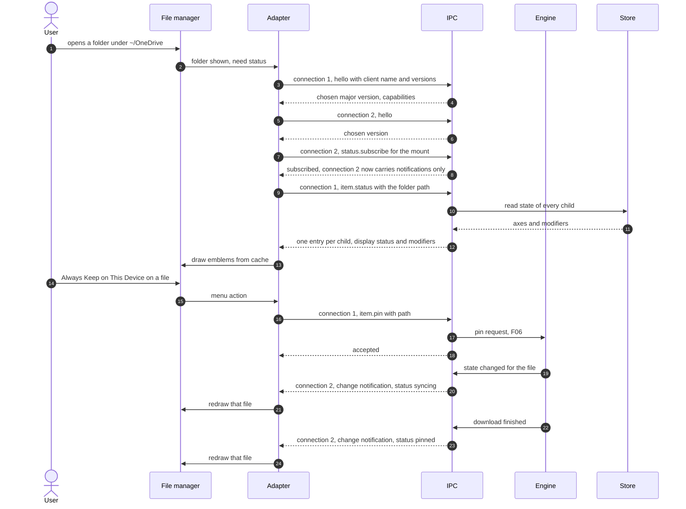
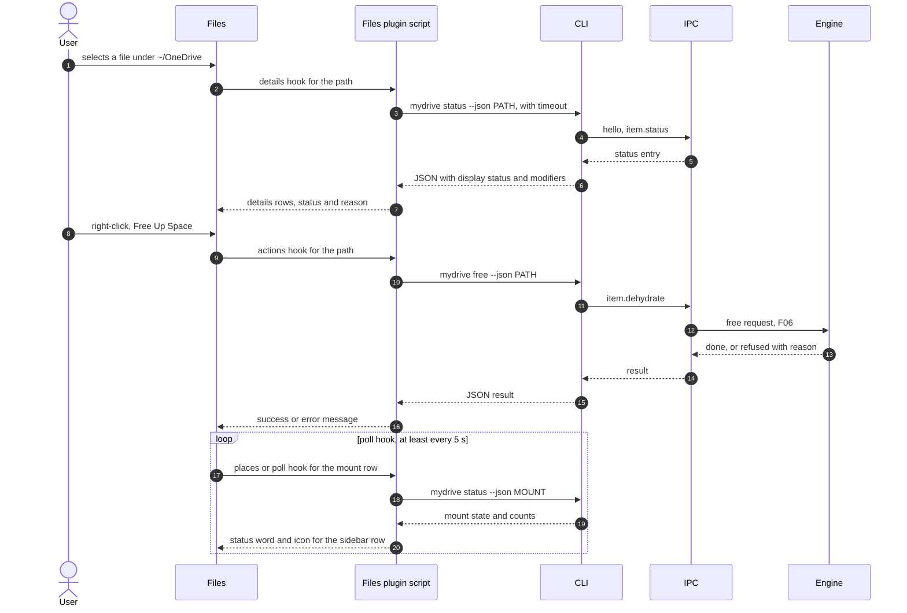

# F11 Status for file managers

**Purpose.** Shows how a thin adapter gets item status without polling per file and without ever
causing a download: connect, `hello`, `item.status` for a whole folder, `status.subscribe` on a
second connection, and change notifications. Also the Omarchy Files plugin, which has no socket
client and calls the `mydrive` CLI instead.

## Preconditions

- `mydrived` is running and listening on `$XDG_RUNTIME_DIR/mydrive/daemon.sock` (directory 0700,
  socket 0600, ADR-0009 R1).
- The adapter runs as the same user.
- Method and notification names below are those of ADR-0009; parameters and result shapes are
  defined in `docs/protocol/`.

## Diagram: socket adapter (Nautilus, Dolphin, yazi and later)

## Diagram: Omarchy Files plugin

## Steps

1. Steps 3 to 6: the first request on every connection is `hello`; anything else first gets an
   error (ADR-0009 R3). The adapter opens two connections because a connection that calls
   `status.subscribe` carries notifications only (overview "Rulings on details", ADR-0009).
2. Steps 7 and 8: the subscription covers the mounts or folders the adapter names; from then on the
   daemon pushes JSON-RPC notifications for state changes. Adapters never poll per file
   (ADR-0014 R3).
3. Steps 9 to 12: `item.status` with one directory path returns every child in one response
   (ADR-0009 R7). It is answered from the State store only: the daemon does not stat, open or read
   anything under the mount point, so a status query can never hydrate.
4. Each entry carries the display status computed by the one derivation function in
   `mydrive-core` (ADR-0008 R2) in its wire form (`online-only`, `local`, `pinned`, `syncing`,
   `error`, `blocked`), the modifiers (`read-only`, `shortcut`), and the underlying axes in wire
   form for clients that want detail. Adapters draw from the display status and never derive it
   themselves (ADR-0014 R5).
5. Paths in requests and results are absolute paths under a mount point; a backing-directory path
   is rejected (ADR-0009 R8). A path outside every mount returns a "not managed" entry.
6. Steps 14 to 24: commands go out on the request connection (`item.pin`, `item.unpin`,
   `item.dehydrate`, `item.hydrate`); their effects come back as notifications on the subscription
   connection.
7. The adapter answers the host from its cache and never blocks the host's UI thread. Every call
   has a timeout; on timeout it shows the cached or an "unknown" status and does not retry in the
   UI thread (ADR-0014 R2).
8. If the daemon restarts, both connections drop. The adapter reconnects with backoff, repeats
   `hello`, re-subscribes and re-requests status for folders on screen.
9. Adapters ignore unknown result fields, notification methods and capabilities (ADR-0009 R5).

### Files plugin (Omarchy, ADR-0014)

10. Files plugin interface v1 runs plugin commands that print JSON; Files never loads plugin code.
    The plugin is a `manifest.json` plus small scripts that call the `mydrive` CLI with `--json`.
11. Hooks used: `details` (the selected file's display status and reason), `actions` restricted to
    paths under the mount points ("Always Keep on This Device", "Free Up Space", "Copy Link",
    "View Online"; ADR-0014 R4), and `poll`/`places` for the mount's sidebar row (Files' minimum
    interval is 5 s). "Copy Link" copies the item's existing web address and never creates a
    sharing link (overview "Rulings on details").
12. There is no per-file badge in Files plugin interface v1, so tiles and list rows show no status
    on Omarchy until Files adds a hook (gate G4, Q17).
13. The plugin never writes the store, backing directories or `config.toml` (ADR-0014 R1).
    Removing it leaves on-demand files working (ADR-0014 R6).

## Failure paths

| Failure | What the user sees | Resulting state |
|---|---|---|
| Daemon not running | Adapter shows no emblems or "unknown"; Files details row "my-drive is not running" | Adapter retries in the background |
| `hello` version mismatch | Adapter shows "unknown" and logs that it needs updating; the error lists supported versions (ADR-0009 R4) | No requests sent |
| Call times out | Cached or "unknown" status | UI not blocked |
| Notification connection drops | Emblems may go stale briefly | Reconnect, re-subscribe, re-request visible folders |
| Action refused (for example Free Up Space on a file with pending changes) | Error message from the daemon's reason | No state change (F06) |
| Path outside any mount | Plugin actions not shown (manifest scope); socket adapter gets "not managed" | — |
| Mount point changes after the plugin manifest was written | Actions missing for the new path | See Q16 |

## Invariants

- A status query never touches the mount point and never causes a download.
- An adapter never polls the daemon once per file per repaint (ADR-0014 R3, ADR-0009 R7).
- A subscription connection carries notifications only.
- Adapters never derive display status from the axes (ADR-0014 R5).
- Adapters hold no state beyond a cache and contain no sync logic (ADR-0014).
- Every adapter call has a timeout (ADR-0014 R2).

## Open questions

Existing: Q16 (the Files manifest's fixed `under` folders versus changing mount points), Q17
(per-file status and thumbnail hooks in Files, gate G4).

New:

1. **CLI latency for the Files `details` hook.** Each selection starts a `mydrive` process that
   connects, says `hello` and asks for status. Whether that is fast enough on Omarchy needs
   measuring; a small persistent helper would conflict with Files never running plugin code
   persistently.

## Related

- Journeys: J02, J06, J07, J17.
- ADRs: 0008 (R2), 0009 (R1, R3 to R5, R7, R8), 0014 (R1 to R6).
- Gates: G4.
- Flows: F06 (actions), F13 (display status).
