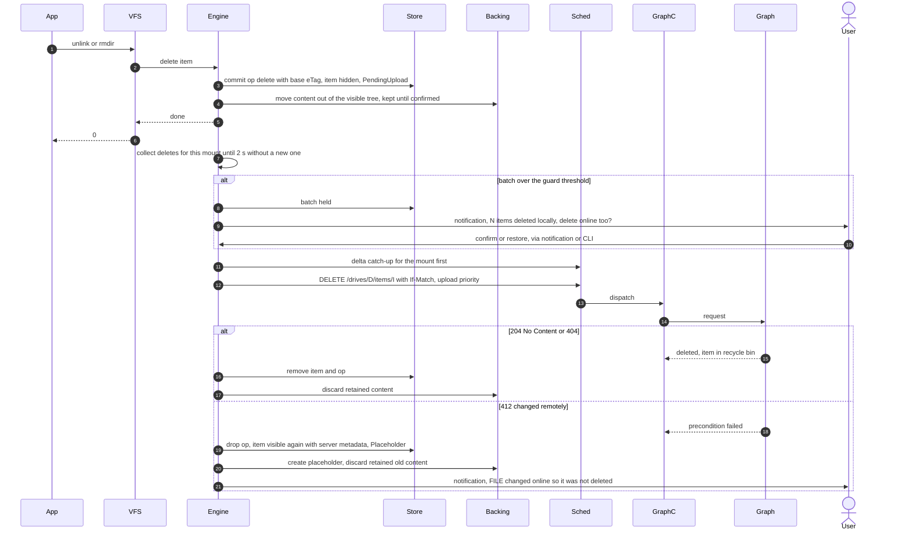
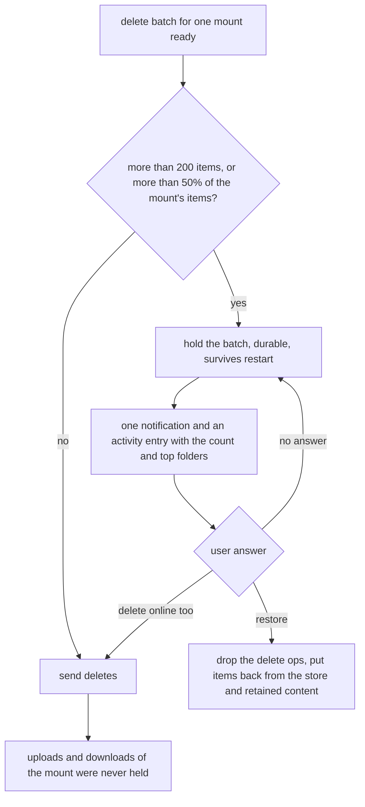

# F12 Delete safety

**Purpose.** Takes a local delete to the server's recycle bin without ever deleting something the
user did not mean to: deletes are recorded durably, guarded by `If-Match`, held for confirmation
when a batch is large, and never produced by removing a mount.

## Preconditions

- The mount is `active` and not read-only (in a read-only library `unlink` and `rmdir` fail with
  `EROFS`, ADR-0015 R5; in a `blocked` mount they fail with `EACCES`, F09).
- The item exists in the State store with an eTag.

## Diagram: local delete to recycle bin

## Diagram: mass-delete guard

## Steps

1. Steps 1 to 6: the delete record is committed before the backing directory changes, like every
   local change (ADR-0012 R3). The item disappears from the mount at once. Its content, if any, is
   moved to a place in the backing directory outside the visible tree and kept until the server
   confirms the delete, so a restore needs no download.
2. A folder delete (`rm -r`) arrives as many `unlink` and `rmdir` calls. When every descendant of a
   folder is deleted, the batch sends one `DELETE` for the folder instead of one per item.
3. Step 7: deletes accumulate per mount until 2 s pass with no new delete; that batch is the "one
   operation" the guard measures (Q6).
4. Steps 8 to 10, **mass-delete guard** (ADR-0012 R10): a batch deleting more than 200 items or more
   than 50% of the mount's items (both configurable) is held until the user confirms. Only the
   deletes wait; the mount stays `active` and uploads, downloads and reads continue. The held batch
   is in the store, survives a restart (F08), and never expires on its own. The question is
   offered from the notification and from `mydrive activity`.
5. "Restore" puts every held item back where it was, from the store's metadata and the retained
   content: hydrated files come back hydrated, placeholders come back as placeholders.
6. Step 11: before sending deletes the engine runs delta for the mount. If the server has items
   under a deleted folder that the local side never saw, those items are not deleted: the folder's
   known children are deleted one by one and the folder is kept with the unseen items, which then
   appear locally.
7. Steps 12 to 14: `DELETE` moves the item to the OneDrive recycle bin. `permanentDelete` is never
   used. `If-Match` carries the eTag the local side last saw, so a file changed elsewhere since
   then is not deleted.
8. Steps 15 to 17: `204`, or `404` (already gone), completes the delete.
9. Steps 18 to 21: `412` means the item changed online. The delete is abandoned, the item comes
   back locally as a placeholder for the server version, and the user is told (the "local
   deleted, remote changed" case of F07).
10. A file with pending local content changes that the user deletes is still deleted: the user's
    intent is the delete, and the server still has the previous version in its history. The
    content upload is cancelled.

### Removing a mount (`mydrive mount remove`)

11. Removing a mount sends nothing to Graph: no delete, no move, no unredeem (ADR-0015 R8). The
    sequence is: stop the mount's worker and notification socket; refuse if any item has a pending
    operation, listing them, unless the user confirms that those files will stay only on this
    computer; unmount the FUSE filesystem (lazy if busy); move every `Full` file from the backing
    directory into the now-plain mount point directory at its path, so no local copy of hydrated
    content is removed; delete placeholders and partial files; delete the backing directory and the
    mount's store rows.
12. The backing directory is removed by the daemon directly, never through the FUSE mount, so the
    VFS never sees those removals as user deletes.
13. Deleting the mount point directory by hand while the daemon is stopped touches only an empty
    directory (ADR-0005 R3). `rm -rf ~/OneDrive` while mounted is an ordinary mass delete and meets
    the guard.
14. `mydrive logout` and `mydrive pause` never delete anything (F01).

## Failure paths

| Failure | What the user sees | Resulting state |
|---|---|---|
| `rm -rf` of a large folder | Files vanish locally; one notification asks whether to delete online too | Batch held; uploads continue |
| User chooses restore | Files reappear as they were | Delete ops dropped |
| No answer, daemon restarts | Question asked again | Batch still held |
| `412` on delete | Notification "FILE changed online, so it was not deleted" | Item back as a placeholder of the server version |
| `403` on delete (library became read-only, or retention policy) | Notification; item restored locally | Item restored, mount marked read-only if that was the cause |
| Network lost before the delete is sent | Nothing; file stays gone locally | Op `PendingUpload`, sent on reconnect |
| `mydrive mount remove` with pending changes | Refused, with the list of files | Nothing changed until the user confirms |
| Mount busy at removal | Removal waits for a lazy unmount | Completes when no process holds it |

## Invariants

- A local delete always goes to the recycle bin, never to permanent deletion.
- A delete never removes an item that changed online since the local side last saw it (`If-Match`).
- A delete batch over the threshold is never sent without explicit confirmation (ADR-0012 R10).
- A held batch never expires into a delete.
- Removing a mount, unmounting, logging out or pausing never issues a remote delete and never
  removes a local copy of hydrated content (ADR-0015 R8).
- Missing backing content is never turned into a remote delete (F08).
- Server items the local side never saw are never deleted as part of a folder delete.

## Open questions

Existing: Q6 (what counts as one operation; this flow proposes a per-mount batch closed by 2 s
without a new delete).

New:

1. **Small mounts.** "More than 50% of a mount" trips on very few deletes in a small mount (2 of 3
   items). A minimum count for the percentage rule may be needed. This flow reads both limits as
   "more than", following ADR-0012 (J05 asks which).
2. **Where hydrated files go on mount removal.** ADR-0015 R8 says removal keeps local copies of
   hydrated content but, with the mount point separate from the backing directory, does not say
   where. This flow moves them into the plain mount point directory, which matches Windows'
   "stop syncing" but leaves files the user may not expect to be unsynced.
3. **Deleting a file that has pending content changes** sends the delete (step 10). A more
   conservative reading would ask first.
4. **Answering the guard from the CLI.** The overview's CLI table has no command for it; the CLI
   work package must add one (J05 asks the same).
5. **Remote mass deletes** are not guarded (F05 new question 1).

## Related

- Journeys: J05, J15, J16.
- ADRs: 0005 (R3, R5), 0012 (R3, R10), 0015 (R5, R8, R9).
- Gates: G2 (retention and policy refusals on delete are unverified).
- Flows: F04 (coalescing of create then delete), F05 (remote deletes), F07 (delete against remote
  change), F08 (held batches across restarts), F09 (read-only and blocked mounts).
