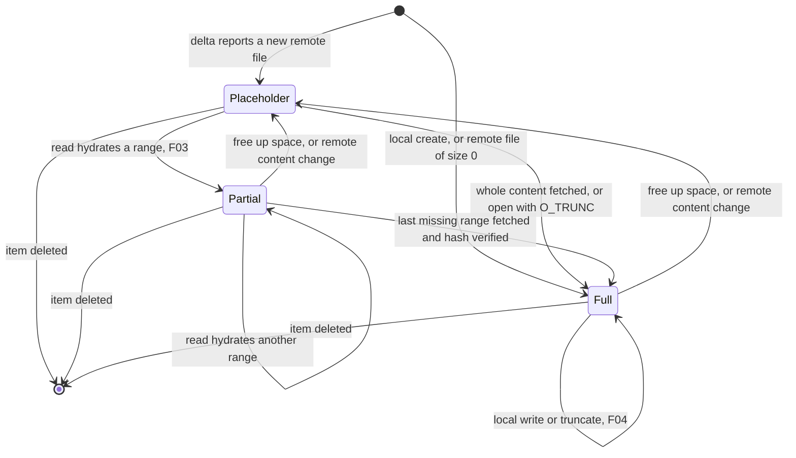
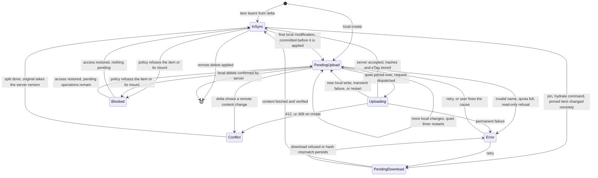

# F13 State machines

**Purpose.** Defines how an item moves along the hydration axis and the sync axis, what event causes
each transition, and how the axes collapse into the one display status that the CLI and adapters
show. Every other flow refers to these transitions.

## Preconditions

- The state model, wire forms, and account and mount states of `docs/architecture/overview.md`,
  and ADR-0008.
- The State store is the source of truth (ADR-0006). The five `user.mydrive.*` xattrs are served
  from it. The State store's hydrated-range map, not the sparse holes, says which bytes are local
  (ADR-0006 R6).

Names in prose and diagrams are the Rust names (`PendingUpload`). On the wire (IPC, xattrs,
CLI `--json`, store columns) the same values are lowercase kebab-case (`pending-upload`); the
tables below give both where they first appear.

## Hydration axis

Applies to files. Folders are `Full` once listed; after F02 every folder is listed, so folders are
always `Full` and have no transitions of their own.

| Event | From | To | Flow | Rule | Side effects |
|---|---|---|---|---|---|
| Delta reports a new file with size > 0 | — | `Placeholder` (`placeholder`) | F02, F05 | ADR-0005 R8 | Sparse backing file with `st_size` = cloud size, `st_blocks` = 0 |
| Local create, or remote file of size 0 | — | `Full` (`full`) | F04, F02 | | Nothing to fetch |
| Read needs a range that is not local and the fetch succeeds | `Placeholder`, `Partial` | `Partial` (`partial`) | F03 | ADR-0005 R5 | Extent recorded after the bytes are durable |
| Last missing range lands and the whole-file quickXorHash equals `server_hash` | `Partial` | `Full` | F03 | | On mismatch every extent is dropped: `Placeholder`, sync `Error` |
| Whole file fetched (small file, pin, `mydrive hydrate`, `200` to a ranged request) | `Placeholder`, `Partial` | `Full` | F03, F06 | ADR-0011 R11 | Hash verified as above |
| Open with `O_TRUNC` | any | `Full` | F04 | ADR-0012 R2 | Old extents dropped, no download |
| First partial write to a non-`Full` file | `Placeholder`, `Partial` | `Full` | F04 | ADR-0005 R7, ADR-0012 R1 | The write waits until the missing ranges are fetched |
| Free up space accepted | `Partial`, `Full` | `Placeholder` | F06 | ADR-0008 R5 | Holes punched, extents deleted |
| Remote content change, no local change pending, effective pin not `Pinned` | `Partial`, `Full` | `Placeholder` | F05 | ADR-0012 R8 | Deferred while handles are open; kernel cache invalidated |
| Remote content change, effective pin `Pinned` | `Full` | `Full` | F05 | ADR-0008 R6 | New version fetched to a staging file, swapped in atomically |

## Sync axis

| Event | From | To | Flow | Rule |
|---|---|---|---|---|
| Delta reports an item and nothing is pending locally | — | `InSync` (`in-sync`) | F02, F05 | |
| First write, truncate, create, mkdir, rename, move, unlink or rmdir. The record is committed **before** the change touches the backing directory | `InSync` | `PendingUpload` (`pending-upload`) | F04, F12 | ADR-0012 R3 |
| Quiet period (default 2 s after the last close) ends and the request is dispatched | `PendingUpload` | `Uploading` (`uploading`) | F04 | ADR-0012 R4 |
| Server returns the new driveItem | `Uploading` | `InSync` | F04 | ADR-0012 R8 |
| Write while the upload is in flight | `Uploading` | `PendingUpload` once the request ends | F04 | ADR-0012 R4 |
| Network error, 5xx, 429, daemon restart | `Uploading` | `PendingUpload` | F04, F08, F10 | ADR-0012 R11 |
| `412`, or `409 nameAlreadyExists` on create | `Uploading` | `Conflict` (`conflict`) | F07 | ADR-0012 R7 |
| Delta reports a content change for an item with a pending content operation | `PendingUpload`, `Uploading` | `Conflict` | F07 | ADR-0012 R11 |
| Conflict split completed | `Conflict` | `InSync` | F07 | ADR-0012 R7 |
| Invalid name, `507`, read-only refusal, retries exhausted | `PendingUpload`, `Uploading` | `Error` (`error`) | F04, F09 | ADR-0015 R6 |
| Pin, `mydrive hydrate`, pinned item changed remotely | `InSync` | `PendingDownload` (`pending-download`) | F05, F06 | ADR-0008 R6 |
| Download finished and verified | `PendingDownload` | `InSync` | F06 | |
| Organisation policy refuses the item, or the item's mount enters `blocked` | `InSync`, `PendingUpload`, `PendingDownload`, `Error` | `Blocked` (`blocked`) | F09 | ADR-0015 R4 |
| Mount leaves `blocked` | `Blocked` | `PendingUpload` if pending operation records exist, else `InSync` (then delta) | F09 | ADR-0006 R8 |
| Remote delete applied (never to an item with a pending local change) | `InSync` | removed | F05 | ADR-0012 R11 |
| Remote delete confirmed for a local delete | `PendingUpload` | removed | F12 | ADR-0012 R10 |

Interactive reads (F03) do not use `PendingDownload`; they move only the hydration axis, so
opening a file does not show sync arrows.

### What the sync value does not carry

The sync axis is a single value, so some facts live in separate State store records and survive
every transition, including `Error`, `Conflict` and `Blocked`:

- **Pending operation records** (create, update content, move, delete), each with the base eTag it
  was made against. Leaving `Error` or `Blocked` re-derives `PendingUpload` from them, so a local
  change is never forgotten (principle 1).
- **Hash baseline**: `local_hash` and `server_hash` (ADR-0012 "Two hashes").
- **Error or block reason** and retry count, for `mydrive activity` and `mydrive status <path>`.

### Account and mount states

From the overview. They are not item states, but they drive item transitions:

| Scope | State | Effect on items |
|---|---|---|
| Account | `signed-in` | — |
| Account | `needs-sign-in` | Every mount of the account stops issuing Graph requests (ADR-0010 R9). Items keep their states; local content stays readable; non-local reads fail with `EIO`; local writes still record `PendingUpload` |
| Mount | `active` | — |
| Mount | `paused` | `mydrive pause`. Reads still hydrate; uploads, deletes and background downloads queue |
| Mount | `blocked` (with a reason) | Every item of the mount moves to sync `Blocked`; pending operation records stay. A tenant-wide refusal blocks every mount of the account; a per-site policy blocks one |
| Mount | `resyncing` | `410 Gone` resync (F05), and, in these flows, the first enumeration before the mount point is mounted (F02) |

Read-only is a property of the mount (or item), not a state: it produces the `read-only`
modifier and `EROFS` for writes (ADR-0015 R5).

## Display status

One function in `mydrive-core` derives it (ADR-0008 R2); it is never stored. First match wins.

| Priority | Status | Derived when | Windows equivalent |
|---|---|---|---|
| 1 | `blocked` | sync = `Blocked` | — |
| 2 | `error` | sync = `Error` or `Conflict` | Red cross |
| 3 | `syncing` | sync = `PendingUpload`, `Uploading` or `PendingDownload` | Sync arrows |
| 4 | `pinned` | effective pin = `Pinned` and hydration = `Full` | Solid green tick |
| 5 | `local` | hydration = `Full` | Green tick outline |
| 6 | `online-only` | hydration = `Placeholder` or `Partial` | Cloud |

Effective pin is the item's own pin unless it is `Inherit`, in which case it is the nearest
ancestor's non-`Inherit` value, and `Unpinned` at the root (ADR-0008 R4). A pinned file that is
not yet `Full` is `PendingDownload`, so it shows `syncing`, not `pinned`.

Modifiers, independent of the status: `read-only` (mount or item is read-only) and `shortcut`
(M5).

### Worked examples

| Hydration | Effective pin | Sync | Display |
|---|---|---|---|
| `Placeholder` | `Unpinned` | `InSync` | `online-only` |
| `Partial` | `Unpinned` | `InSync` | `online-only` |
| `Full` | `Unpinned` | `InSync` | `local` |
| `Full` | `Pinned` | `InSync` | `pinned` |
| `Placeholder` | `Pinned` | `PendingDownload` | `syncing` |
| `Full` | `Unpinned` | `PendingUpload` | `syncing` |
| `Full` | `Pinned` | `Conflict` | `error` |
| `Full` | `Unpinned` | `Blocked` (mount `blocked`, change pending) | `blocked` |
| `Full` | `Unpinned` | `InSync`, read-only library | `local` + `read-only` |

## Invariants

- The three axes are stored in separate columns; only display collapses them (ADR-0008 R1).
- Hydration never moves towards `Placeholder`, and content is never overwritten by a download,
  while the item has a pending content operation (ADR-0008 R7).
- The `PendingUpload` record is durable before any local byte differs from the server's
  (ADR-0012 R3).
- An extent is recorded only for bytes that are durable in the backing file.
- `Full` is set only after a whole-file quickXorHash match, or for content that originated
  locally.
- Bytes from two server versions are never mixed in one backing file.
- No transition discards a pending operation record except the server confirming it.

## Open questions

Existing: Q7 (when `Conflict` is set and cleared; this file sets it on detection and clears it
when the split completes, see F07).

New:

1. **Folder display.** Folders are `Full` when listed, so by the table every folder shows `local`,
   even one whose files are all online-only; Windows shows an aggregate. Proposal, not decided:
   folders show `pinned` if effectively pinned, `error` or `syncing` if any descendant does,
   `local` if every descendant file is `Full`, else `online-only`, from per-folder counters in
   the store. Needs a ruling in ADR-0008.
2. **Mount state during the first enumeration.** The overview has no `initialising` mount state.
   These flows use `resyncing` for the first enumeration (the mount point is not yet mounted). If
   the lead prefers a separate `initialising` state, the overview needs it (J01 asks the same).
3. **Mount-level `blocked` written into every item.** ADR-0008 R2 derives display from the item's
   axes only, so this file moves every item of a blocked mount to sync `Blocked` and relies on
   pending operation records to restore `PendingUpload` afterwards. The alternative (leave item
   values alone and let the mount state override display) would need the derivation function to
   take the mount state.
4. **Locally created items have no `item_id`** until the server assigns one, while the store is
   keyed by (`drive_id`, `item_id`) (ADR-0006 R4). The store needs a provisional local key
   replaced on upload.

## Related

- Journeys: J02, J03, J04, J06, J07, J08, J10, J12, J13, J17.
- ADRs: 0005, 0006, 0008, 0010, 0012, 0015.
- Gates: G2 (what policy refusals look like).
- Flows: all; F03, F04, F05, F06, F07 and F09 drive these transitions.
