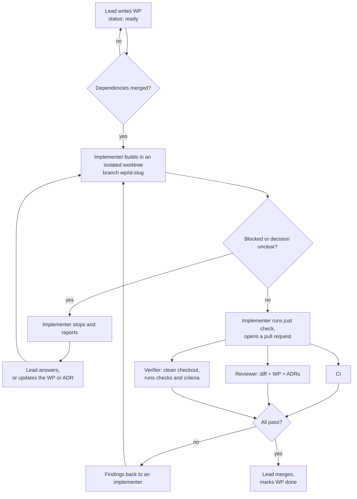

# Development workflow

How work gets from an idea to merged code. Decided in ADR-0018.

## Roles

| Role | Who | Does |
|---|---|---|
| Owner | Paul | Sets direction; approves milestones and anything outward-facing |
| Lead | The orchestrating Claude session | Writes ADRs and work packages, assigns work, resolves questions, merges |
| Implementer | Opus agent (`.claude/agents/wp-implementer.md`) | Builds one work package |
| Reviewer | Opus agent (`.claude/agents/wp-reviewer.md`) | Reviews one pull request it did not write |
| Verifier | Opus agent (`.claude/agents/wp-verifier.md`) | Proves the acceptance criteria from a clean checkout |

## Life of a work package

1. **Ready.** A WP is `ready` when its dependencies are merged and it has no open questions.
2. **Build.** One implementer, one isolated git worktree, one branch. It changes only the
   WP's owned paths.
3. **Stop on doubt.** An implementer that finds a decision wrong, ambiguous or impossible
   stops and reports. The lead answers, or changes the WP or the ADR. Agents do not improvise
   around decisions.
4. **Pull request.** Uses the template. Lists each acceptance criterion with the test that
   proves it, and anything not done.
5. **Three independent checks.** CI, a reviewer and a verifier. The reviewer and verifier
   are different agents from the implementer and are given the diff, the WP and the ADRs,
   never the implementer's own account of what it did.
6. **Fix.** Findings go back to an implementer. Repeat until all three pass. After three
   rounds without convergence the lead takes it over or re-scopes the WP.
7. **Merge.** The lead squash-merges and sets the WP to `done`.

## Running work in parallel

Work packages are grouped into **waves**. Every WP in a wave has all its dependencies in
earlier waves and owns paths no other WP in the wave touches, so a wave can run fully in
parallel without merge conflicts.

- Shared files (`Cargo.toml` at the root, `Cargo.lock`, `lib.rs` module lists) are the usual
  conflict points. The lead prepares them before a wave: module files exist as stubs and the
  dependency stack is already declared.
- If two WPs turn out to need the same file, the lead sequences them or splits out a small
  preparatory WP.
- A wave is merged one PR at a time; later PRs rebase.

## Branches and commits

- `master` is protected by convention: no direct pushes, changes arrive by pull request.
- Branch `wp/<id>-<slug>`, for example `wp/004-store-schema`.
- Conventional Commits. The PR title is the squash commit message.

## Changing a decision

Only the lead changes `docs/adr/` and `docs/architecture/overview.md`, in a pull request of
its own. An accepted ADR is not edited to say something different; a new ADR supersedes it
(ADR-0001). Work packages affected by the change are updated in the same pull request.

## What needs the owner

- Starting a milestone and accepting it as complete.
- Anything that uses a real Microsoft account or tenant.
- The app registration and its settings.
- Releases, tags and packages published anywhere.
- Issues, pull requests or messages on other projects.
- Adding a dependency with a licence not already allowed in `deny.toml`.
